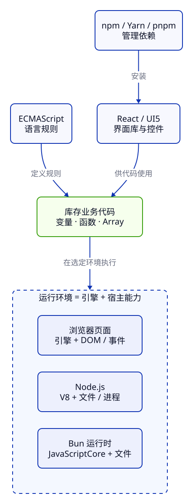

> **第 1 周 · 第 1 天** · 阅读跟做约 45 分钟 · 练习约 40 分钟\
> 前置：会读 Java 的变量和方法调用 · 运行：浏览器 Console（Node 可选）· 示例已运行验证

## 这一课解决什么问题

做库存网页，需要显示商品、点击卖出、更新库存。找教程时，却遇到了 JavaScript、ES6、V8、Node、npm、React、UI5 一串名字。

先分清职责，你就能判断「这段代码交给谁执行」「这个错误该查哪一层」。这一课先用浏览器算出剩余库存，再把这些名字放回它们解决的问题里。学完你能：

- 在 Console 执行 JS，区分计算结果、日志和网页显示
- 说明 JavaScript 与 Java 的关系，以及几个重要的历史转折
- 分清 ECMAScript、引擎、浏览器、Node 和 Bun
- 解释 npm、Yarn、pnpm、React 与 UI5 分别负责什么
- 读旧教程时，先判断运行环境、模块写法和特性支持

配套文件在仓库的 [examples/c01](https://github.com/socoo123/js_web/tree/main/examples/c01)。示例用于讲解；标有「自己尝试」的地方请亲手操作。必做练习只需文本编辑器和 Chrome。

## Java 程序员先看这里

| Java 经验 | JS 里的对应 | 先记住的差异 |
| --- | --- | --- |
| Java 语言规范 | ECMAScript 语言规范 | 规则独立；JS 不运行在 JVM 上 |
| JVM 执行字节码 | JS 引擎执行 JS | 可以直接把脚本交给环境，无需先写类和 `main` |
| JDK 与运行库 | Node 运行时及其 API | 浏览器也是一种运行环境，提供另一组 API |
| Maven 管依赖、运行任务 | npm 管包、调用项目脚本 | 实际构建由脚本调用的工具负责 |
| `int stock = 12;` | `const stock = 12;` | JS 的值有类型，变量名不声明 `int` |

## 1. 第一段 JS：先让库存计算跑起来

浏览器能直接执行 JavaScript。网页通常由三部分组成：**HTML 描述内容与结构，CSS 控制样式和布局，JS 编写计算与交互逻辑。**

商品名称和按钮用 HTML 表达，间距和颜色由 CSS 决定，售出后减库存由 JS 计算。先做一个只有标题和说明的实验页。

### 准备自己的实验页

新建 `c01-lab` 文件夹，用文本编辑器把下面内容保存为 `index.html`。保存时选择 UTF-8 编码，确认文件名末尾是 `.html`。已经下载课程仓库的话，可以直接打开 `examples/c01/index.html`。

```html title="index.html"
<!doctype html>
<html lang="zh-CN">
  <head>
    <meta charset="UTF-8" />
    <meta name="viewport" content="width=device-width, initial-scale=1" />
    <title>C01：我的 JavaScript 实验页</title>
  </head>
  <body>
    <h1>C01：我的 JavaScript 实验页</h1>
    <p>打开浏览器开发者工具的 Console，在这里运行本课代码。</p>
  </body>
</html>
```

双击文件，用 Chrome 打开，页面应出现一个主标题和一段说明。`<h1>` 表示主标题，`<p>` 表示段落，`<title>` 是浏览器标签页上的名字。`UTF-8` 用来正确显示中文；`viewport` 让移动设备按屏幕宽度排版。其余 HTML 与 CSS 写法在下一课跟着商品卡片学习。

文件还没有加载 JS，先到开发者工具里执行代码。

:::tip[自己尝试 · 浏览器 Console]
1. 在实验页空白处右键，选择「检查 / Inspect」。
2. 在打开的开发者工具（DevTools）中选择 **Console**。
3. 在带 `>` 的输入区输入 `1 + 2`，按 Enter，应显示 `3`。
4. 把下面的 `stock.js` 整段输入，最后按 Enter 执行。多行输入可用 Shift + Enter 换行。

预期：出现商品名称、数字 9 和「剩余库存：9」三条日志。页面上的标题和段落保持原样。
:::

### 计算剩余库存

**先猜一猜：** P001 机械键盘有 12 件，卖出 3 件。下面三条日志分别是什么？

```js title="stock.js"
const productName = "机械键盘"; // P001
const stock = 12;
const sold = 3;
const remaining = stock - sold;

console.log(productName);
console.log(remaining);
console.log("剩余库存：" + remaining);
```

```text
机械键盘
9
剩余库存：9
```

`const` 声明一个之后不重新赋值的名字。`stock - sold` 是普通减法；最后一行的 `+` 把文字与计算结果拼成一条消息。`console.log(...)` 把日志写到 Console，作用类似 Java 的 `System.out.println(...)`。

Console 还可能显示灰色的 `undefined`，那是最后一次 `console.log` 调用的返回值。日志与返回值分别观察；见 [Chrome Console 文档](https://developer.chrome.com/docs/devtools/console/javascript)。

网页文字没有变，因为我们只做了计算和日志输出。**要改变网页，需要调用浏览器操作页面的 API。** Console 里也能调用这些 API。

### 和 Java 对照一次

同样的计算用 Java 写如下，输出相同：

```java title="Stock.java"
public class Stock {
    public static void main(String[] args) {
        String productName = "机械键盘";
        int stock = 12;
        int sold = 3;
        int remaining = stock - sold;

        System.out.println(productName);
        System.out.println(remaining);
        System.out.println("剩余库存：" + remaining);
    }
}
```

JS 脚本从第一条语句开始执行。这里的数字是 Number 类型。Java 的 `var` 在编译时推断类型；JS 的变量不固定值的类型。

要保存计算，用编辑器把代码存成 `c01-lab/stock.js`。Console 输入不会自动写进磁盘，重新打开页面时需再次输入或加载脚本。

## 2. 从浏览器脚本到现代 JS：每次变化解决什么问题

网页越来越像应用，需要更好的交互、代码组织和工具。这条主线能帮你读懂 JS 的新旧写法。

### 1995—1997：先让页面响应，再统一语言规则

1995 年，Brendan Eich 在 Netscape 创建了这门语言的最初原型，用来让网页响应操作、检查输入。名字从 Mocha、LiveScript 变成 JavaScript。命名与当时 Java 的热度及 Netscape、Sun 的合作有关；它有独立的类型和对象规则。[设计者参与撰写的历史论文](https://www.wirfs-brock.com/allen/jshopl.pdf)详细记录了这段过程。

常说的「十天写出 JavaScript」指最初原型。此后的修改与标准化持续了几十年。

其他浏览器也实现脚本语言后，开发者开始遇到兼容问题。1997 年，第一版 ECMA-262 发布，标准中的语言名称是 **ECMAScript**。日常说「写 JavaScript」，讨论语言规则时说「ECMAScript 规定了什么」，学的是同一门语言的核心。

兼容问题还涉及页面 API。2000 年代，jQuery 等库封装了节点查找、事件和浏览器差异，方便页面局部更新。

### 2009—2015：走出浏览器，也更适合组织大程序

2009 年有两件不同层面的事：**ES5 补强语言，Node.js 扩展运行场景。** ES5 加入严格模式、标准化 JSON 和更多数组方法；Node 由 Ryan Dahl 推出，把 V8 引擎与文件、网络等能力组合起来，让 JS 能写命令行工具和服务端程序。随后 npm 让分享和安装 JS 包更方便。

2015 年发布的 **ES2015 就是 ES6**。`let`、`const`、箭头函数、`class`、标准模块、Promise、Map、Set 等进入语言，改善了变量、代码与数据的组织方式。之后标准按年发布，`async`/`await` 则属于 ES2017；「现代 JS」包含多个年度的能力。

### 旧项目里为什么还有 var 和回调

ES2015 之前没有 `let`、`const`，`var` 很常见；函数作为参数传入也早已被广泛使用。下面这段可以在实验页 Console 执行：

```js title="old-style.js"
var legacyProductName = "机械键盘";

function showStock(stock, onReady) {
  onReady(legacyProductName + "剩余库存：" + stock);
}

showStock(12, function (message) {
  console.log(message);
});
```

输出一条日志：`机械键盘剩余库存：12`。读法是：先把函数作为 `onReady` 传给 `showStock`，再由 `showStock` 调用它。这种被传入、随后由另一段代码调用的函数叫**回调**。这里在当前调用里立即执行，是同步回调。

Java 的 lambda 也能把行为交给方法；JS 直接把函数当作值传递。`var` 与回调今天仍有效。新代码优先用 `const`，需要重新赋值时用 `let`。

### 走到今天：复杂界面催生组件

商品越来越多，页面开始有列表、筛选、编辑表单和详情。React 等库用组件组织界面，用数据和状态描述它，JS 语言也在继续演进。

截至 2026 年 10 月，已发布的年度标准是 **ECMAScript 2026，第 17 版**。抓住四次扩展：页面交互 → 统一规则 → 扩展环境与语言能力 → 组织复杂界面。

## 3. 语言、引擎与宿主：规则相同，能力来自哪里

**ECMAScript 定义语言规则，引擎负责实现和执行，宿主环境提供额外能力。** 「宿主」就是接纳程序并向它开放 API 的环境。

Chrome 和 Node 都使用 V8 引擎；Bun 运行时使用 JavaScriptCore。浏览器还提供页面、事件等 Web API，Node 提供文件、进程等 API。引擎可以解释或即时编译代码，脚本语言内部也能有编译。

**先猜一猜：** 下面代码在我们的实验页与普通 Node 脚本里，输出会一样吗？

```js title="host-probe.js"
console.log("Array：" + typeof Array);
console.log("document：" + typeof document);
console.log("process：" + typeof process);
```

| 日志 | 浏览器实验页 | 普通 Node 脚本 |
| --- | --- | --- |
| `Array：` 后面 | `function` | `function` |
| `document：` 后面 | `object` | `undefined` |
| `process：` 后面 | `undefined` | `object` |

`typeof` 查看值的类型；对这里不存在的名字，它返回字符串 `"undefined"`。直接使用不存在的名字则会报错。

`Array` 是语言内建的数组构造函数，两边都有。`document` 是浏览器页面中文档对象的入口，JS 通过它找到并修改 HTML 元素，这套对象模型叫 **DOM**。`process` 则是 Node 提供的进程对象。[Node 官方说明](https://nodejs.org/en/learn/getting-started/differences-between-nodejs-and-the-browser)说明了这些区别。

因此 `stock - sold` 能在两边执行，页面操作需要浏览器。把计算与页面、文件操作分开，就能复用库存逻辑。



沿「规则 → 代码 → 环境」读主线，再看工具怎样提供依赖。箭头标的是职责关系；Bun 这个名字在图里只表示它的运行时角色。

Array、Map、Set 解决「如何组织数据」，Node、Bun 解决「在哪里执行」，npm 解决「怎样取得依赖」。碰到一个新名称，先问它回答的是哪个问题。

## 4. 包管理器和界面库：开发时与运行时各做什么

电脑已有 Node 时，在终端进入 **`c01-lab` 目录**，执行：

```sh
node stock.js
```

同样打印机械键盘、9、剩余库存：9，日志出现在终端。没有 Node 可跳过。

### npm、Yarn、pnpm 管依赖

别人的代码通常以「包」安装到项目。包管理器记录依赖与版本，并帮助执行项目任务。

| 名称 | 主要职责 | 放到库存应用里理解 |
| --- | --- | --- |
| [npm](https://docs.npmjs.com/about-npm/) | CLI 管包和脚本；也有同名的包仓库与网站 | 安装 React，调用项目的构建任务 |
| [Yarn](https://yarnpkg.com/) | 另一种包管理器 | 也能管理依赖，有自己的安装策略 |
| [pnpm](https://pnpm.io/) | 另一种包管理器 | 以自己的存储与链接布局安装依赖 |
| [Bun](https://bun.com/docs) | 同时提供运行时、包管理器、打包器、测试运行器 | `bun stock.js` 是运行代码，`bun install` 是安装包 |

`node stock.js` 是执行文件；`npm install` 是安装项目依赖；`npm run build` 是调用 `package.json` 里定义的 `build` 脚本。具体构建由脚本中的工具完成，例如生成 HTML、CSS、JS 文件。

npm 与 Maven 在依赖和任务上相近，Node 负责运行。一个用 React 写的网页，开发时常用 Node 跑工具，交付后由浏览器执行生成的页面代码。**开发工具在哪里运行，与用户界面在哪里运行，要分别判断。**

### React 与 UI5 帮你组织界面

[React](https://react.dev/learn)是构建用户界面的库。商品卡片可以写成组件并在列表中复用。JS 表达逻辑，HTML 和 CSS 的知识决定结构、样式与布局。常见的 JSX 写法如 `<ProductCard />` 是语法扩展，通常需要工具转换后交给浏览器。

UI5 里则有几套相互关联的技术，先按下面四个位置认识：

| 名称 | 定位 |
| --- | --- |
| OpenUI5 | 开源的经典 UI 框架，带控件、模型与绑定等能力 |
| SAPUI5 | 与 OpenUI5 共享核心，另有 SAP 库及相应交付、许可条件 |
| UI5 Web Components | 基于浏览器 Custom Elements 的组件体系，与经典 UI5 控件体系不同 |
| UI5 Web Components for React | 面向 React 使用这些 Web Components 的包装库 |

参阅 [SAPUI5/OpenUI5](https://ui5.github.io/docs/02_Read-Me-First/sapui5-vs-openui5-5982a97.html)、[Web Components](https://ui5.github.io/webcomponents/docs/)、[React 包装库](https://github.com/UI5/webcomponents-react)。后续用库存业务比较这些路线。

## 5. 读教程时，先确认环境和标准状态

复制代码前，先看文件类型和启动方式，它们决定哪些名字能用。

### CommonJS：Node 生态的一种模块写法

Node 的早期生态广泛使用 CommonJS。下面文件导出一个库存计算函数：

```js title="commonjs.cjs"
function remainingStock(stock, sold) {
  return stock - sold;
}

module.exports = remainingStock;
```

已有 Node 的话，把它保存为 `c01-lab/commonjs.cjs`，在 **`c01-lab` 目录**运行：

```sh
node -e "console.log(require('./commonjs.cjs')(12, 3))"
```

输出 `9`。`node -e` 执行后面的短代码，`require` 加载导出的函数，随后传入 12 和 3。单独执行导出文件没有日志。

`.cjs` 明确表示 [CommonJS 模块](https://nodejs.org/api/modules.html)。普通网页没有它所需的 `module`、`require`。ES2015 还定义了 `import`/`export` 这种标准模块写法（ESM），完整用法在模块课学习。Java 的 `import` 主要帮助解析类型名，JS 模块还涉及文件的加载与执行。

`var` 是变量声明，回调是函数使用方式，CommonJS 是模块组织方式；三个维度分别判断。

### 「最新」需要回答三个问题

年度标准、提案完成和环境支持是三个独立状态：

| 你要问什么 | 怎么判断 |
| --- | --- |
| 已经正式发布了吗？ | 查已发布的年度标准；目前是 ECMAScript 2026 |
| 还在设计，还是已经完成？ | TC39 用阶段推进提案；Stage 4 表示完成、准备纳入标准，年度归属还需核对 |
| 我的环境能运行吗？ | 查 MDN 的浏览器兼容表，或目标 Node 版本的官方文档，再实际运行 |

Stage 4 之前的提案仍在推进；某个工具能转换一种实验语法，也不等于所有浏览器原生支持它。构建工具可以转换语法，新的 API 则可能还需要额外实现。

新特性按「标准状态 → 目标环境 → 实际运行」查，入门先用稳定常见的语法。

## 常见错误与调试

### 名字拼错：ReferenceError

**现象**：在实验页 Console 输入下面代码，出现红色的 `ReferenceError: productNmae is not defined`：

```js title="language-error.js"
// expect-error: ReferenceError
// 有问题的写法：使用时把 productName 拼成了 productNmae
const productName = "机械键盘";
console.log(productNmae);
```

**工具**：查看 Console 红色错误里的名字和来源行号，点击行号查看触发错误的代码。Console 输入的代码可能显示为 `VM…` 这样的临时来源。

**证据**：声明的 `productName` 与错误中的 `productNmae` 字母次序不同，是两个名字。

**原因**：使用了没有声明的名字。Java 编译器通常会提前发现这类问题，JS 在执行到这里时才报错。

**修复**：把使用处的名字改成声明的名字，重新执行完整代码：

```js title="language-fixed.js"
const productName = "机械键盘";
console.log(productName); // → 机械键盘
```

**确认**：出现机械键盘这条日志，本次执行没有新的红色错误。旧错误会留在 Console，看最近一次的结果。若提示重复声明，刷新后再运行完整代码。

### 环境选错：document is not defined

**现象**：在 `examples/c01` 目录执行 `node host-error.js`，报 `ReferenceError: document is not defined`：

```js title="host-error.js"
// expect-error: ReferenceError
// 有问题的写法：把浏览器页面的 DOM 操作交给普通 Node 脚本执行
console.log(document.querySelector("h1").textContent);
```

**工具**：看终端错误的文件名、行号和缺失的名字；在浏览器实验页 Console 执行第 3 节的 `host-probe.js` 作比较。

**证据**：普通 Node 中 `typeof document` 为 `"undefined"`，浏览器实验页中为 `"object"`。

**原因**：`document` 属于浏览器页面提供的 DOM API，普通 Node 没有它。

**修复**：要读网页标题，就把这段代码放到实验页 Console 执行。`querySelector("h1")` 找到页面主标题元素，`textContent` 读取其中的文字。

**确认**：Console 打印 `C01：我的 JavaScript 实验页`。Node 报告保留计算与日志，页面操作留给浏览器。

## 练习

### 练习 1：预测输出，再改变一次输入

先预测 `prediction.js` 在**浏览器实验页**的 4 行输出，再执行核对。

```js title="prediction.js"
const predictionStock = 12;
const predictionSold = 3;
console.log(predictionStock - predictionSold);
console.log("剩余库存：" + (predictionStock - predictionSold));
console.log(typeof Array);
console.log(typeof document);
```

再从 `stock.js` 开始，把商品改为 P004 USB-C 扩展坞，库存 3 件、卖出 2 件。验收：日志为商品名称、1、剩余库存：1；把卖出量改为 0 后，剩余库存应为 3。

<details>
<summary>提示</summary>

前两行输出来自计算；后两行判断能力来自哪里。改商品时只改名称、初始库存和卖出量，保留减法表达式。

</details>

<details>
<summary>参考答案</summary>

浏览器里的 4 行输出依次是 `9`、`剩余库存：9`、`function`、`object`。Node 中最后一行是 `undefined`，因为没有页面文档。

改商品后的代码如下，对应 `stock-answer.js`：

```js title="stock-answer.js"
const productName = "USB-C 扩展坞"; // P004
const stock = 3;
const sold = 2;
const remaining = stock - sold;

console.log(productName);
console.log(remaining);
console.log("剩余库存：" + remaining);
```

`3 - 2` 得到 1；改成卖出 0 件，`3 - 0` 得到 3。结果来自输入与计算，所以同一段逻辑能处理不同商品。Console 里有数字而页面没变，也符合预期：代码只调用了日志 API。

</details>

### 练习 2：让同一段计算适合两种环境

起始文件是 `environment-broken.js`。它在浏览器实验页能运行，在普通 Node 中会先打印剩余库存，再报错：

```js title="environment-broken.js"
// expect-error: ReferenceError
// 有问题的写法：把 DOM 当成所有 JS 环境都提供的能力
const reportRemaining = 12 - 3;
console.log("剩余库存：" + reportRemaining);
console.log(document.querySelector("h1").textContent);
```

改成两种环境通用的库存报告。验收：都只输出 `剩余库存：9`；卖出量改为 0 后输出 `剩余库存：12`，无新错误。

没有 Node 时，先在浏览器完成修改，并用一句话指出原代码哪一行依赖浏览器。

<details>
<summary>提示</summary>

报错发生在算术、日志，还是读取网页标题？根据 `host-probe.js` 的结果，找出只由浏览器提供的名字。

</details>

<details>
<summary>参考答案</summary>

删除读取标题的那一行，保留计算与日志。答案文件是 `environment-answer.js`：

```js title="environment-answer.js"
const reportRemaining = 12 - 3;
console.log("剩余库存：" + reportRemaining);
```

终端库存报告用不到 DOM。删掉它后，只剩语言中的减法与两种环境都有的日志能力。

</details>

## 小结

- JS 可以直接交给浏览器执行；日志、返回值、网页内容分别观察。
- JavaScript 从网页脚本发展成通用语言；ES6 是 ES2015，后续还有年度标准。
- ECMAScript 定义规则，引擎实现规则，宿主环境提供页面或文件等能力。
- npm、Yarn、pnpm 管理依赖；React 和 UI5 组织界面；Bun 同时有多种工具角色。
- 读教程先看环境和启动方式，再区分正式标准、提案阶段和实际支持。

自测：

1. 不安装 Node 和 npm，怎样运行一段库存计算？
2. 用自己的话解释 V8、Node、Bun、npm、React 的职责。
3. 为什么 `Array` 两边都有，`document` 只在我们的浏览器实验页里有？
4. 看到 `var`、回调和 `module.exports`，分别能判断什么？
5. Stage 4 为什么还不能直接回答「我的浏览器能不能用」？

下一课用 HTML、CSS 和 JS 做出真正的商品卡片，开始观察页面加载、样式和断点。

## 延伸阅读

- [MDN：JavaScript 介绍](https://developer.mozilla.org/zh-CN/docs/Web/JavaScript/Guide/Introduction)
- [JavaScript: The First 20 Years](https://www.wirfs-brock.com/allen/jshopl.pdf)：设计者与标准工作者记录的历史
- [Chrome DevTools：在 Console 运行 JavaScript](https://developer.chrome.com/docs/devtools/console/javascript)
- [Node：Node 与浏览器的差异](https://nodejs.org/en/learn/getting-started/differences-between-nodejs-and-the-browser)
- [Ecma：ECMA-262 已发布标准与历史版本](https://ecma-international.org/publications-and-standards/standards/ecma-262/)
- [TC39：提案推进流程](https://tc39.es/process-document/)
