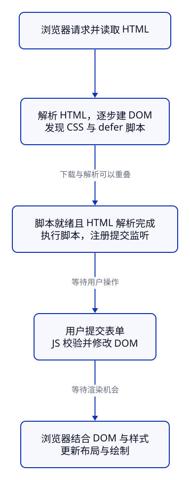

> **课号 C02 · 第 1 周 / 第 1 天 · 必修**  
> 前置：[C01 JavaScript 的故事与生态地图](../c01-story-ecosystem/)；能理解 Java 的变量、方法和条件判断。无需 HTML/CSS、Node 或 React 经验。  
> 时间：阅读与跟做约 50 分钟，独立练习约 40–50 分钟；首次使用终端可以再留 15 分钟。4 周路线与 C01 同一天，8 周路线单独一天。  
> 资料核查：2026-10-15。操作方式与验证状态分别标注，逐项记录见课尾。

## 1. 这节解决什么问题：日志里的 9，怎样变成页面上的 9？

C01 已能算出 `12 - 3`，但 `console.log` 只在日志面板打印。真实库存页面还需要回答：商品名称写在哪里？输入框怎样有标签？按钮为什么会刷新页面？手机上卡片为什么超宽？

这节用三个文件做一张商品卡片：初始库存 12 件，输入 3 并提交后显示 9 件；超卖时说明原因；售完时禁用售出按钮。数据只在当前页面内存中，**刷新恢复为 12**。我们还会故意拼错脚本路径，凭证据修复。

学完后你应当能够：

1. 解释 HTML 源码、浏览器 DOM 与屏幕画面的区别。
2. 读懂基本标签、表单、CSS 选择器和盒模型，用 Grid/Flex 调整布局。
3. 从页面 URL 推导脚本的请求地址，判断 200、304 与 404 的含义。
4. 在 Console 查询节点，在 Elements 查样式，在 Network 查请求，在 Sources 停住代码观察变量。
5. 修改源文件并重做原操作，确认修复真正保留下来。

### 与 Java 对照：哪些经验有用？

| Java 中熟悉的事 | 本课中的对应 | 要留意的边界 |
| --- | --- | --- |
| 一个项目有不同职责的文件 | HTML 写内容结构，CSS 写外观布局，JS 写计算和交互 | HTML/CSS 不是 Java 的类，也不是需要 `javac` 编译的 JS |
| 取得对象，再调用方法或改属性 | 取得 DOM 节点，再改 `textContent` | 改业务变量不会自动改页面；本课要显式更新节点 |
| 注册监听器，事件发生时调用方法 | `addEventListener` 注册函数 | 注册时交的是函数，提交表单时才执行 |
| IDE 断点、局部变量、调用栈 | Sources 的断点、Scope、Call Stack | 网络加载、DOM 和 CSS 也会造成故障，要选择对应面板 |
| 程序内存和数据库不是同一层 | JS 中的库存与持久化存储不同 | 本课没有数据库、真实订单接口或多人同步 |

JS 的转换、函数和作用域会在 C03–C06 细讲。这里先用能运行的少量语法连接页面，不要求先学完整门语言。

## 2. 准备：编辑器、终端、浏览器各做一件事

**操作方式：自己尝试 · 本地网页，示例 W01。**  
**验证状态：已验证三个文件的加载与交互；版本和具体结果见第 12 节。**

需要一个能保存 UTF-8 纯文本的编辑器、Chrome，以及本地静态文件服务。Edge 的面板命名通常相近，本次没有执行 Edge 验证。

- **编辑器**：创建和保存文件；改完要保存。
- **终端**：在指定目录运行服务；服务运行时保留这个终端。
- **浏览器**：打开页面；改完文件后刷新。这个简单服务没有自动热更新。

自己创建 `c02-lab` 文件夹，把下一节的三个文件放在同一层；也可以取得[仓库 examples/c02 的文件](https://github.com/socoo123/js_web/tree/main/examples/c02)。不要把 Markdown 的三条反引号复制进文件，也不要保存成 `index.html.txt`。

```text
c02-lab/
├── index.html
├── styles.css
└── app.js
```

如果电脑已有 Python 3，在终端先进入你创建的目录，再运行：

```sh
cd /你的实际路径/c02-lab
python3 --version
python3 -m http.server 8000 --bind 127.0.0.1
```

`/你的实际路径/` 要替换成自己的位置。Windows 的 Python 启动器可用时，对应命令是 `py -3 -m http.server 8000 --bind 127.0.0.1`；这是对照 [Python Windows 启动器](https://docs.python.org/3.11/using/windows.html#python-launcher-for-windows)核对的可选写法，本次未在 Windows 执行。如果没有 Python，可使用已有编辑器的静态预览服务，按其显示的 HTTP 地址打开；本课不要求提前安装 Node 或 npm。

以上命令只把当前目录中的文件通过本机 HTTP 提供出来，**JS 仍由浏览器执行**。Python 在这里承担文件服务，不能由此推出它在执行 `app.js`。启动方式已对照 [Python http.server 命令行说明](https://docs.python.org/3/library/http.server.html#command-line-interface)。

打开 `http://127.0.0.1:8000/`。若提示端口占用，把命令和地址中的 8000 一起改为 8001；结束练习时在服务终端按 `Ctrl+C`。如果直接在仓库练习，先进入 `examples/c02/`，不要为本课运行网站根目录的 `npm install` 或把整个网站工程当作练习项目。

这里使用 HTTP，方便在 Network 观察真实资源请求。双击 HTML 得到的 `file://` 地址是另一种加载环境；后续模块和请求练习也会继续使用本地服务。

## 3. HTML：先把商品写成有含义的文档

文件一：`c02-lab/index.html`。**操作方式：自己尝试 · 本地网页；验证状态：W01 已验证。**

```html title="index.html"
<!doctype html>
<html lang="zh-CN">
  <head>
    <meta charset="UTF-8">
    <meta name="viewport" content="width=device-width, initial-scale=1">
    <title>C02 库存商品卡片</title>
    <link rel="icon" href="data:,">
    <link rel="stylesheet" href="./styles.css">
    <script src="./app.js" defer></script>
  </head>
  <body>
    <main class="page">
      <header>
        <p class="eyebrow">库存管理 · C02</p>
        <h1>商品库存</h1>
        <p>先观察页面，再用开发者工具解释每一次变化。</p>
      </header>

      <div class="product-grid">
        <article class="product-card" aria-labelledby="product-name">
          <div class="card-heading">
            <h2 id="product-name">键盘</h2>
            <span class="badge">外设</span>
          </div>
          <p>商品编号：KB-001</p>
          <p class="stock-line">剩余库存：<strong id="stock">12</strong> 件</p>

          <form id="sale-form">
            <label for="quantity">售出数量</label>
            <div class="sale-controls">
              <input id="quantity" name="quantity" type="number"
                min="1" step="1" value="3" required>
              <button id="sell-button" type="submit" disabled>确认售出</button>
            </div>
          </form>
          <p id="feedback" role="status">加载完成后可以登记售出。</p>
          <noscript><p>交互需要 JavaScript；商品信息仍可阅读。</p></noscript>
        </article>
      </div>

      <footer><p>数据只在本页内存中；刷新会恢复为 12 件。</p></footer>
    </main>
  </body>
</html>
```

### 3.1 标签、属性与层级怎么读？

`<h2 id="product-name">键盘</h2>` 包含开始标签、属性、文本和结束标签。属性给元素补充信息；`id` 标识本页唯一节点，供标签关联、CSS 和 JS 查找。嵌套表达包含关系，不是 Java 的继承关系。`meta`、`link`、`input` 是空元素，没有对应的结束标签。

- `<!doctype html>` 让浏览器使用现代 HTML 的标准模式。
- `html lang="zh-CN"` 指定文档语言；`charset` 指定字符编码，减少中文乱码。
- `head` 放标题、编码、资源引用等信息；`body` 放页面内容。`title` 主要显示在浏览器标签页，`h1` 是正文标题。
- `main` 标识主体，`article` 容纳一份能独立理解的商品内容；`h1 → h2` 表达标题层级。`div`、`span` 是没有特定语义的通用容器。
- `aria-labelledby="product-name"` 用现有商品标题给这张卡片提供可访问名称；`role="status"` 让辅助技术有机会获知反馈更新。

选择标签先看内容的职责。不要仅为了“大字”使用标题，也不要用可点击的 `div` 替代这里已有键盘行为的 `button`。HTML 的结构语义与 CSS 的显示方式分别负责一部分问题。[HTML 文档元信息](https://html.spec.whatwg.org/multipage/semantics.html)、[章节与标题](https://html.spec.whatwg.org/multipage/sections.html)

### 3.2 表单为什么不只放一个输入框？

`form` 把一次输入与提交组织起来。`label for="quantity"` 对应输入的 `id`，点击标签可把焦点交给输入框；`placeholder` 不能替代标签。`name` 则是默认表单提交时使用的字段名，不要求和 `id` 永远相同。

`type="number"`、`required`、`min="1"`、`step="1"` 给浏览器原生约束：需要填写、最小为 1、步长为整数。正常提交前浏览器会检查这些约束；因此填 0、小数或空值时，常先出现浏览器提示，JS 的提交处理不会执行。**原生约束与 JS 的业务校验都需要理解**：超出当前库存是业务规则，后面由 JS 判断。客户端校验也不能替代未来真实后端的校验。[HTML 表单与校验](https://html.spec.whatwg.org/multipage/forms.html)

`type="submit"` 明确表示提交按钮。表单里的普通操作按钮要写 `type="button"`，后面补货练习会用到。售出按钮最初带 `disabled`；脚本成功注册监听后才启用，所以脚本路径错误时可以直接观察到“按钮仍禁用”。`disabled` 是布尔属性，写 `disabled="false"` 仍然表示存在该属性，不能用它启用按钮。[HTML 按钮](https://html.spec.whatwg.org/multipage/form-elements.html#the-button-element)

## 4. CSS：看懂选择器、盒模型和两种布局

文件二：`c02-lab/styles.css`。**操作方式：自己尝试 · 本地网页；验证状态：W01 已验证桌面与手机宽度。**

```css title="styles.css"
* {
  box-sizing: border-box;
}

body {
  margin: 0;
  font-family: system-ui, "PingFang SC", "Microsoft YaHei", sans-serif;
  line-height: 1.6;
  color: #17243a;
  background: #f1f5f9;
}

.page {
  max-width: 960px;
  margin: 0 auto;
  padding: 24px;
}

.eyebrow {
  color: #2559a6;
  font-weight: 700;
}

.product-grid {
  display: grid;
  grid-template-columns: repeat(2, minmax(0, 1fr));
  gap: 16px;
}

.product-card {
  min-width: 0;
  padding: 20px;
  border: 1px solid #b8c8db;
  border-radius: 12px;
  background: white;
  overflow-wrap: anywhere;
}

.card-heading {
  display: flex;
  align-items: center;
  justify-content: space-between;
  gap: 12px;
  flex-wrap: wrap;
}

h2 {
  margin: 0;
}

.badge {
  padding: 4px 10px;
  border-radius: 999px;
  color: #164b36;
  background: #dcfce7;
}

.stock-line {
  font-size: 1.2rem;
}

label {
  display: block;
  margin-bottom: 6px;
}

.sale-controls {
  display: flex;
  gap: 8px;
  flex-wrap: wrap;
}

input,
button {
  min-height: 44px;
  padding: 8px 12px;
  border: 1px solid #687d99;
  border-radius: 6px;
  font: inherit;
}

input {
  flex: 1 1 100px;
  min-width: 0;
  width: 100%;
}

button {
  color: white;
  background: #1d4ed8;
  cursor: pointer;
}

button:disabled {
  color: #334155;
  background: #e2e8f0;
  cursor: not-allowed;
}

:focus-visible {
  outline: 3px solid #9a3412;
  outline-offset: 3px;
}

#feedback {
  min-height: 3.2em;
}

@media (max-width: 640px) {
  .page {
    padding: 16px;
  }

  .product-grid {
    grid-template-columns: 1fr;
  }
}
```

### 4.1 一条规则选中了谁？

CSS 规则写作“选择器 `{ 属性: 值; }`”。例如 `.product-card` 选择有这个 class 的元素，再为它设置内边距和边框。HTML 中 `class="product-card"` 不带点；CSS 中点表示 class 选择器。

| 本例选择器 | 选中什么 |
| --- | --- |
| `body` | `body` 元素，按标签名选择 |
| `.product-card` | 带 `product-card` class 的元素；class 可以复用 |
| `#feedback` | id 为 `feedback` 的唯一元素 |
| `input, button` | 两类元素都使用同一组声明 |
| `button:disabled` | 当前处于禁用状态的按钮 |
| `:focus-visible` | 浏览器判断需要显示焦点提示的元素，例如键盘 Tab 聚焦 |
| `*` | 所有元素；本课统一盒子的尺寸计算方式 |

本课先掌握这几种选择器。同一属性冲突时，不能只说“最后一行一定赢”：来源、重要性、层、优先级等会参与层叠；在本课同一来源、同一层的普通声明中，ID 选择器优先于 class，class 优先于标签，同等优先级才比较先后。**Elements → Styles 的划线声明和 Computed 最终值是排错证据**。[CSS 层叠规则](https://www.w3.org/TR/css-cascade-5/#cascade-sorting)

### 4.2 盒模型：宽度为什么会多出来？

一个盒子从内到外有 **content（内容）→ padding（内边距）→ border（边框）→ margin（外边距）**。`padding` 在边框内，`margin` 在边框外；外边距不涂背景色。[CSS 盒模型](https://www.w3.org/TR/css-box-3/)

本课所有元素都设置 `box-sizing: border-box`。例如指定 `width: 300px; padding: 20px; border: 1px solid` 时，300px 包含内容、左右 padding 和左右 border；内容区剩下 `300 - 40 - 2 = 258px`。默认 `content-box` 下同一组数值的边框盒会是 342px；两种方式都不把 margin 算进 width。[CSS 尺寸与 box-sizing](https://www.w3.org/TR/css-sizing-3/#box-sizing)

`body` 的默认 margin 清零；`.page` 的 `max-width` 限制内容最大宽度，`margin: 0 auto` 在空间充足时把它居中，padding 给手机屏幕留下边缘。`px` 是 CSS 像素，不必等于设备上的一个物理像素；`rem` 相对根元素字体，`em` 相对当前上下文的字体。这里用 `1.2rem` 让库存文字随基础字号调整。

### 4.3 Grid 管卡片列，Flex 管一行里的项目

`.product-grid` 使用 **Grid**：本例先声明两个等宽列，`gap: 16px` 留列间距。`repeat(2, minmax(0, 1fr))` 表示重复两个轨道，最小尺寸允许到 0，再各分一份剩余空间。现在只有一张卡片，桌面上第二个位置留空；C11 才扩为真正的商品列表。[CSS Grid](https://www.w3.org/TR/css-grid-1/)

`.card-heading` 与 `.sale-controls` 使用 **Flex**：主要安排一条轴上的项目。标题行用 `justify-content: space-between` 沿主轴分配空白，`align-items: center` 沿交叉轴居中；`flex-wrap: wrap` 允许放不下时换行。输入框的 `flex: 1 1 100px` 允许它以 100px 为基础分配/缩减空间，`min-width: 0` 避免内容的默认最小尺寸妨碍收缩。[CSS Flexbox](https://www.w3.org/TR/css-flexbox-1/)

这两种布局可以组合。Grid 不限于两维，Flex 也可以换成多行；本课按要表达的关系选择，不背“只能做什么”的口诀。

### 4.4 响应式：根据可用空间改变规则

`@media (max-width: 640px)` 在视口宽度不超过 640 个 CSS 像素时生效，把外层改为单列、页面 padding 改为 16px。它检查可用视口，不检测“这是不是某个手机品牌”。HTML 中的 viewport meta 让移动浏览器按设备宽度建立布局视口；两者配合才方便验收。[媒体查询](https://www.w3.org/TR/mediaqueries-4/)、[web.dev：设置 viewport](https://web.dev/articles/responsive-web-design-basics#set_the_viewport)

不要用 `overflow-x: hidden` 掩盖超宽元素。先看哪个盒子超出容器，检查固定宽度、padding、默认最小尺寸和不换行的内容；第 9 节会亲手复现。

## 5. JS：从输入到计算，再到 DOM 更新

文件三：`c02-lab/app.js`。**操作方式：自己尝试 · 本地网页；验证状态：W01 已验证正常、超卖、售完与无效输入边界。**

```js title="app.js"
const saleForm = document.querySelector("#sale-form");
const quantityInput = document.querySelector("#quantity");
const stockNode = document.querySelector("#stock");
const feedback = document.querySelector("#feedback");
const sellButton = document.querySelector("#sell-button");
let stock = 12;

function handleSale(event) {
  // 本课在页面内处理表单，不执行默认的导航提交。
  event.preventDefault();
  const quantity = Number(quantityInput.value);

  if (!Number.isInteger(quantity) || quantity < 1) {
    feedback.textContent = "请输入大于 0 的整数。";
    return;
  }

  if (quantity > stock) {
    feedback.textContent = "库存不足，当前只有 " + stock + " 件。";
    return;
  }

  const remaining = stock - quantity;
  stock = remaining;
  stockNode.textContent = String(stock);
  feedback.textContent = "已售出 " + quantity + " 件，剩余 " + stock + " 件。";
  sellButton.disabled = stock === 0;
  console.log("库存变化", stock);
}

saleForm.addEventListener("submit", handleSale);
sellButton.disabled = false;
feedback.textContent = "填写数量后，点击确认售出。";
console.log("C02 ready");
```

### 5.1 HTML 源码、DOM、画面是三件事

浏览器解析 HTML，建立带父子关系的节点树，叫 **DOM**。`document` 是访问当前文档的入口；`querySelector("#stock")` 按 CSS 选择器找到第一个匹配节点，找不到返回 `null`。[DOM 查询接口](https://dom.spec.whatwg.org/#dom-parentnode-queryselector)

`stock` 是保存数字的 JS 变量，`stockNode` 是页面节点。前者从 12 变成 9 后，后者不会自动变化，所以紧接着写 `stockNode.textContent = String(stock)`。`textContent` 设置节点的文本；它把文字作为文本处理，不能用来执行 HTML 标签。这节不使用 `innerHTML` 拼装输入。[DOM textContent](https://dom.spec.whatwg.org/#dom-node-textcontent)

提交后，在 Elements 里会看见 `strong` 的文本为 9，而原始 `index.html` 文件仍写 12。“查看网页源代码”读取的源文档与 Elements 的当前 DOM 也可能不同。JS 没有把你的硬盘文件重写；刷新后重新加载文件，自然从 12 开始。

### 5.2 先读输入，再校验，最后更新

输入框即使是 `type="number"`，读取 `.value` 得到的仍是字符串。本课显式用 `Number(...)` 得到数值，再用 `Number.isInteger` 和正数条件校验；C03 会详细解释空字符串、`NaN` 与转换规则。

一次合法提交的顺序是：读取数量 → 检查正整数 → 检查库存是否足够 → 计算 `remaining` → 更新 `stock` → 更新 DOM 和反馈 → 根据库存决定按钮状态。失败分支的 `return` 提前结束，不扣库存。

`saleForm.addEventListener("submit", handleSale)` 把函数注册为提交监听器，和 Java 监听器模型很接近；这里没有写 `handleSale()`，因为不应在注册时立即调用。浏览器稍后传入事件对象 `event`。`preventDefault()` 阻止本次表单默认导航提交，让本课留在当前页面处理；它不表示停止所有事件传播。[DOM 事件与 preventDefault](https://dom.spec.whatwg.org/#dom-event-preventdefault)

监听的是表单的 `submit`，所以点击提交按钮与输入框内按 Enter 都能走同一路径。JS 写了防御性校验；正常操作中的空值/小数/0 仍通常先被 HTML 约束挡住，不能把“浏览器原生提示”误记成某个 JS 分支打印的信息。

### 5.3 第一次运行应当看到什么？

保存三个文件，服务仍在运行时刷新，按顺序观察：

| 操作 | 页面结果 | Console |
| --- | --- | --- |
| 刷新页面 | 键盘、12 件、输入默认 3，按钮启用 | `C02 ready` |
| 点击确认售出 | 剩余 9，反馈“已售出 3 件，剩余 9 件。” | `库存变化 9` |
| 把输入改为 10 并提交 | 仍为 9，反馈库存不足 | 不增加库存变化日志 |
| 把输入改为 9 并提交 | 剩余 0，按钮禁用 | `库存变化 0` |
| 再刷新 | 恢复 12，按钮启用 | 新页面的 `C02 ready` |

另起一次刷新，分别试空值、0、1.5：浏览器原生校验应阻止提交，库存保持 12。原生提示的具体语言随浏览器设置变化，验收看“没有扣库存”，不用逐字匹配提示。

## 6. URL 与 HTTP：先知道文件从哪里来

**操作方式：讲解示例 U01；验证状态：下列 URL 解析表达式已在本课 Chrome 环境执行。**

以 `http://127.0.0.1:8000/index.html?mode=learn#stock` 为例：

| 部分 | 值与用途 |
| --- | --- |
| 协议 / scheme | `http`，本例通过 HTTP 取得文件；线上常用 HTTPS |
| 主机 / host | `127.0.0.1`，当前电脑的回环地址 |
| 端口 | `8000`，对应正在运行的文件服务 |
| 路径 | `/index.html`，定位服务中的资源 |
| 查询 / query | `?mode=learn`，查询参数；本例 JS 没读取它，所以不会自行改变页面 |
| 片段 / fragment | `#stock`，浏览器可定位到该 id；不作为 HTTP 请求目标的一部分发给服务器 |

本例没有 `base` 元素，`./app.js` 相对当前文档地址解析；以 `/` 开头则从该站点的根路径解析。可以在 Console 运行：

```js
new URL("./app.js", "http://127.0.0.1:8000/c02-lab/index.html").href
// "http://127.0.0.1:8000/c02-lab/app.js"

new URL("/app.js", "http://127.0.0.1:8000/c02-lab/index.html").href
// "http://127.0.0.1:8000/app.js"
```

这里特意用多一层目录展示区别。按第 2 节把服务启动在练习目录时，页面在 `/`，两种写法可能碰巧指到同一处；**不能因为本地碰巧成功就判断部署也正确**。本课程站的地址是 `https://socoo123.github.io/js_web/`，根路径 `/app.js` 会丢掉 `/js_web/`。这里的练习文件使用相对路径，不要求把本地例子安装进课程站。[URL 标准：解析与序列化](https://url.spec.whatwg.org/)

HTTP 是请求与响应：浏览器请求一个 URL，服务返回状态、响应头和内容。HTML、CSS、JS 是分别请求的资源，HTML 成功不保证脚本成功。

- **200**：本次请求成功，资源随响应返回。
- **304**：带条件的缓存再验证确认资源未修改，浏览器继续用缓存；不是坏文件。
- **404**：服务找不到这个请求目标，先核对请求 URL、服务目录、文件名和大小写。

这是常见状态的入门判断，完整缓存与请求错误在 C13 深化。[HTTP 语义与状态码](https://httpwg.org/specs/rfc9110.html#status.codes)

## 7. 页面怎样加载，`defer` 为什么放在这里？



图聚焦从脚本加载到交互更新的路径，**不是精确请求瀑布或每次绘制的时间线**。初始页面绘制不必等用户操作；浏览器可以重叠发现和下载资源，也可能在所有资源到齐前先绘制部分内容。CSS 就绪、脚本执行和渲染之间还有更多约束，后续再深入。

本例先取得 HTML，边解析边建 DOM；遇到 `link` 与 `script` 时取得 CSS 和 JS。样式参与布局与绘制；脚本找到节点并注册监听，用户提交后才调用处理函数。改 DOM 后，浏览器会在合适的渲染机会更新画面，不保证每一行属性赋值都立即单独绘制。

针对本课**写在原始 HTML 中、带 `src` 的普通外部脚本**：

| 写法 | 与 HTML 解析的关系 | 本课选择 |
| --- | --- | --- |
| `<script src="./app.js"></script>` | 解析器遇到它时，等待取得并执行脚本，再继续解析 | 放在 head 时，下面的表单可能还不存在 |
| `<script src="./app.js" defer></script>` | 下载与解析可以并行；解析完成后按文档顺序执行 | 本例采用，查找表单时 DOM 已建立 |
| `<script src="./app.js" async></script>` | 下载与解析可以并行；可用时尽快执行，不保证等待 DOM 或按文档顺序执行 | 本例不使用 |

`defer` 不表示开启一个 JS 后台线程，也不表示等待所有图片加载。普通模块脚本默认也有延后到解析完成的执行行为，但模块有独立的作用域和加载规则，C16 再讲；不能靠给所有脚本加 `defer` 概括它们。[HTML script 的处理规则](https://html.spec.whatwg.org/multipage/scripting.html#attr-script-defer)

**故障 E02：DOM 尚未建立。操作方式：自己尝试 · 本地网页；验证状态：已复现并恢复。** 把 head 中的 `defer` 删掉，保存并刷新。在本例中查询得到 `null`，随后调用 `saleForm.addEventListener` 会抛 `TypeError`。原因是执行到了 JS，但页面正文还没被解析；恢复 `defer` 再刷新，按钮恢复可用。不要只用“加个延时”掩盖加载顺序问题。

## 8. 第一个调试现场：四个面板建立证据

右键页面 → **检查 / Inspect** 打开 DevTools。以下界面路径已核对 Chrome 官方说明；本次自动化确实执行了请求检查、DOM/CSS 观察和协议断点，**没有把自动化结果写成手动点击面板的验证**。面板名称可能随语言和版本改变。

### 8.1 Console：看表达式、错误和当前页面

**操作方式：自己尝试 · 浏览器 Console，D01；验证状态：下列表达式已执行。**

1. 刷新后确认有 `C02 ready`；如果看不到，清除日志过滤并检查是否选中当前页面上下文。
2. 输入 `document.querySelector("#stock").textContent`，初始得到字符串 `"12"`；提交 3 后得到 `"9"`。
3. 输入 `typeof document.querySelector("#quantity").value`，得到 `"string"`。
4. 输入 `stock`，初始为数字 12，售出 3 后为 9。它能在本例 Console 中读取，因为本例是顶层普通脚本；C16 换成模块后不能照搬这种假设，也不要把它等同于 `window.stock`。

`console.log(...)` 自身返回 `undefined`，不影响它此前已经打印的日志。直接打印一个 DOM 节点会得到可检查的节点展示；本课读取 `.textContent` 是为了得到明确的文本值。[Chrome Console 执行 JS](https://developer.chrome.com/docs/devtools/console/javascript)

### 8.2 Elements：查节点，也查最终生效的样式

**操作方式：自己尝试 · Elements，D02；验证状态：DOM 与尺寸变化已自动验证，面板路径已核对。**

1. 用元素选择工具点卡片，定位到 `article.product-card`。
2. 在 Styles 查看 `.product-card` 的 padding、border、背景，留意被划掉的声明；到 Computed 查看最终值与盒模型。
3. 临时把 padding 从 20px 改为 32px，观察卡片内容位置与内容区宽度。
4. 在 Elements 将 `strong#stock` 的文本改成 99；再在 Console 读 `stock`，它仍然是原来的业务数字。
5. 刷新，临时样式与 99 消失。把你真正需要的修改写进编辑器的源文件，保存、刷新再验收。

本课未配置 DevTools Workspaces 或 Local Overrides，所以临时编辑不自动保存到练习文件。页面数字被改不代表业务变量或服务器数据已更新。[Chrome 查看和修改 CSS](https://developer.chrome.com/docs/devtools/css/)

### 8.3 Network：HTML 在，为什么按钮仍不能用？

**故障 E01。操作方式：自己尝试 · 本地网页 / Network；验证状态：已复现错误请求与修复。**

只把 HTML 的 `src="./app.js"` 改为 `src="./ap.js"`，保存后按下列顺序：

1. 打开 Network 后刷新，让它记录加载；必要时勾选 Disable cache，减少旧缓存的干扰。
2. 筛选 JS，选中 `ap.js`；在 Headers 查看 **Request URL** 与 **Status Code**。
3. 预期 HTML/CSS 仍成功，商品与样式存在，但脚本请求为 **404**，按钮维持禁用；Console 没有 `C02 ready`，可能还有资源加载或 MIME 错误。
4. 对照三个事实：请求名称是 `ap.js`、文件实际叫 `app.js`、服务目录正确。根因是路径拼写，不是减法语句。
5. 在编辑器恢复 `./app.js`，保存刷新。脚本成功、按钮启用、售出 3 后为 9，才算完成修复。

如果请求压根没有到达服务，先查服务是否启动、端口和页面 URL；如果 200 返回的内容是 HTML 而不是脚本，也要检查路由回退与响应内容，不能只凭“200”宣布 JS 正确。静态文件服务的 404 不会执行你的业务逻辑。[Chrome Network](https://developer.chrome.com/docs/devtools/network/)

### 8.4 Sources：在扣库存前停住，像调 Java 一样观察

**操作方式：自己尝试 · Sources，D03；验证状态：已用 Chrome 调试协议实际命中同一行断点并检查变量。面板点击步骤为官方资料核对。**

1. 先恢复正常文件、刷新，保证库存 12、输入 3。
2. 打开 Sources，找到当前地址下的 `app.js`，在 `const remaining = stock - quantity;` 左侧点击行号设置断点。
3. 回页面点击确认售出。暂停时这行**尚未执行**：查看 Scope，`quantity` 是数字 3；Console 在暂停上下文求值 `stock` 得到 12。
4. 暂停处的 `remaining` 还未初始化，不要把“尚未赋值”误判为计算失败。点击 Step over / 单步跳过，让这一行执行；下一行前 `remaining` 应为 9，`stock` 仍为 12。
5. 查看 Call Stack 中的 `handleSale`，知道当前是哪次提交调用；用 Resume / 继续执行，页面最终为 9、反馈正确。
6. 删除断点并重新提交一次，确认交互能正常完成。

断点是观察工具，不会修复源代码。页面暂停时按钮或渲染看似没有回应，先确认是否仍停在断点。`Step into` 进入被调用函数，`Step out` 运行到离开当前函数；这节先熟练掌握 Step over 与 Resume。[Chrome 调试 JavaScript](https://developer.chrome.com/docs/devtools/javascript/)

## 9. 自己尝试 A：把卡片故意撑宽，再修回手机布局

**操作方式：自己尝试 · 本地网页 / Elements / 设备模式；验证状态：故障与参考修复 A01 已在 360px、1280px 下验证。**

目标：解释“CSS 生效了，手机却横向滚动”，不靠隐藏滚动条处理。

1. 正常示例保存一份，开启 DevTools 设备工具栏，选择 Responsive，将宽度设为 360。卡片应单列显示，整个页面不横向溢出。
2. 在 CSS 文件末尾追加 `.product-card { width: 720px; }`，保存刷新。
3. 在 Elements 选择卡片，查看宽度；在 Console 运行下面的诊断表达式。
4. 找出造成超宽的声明，在源文件修复；分别重查 360px 与 1280px，确认售出交互也仍可用。

**操作方式：讲解诊断表达式；验证状态：A01 已执行。**

```js
document.documentElement.scrollWidth > document.documentElement.clientWidth
// 故障时 true；修复后 false
```

验收：360px 下无整页横向滚动，输入和按钮可用；1280px 下外层仍是两列轨道、单张商品卡片占第一列。能解释 `box-sizing: border-box` 不能把 720px 自动缩为手机宽度。设备模式模拟视口与部分设备特征，不等于用所有真实手机测试。[Chrome 设备模式](https://developer.chrome.com/docs/devtools/device-mode/)

<details>
<summary>提示 A：先比较哪两个尺寸？</summary>

上面的表达式比较文档内容总宽度与根元素可用宽度。再比较卡片边框盒的宽度与 Grid 第一列的可用宽度。媒体查询把列改成一列，但你后来给卡片写了固定 720px，它仍可能超出那一列。

</details>

<details>
<summary>参考答案 A01：删除造成问题的固定宽度</summary>

删除刚追加的整条 `.product-card { width: 720px; }`，让卡片按网格区域正常伸展。原文件已有 `min-width: 0`、可换行文本与窄屏单列规则，本例不需要额外固定宽度。

修改编辑器里的 `styles.css`、保存、刷新，诊断表达式应恢复为 `false`。只在 Elements 取消声明会暂时恢复，但刷新后故障还会回来。`border-box` 统一的是尺寸的计算范围，无法取消你指定的 720px。

</details>

## 10. 自己尝试 B：给库存增加一个补货按钮

**操作方式：自己尝试 · 本地网页；验证状态：起始 W01 与增量答案 A02 均已验证，你自己的实现需重做验收。**

目标：增加“补货 5 件”，能在库存售完后继续使用。

在 `index.html` 的 `</form>` 之后、反馈段落之前加入：

```html
<button id="restock-button" type="button">补货 5 件</button>
```

然后在 `app.js` 末尾编写监听器。要求每次补 5 件，同时更新业务变量、屏幕数字、反馈和售出按钮状态。不要把“改页面文本”当作完成业务更新。

按下面顺序验收，每次都比较画面与 Console 的 `stock`：

| 操作顺序 | 预期 |
| --- | --- |
| 刷新，补货一次 | 12 → 17，反馈已补货 5 件 |
| 输入 17，确认售出 | 17 → 0，售出按钮禁用 |
| 补货一次 | 0 → 5，售出按钮重新启用 |
| 售出 3 | 5 → 2，反馈剩余 2 件 |

<details>
<summary>提示 B：为什么补了货却仍不能售出？</summary>

除了 `stock` 和 `stockNode.textContent`，还需要考虑 `sellButton.disabled`。从 0 补到 5 后，如果没有重新启用按钮，页面数字虽对，交互仍停在旧状态。

</details>

<details>
<summary>参考答案 A02：将这个增量追加到 app.js</summary>

这段保存在仓库 `examples/c02/restock-answer.js`，用于**追加到已有 app.js**；它依赖前文变量及刚添加的 HTML 按钮，不是可独立执行的 Node 脚本，也不要把它同时追加并再通过 script 加载一次。

```js title="restock-answer.js"
// 练习 B 的增量答案：将这段追加到 app.js 末尾。
// 先按文章在 form 后添加 id="restock-button"、type="button" 的按钮。
const restockButton = document.querySelector("#restock-button");

function handleRestock() {
  stock = stock + 5;
  stockNode.textContent = String(stock);
  feedback.textContent = "已补货 5 件，剩余 " + stock + " 件。";
  sellButton.disabled = false;
}

restockButton.addEventListener("click", handleRestock);
```

售出后为 0 时禁用按钮，而补货固定增加正数，所以补货后可以启用。后续 C11 会抽取统一的页面更新函数，避免业务增长后到处重复更新；本课先看清每个状态变化需要什么。

</details>

### 排错题 C：归到哪一层，再给一个证据

**操作方式：自己尝试 · 阅读判断；核对状态：已核对。E01/E02/A01 已实际复现，下面其余题为代码与概念核对。**

1. 商品和样式都有，按钮却一直禁用，`ap.js` 返回 404。
2. `app.js` 成功加载，但 Console 报对 `null` 读取 `addEventListener`。
3. 库存是 9，Elements 手工改为 99，下一次售出后又变回业务计算值。
4. 360px 设备模式下卡片宽 720px，HTML 与脚本请求都成功。
5. 刷新后库存变回 12，Console 没异常。

<details>
<summary>参考答案 C：从证据到原因</summary>

1. **资源路径**：看 Network 的实际 URL、404 和磁盘文件名，恢复 `app.js`。
2. **DOM 查询/加载时机**：检查选择器是否对应现有 id，及 head 中脚本是否漏了 `defer`。仅凭这一条异常不能断定唯一原因；本课 E02 是删了 `defer`。
3. **DOM 与业务数据不同步**：Console 的 `stock` 仍为 9；手工改文本没有改 JS 变量。
4. **布局**：Elements 的固定 width 声明超出可用列宽，移除并重查；请求成功不能证明 CSS 布局正确。
5. **内存生命周期**：本课没有持久化，刷新重建页面是预期行为。C14 才加入浏览器存储。

</details>

## 11. 接回库存项目，并独立回答五个问题

我们现在有了库存应用的第一张原生商品卡片：结构由 HTML 表达，样式由 CSS 组织，浏览器事件把输入交给 JS，计算后显式更新 DOM。C03–C10 会把类型、函数、对象和集合学扎实；C11 再扩展列表、事件与表单，C14 处理刷新与存储。

调试时先确定故障层：请求没加载 → 看 Network；代码异常 → 看 Console/Sources；节点或样式不对 → 看 Elements；数据与画面不一致 → 同时查变量和 DOM。之后写 UT 也沿用“固定操作、检查可观察结果”的思路；这节不为三个文件提前安装测试运行器。

离开前不看答案，尝试解释：

1. 为什么 `stock = 9` 和页面出现 9 不是同一步？
2. `#quantity`、`.product-card`、`label for="quantity"` 分别引用什么？
3. 为什么 `width: 720px` 加了 `border-box` 仍可能超出手机屏幕？
4. 为什么 head 中的脚本用 `defer`，而不是用 `async` 解决节点不存在？
5. 如何用一个请求 URL、一个状态码和一次重新操作，证明路径故障被修复？

下一课 **C03 值、类型、转换与比较（待发布）** 会解释这节用到的 `Number`、字符串、比较与无效输入。已发布内容见[课程目录](../../roadmap/)。

## 12. 资料与验证记录

资料核查日期 **2026-10-15**。正文相关位置已有直接来源；初学时优先用 Chrome 操作指南回查面板，规范链接用于确认机制，不要求通读。

- HTML：[元素语义](https://html.spec.whatwg.org/multipage/semantics.html)、[表单](https://html.spec.whatwg.org/multipage/forms.html)、[脚本加载](https://html.spec.whatwg.org/multipage/scripting.html#attr-script-defer)。
- DOM：[查询与节点](https://dom.spec.whatwg.org/)。
- CSS：[盒模型](https://www.w3.org/TR/css-box-3/)、[尺寸](https://www.w3.org/TR/css-sizing-3/)、[Grid](https://www.w3.org/TR/css-grid-1/)、[Flex](https://www.w3.org/TR/css-flexbox-1/)、[媒体查询](https://www.w3.org/TR/mediaqueries-4/)。
- 工具：[Console](https://developer.chrome.com/docs/devtools/console/javascript)、[CSS](https://developer.chrome.com/docs/devtools/css/)、[Network](https://developer.chrome.com/docs/devtools/network/)、[Sources](https://developer.chrome.com/docs/devtools/javascript/)。

实际执行环境：macOS arm64，Chrome **155.0.8059.40** 独立 headless 页面，Python **3.11.8** 本地文件服务。日期 **2026-10-15**。作者使用 Node **24.22.0** 调用浏览器调试协议组织验证；学习者无需安装该工具链。

| ID | 内容 | 实际结果与边界 |
| --- | --- | --- |
| W01 | 三文件加载、售出、超卖、售完、刷新 | HTML/CSS/JS 均 200；12→9，超卖保持 9，售完 0 并禁用；刷新 12；Enter 提交同样成功 |
| W01 边界 | 空值、0、1.5 | 原生有效性为 false，正常提交库存不变；绕过原生约束分发提交事件，JS 防御分支仍阻止扣减 |
| U01/D01 | URL 与 Console 表达式 | 相对/根路径地址符合正文；输入 value 为字符串，stock 为数字，节点文本更新正确 |
| D02 | DOM/临时样式与业务变量 | 页面文本改 99 不改变 stock；临时 padding 32px，刷新恢复 20px 和库存 12 |
| E01 | 脚本路径拼错 | ap.js 为 404，按钮仍禁用；恢复后售出 3 得到 9 |
| E02 | 漏 defer | 对 null 读取 addEventListener 抛 TypeError；恢复后正常 |
| D03 | 断点、单步、继续 | 实际命中 app.js 第 23 行；quantity=3、stock=12；单步后 remaining=9、stock 仍 12，继续后页面 9 |
| A01 | 布局故障与修复 | 正常 1280px/360px 无整页溢出，窄屏单列；固定 720px 后窄屏溢出，删除声明恢复 |
| A02 | 补货增量与 HTML 组合 | 12→17→0→5→2；售完禁用、补货启用，画面与变量一致 |
| 静态商品信息 | 禁用页面 JS | 商品与库存 12 仍存在，售出按钮禁用，noscript 提示存在 |

故障与增量答案使用临时页面响应变体执行；正常示例文件没有保留故障。浏览器断点通过调试协议设置、单步并读取调用帧；手动 DevTools 的点击路径为官方资料核对。Edge、Windows 启动命令、编辑器预览插件与真实手机未执行。

**已验证**只覆盖记录中的实际环境和操作；**已核对**不等于执行。示例无第三方依赖；本地网页操作、命令和复现记录另见[仓库练习说明](https://github.com/socoo123/js_web/tree/main/examples/c02)。
