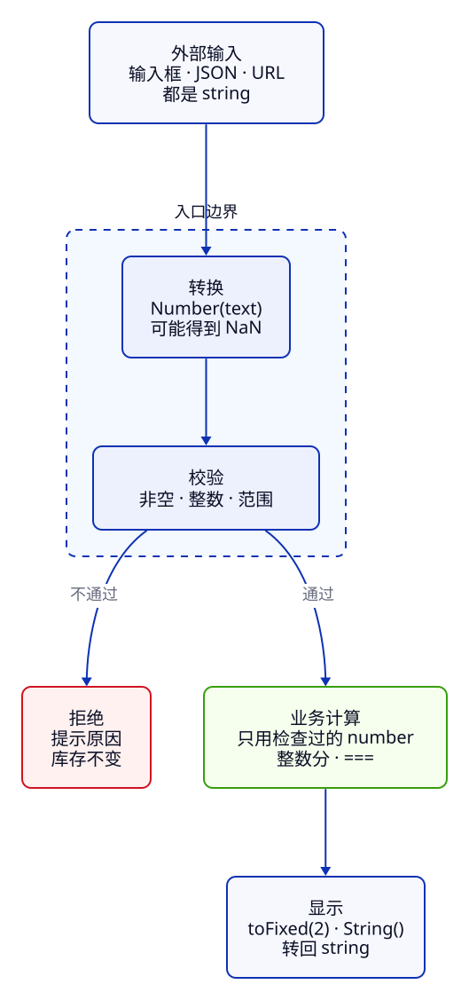

import CodeCompare from '../../../components/CodeCompare.astro';
import CodeExcerpt from '../../../components/CodeExcerpt.astro';
import LessonTask from '../../../components/LessonTask.astro';

> **第 1 周 · 第 2 天** · 阅读跟做约 45 分钟 · 实作约 40 分钟<br />
> 前置：C02 商品卡片 · 运行：本地网页、浏览器 Console 或 Node 24 · 示例已运行验证

## 这一课解决什么问题

P001 有 12 件，输入补货数量 3，卡片却显示 **123**。按钮已经接好，问题就在库存入口怎样处理输入。这一课只修改工作区的 `src/core/inventory.js`，让补货得到 15，空白和非法数量都不保存。同时保住售罄商品的库存 0。

如果你从旧版 C02 过来，使用任务卡里的 C02 起点另存新目录；以后在自己的工作区继续即可。

<LessonTask lessonId="C03" />

## Java 程序员先看这里

<CodeCompare pairId="c03-input-number" />

两侧都先把文本变成数量，再计算。JS 的函数定义写法可以先照着修改；这一课关注输入、值与运算的规则。

<a id="1-值有类型变量没有"></a>

## 1. 值有类型，输入框给的是文本

JS 的类型属于值，变量可以先指向文本，再指向数字。用 [`typeof`](https://developer.mozilla.org/zh-CN/docs/Web/JavaScript/Reference/Operators/typeof) 看清运算前拿到了什么。

```js
let quantity = "3";
console.log(typeof quantity); // → string
quantity = Number(quantity);
console.log(typeof quantity); // → number
console.log(typeof null); // → object
console.log(typeof []); // → object
console.log(typeof console.log); // → function
const product = { id: "P001", stock: 12 };
console.log(product.stok); // → undefined
```

`typeof null` 是历史遗留的 `"object"`，判断空值要写 `value === null`；数组用 `Array.isArray(value)`。输入框即使写着 `type="number"`，读回来的 `value` 也是字符串。

JS 有七种原始类型：String、Number、Boolean、Undefined、Null、BigInt、Symbol；其余归为 Object，数组和函数也属于对象。没有 Java 的 char 类型，单个字符仍是字符串。

`undefined` 常由语言给出：变量没赋值、属性不存在、函数没返回值。`null` 通常由你主动写出，表示“这里没有选择”。Java 只有 `null`；字段拼错在 Java 中是编译错误，在 JS 中可能安静地变成 `undefined`。

<a id="2-number只有一种数字"></a>

## 2. Number、整数分与 BigInt

普通数字只有 Number，使用 IEEE 754 双精度浮点数，行为接近 Java 的 `double`。写成整数也不会变成 Java 的 int。

**先猜一猜：** 库存价值按整数分存储，为什么显示金额时才除以 100？

```js
console.log(5 / 2); // → 2.5
console.log(Math.trunc(5 / 2)); // → 2
console.log(0.1 + 0.2); // → 0.30000000000000004
console.log(1 / 0); // → Infinity
console.log(0 / 0); // → NaN
const valueCents = 12 * 39900;
console.log(valueCents); // → 478800
console.log((valueCents / 100).toFixed(2)); // → "4788.00"
```

二进制浮点数不能精确表示 0.1；库存和金额先用整数运算，展示时才格式化。整数加减乘的输入和结果都在安全整数范围内时是精确的。折扣、分摊需要小数时，要先约定舍入规则。`toFixed` 返回字符串。

Java 的两个 int 相除会舍去小数，JS 的 `5 / 2` 是 2.5；JS 的除零也按浮点规则得到 Infinity 或 NaN。

Number 的安全整数范围是 ±(2⁵³−1)。后端 long 型 ID 应用字符串传输，避免解析时就丢失末位；需要任意大小的整数运算时使用 [BigInt](https://developer.mozilla.org/zh-CN/docs/Web/JavaScript/Reference/Global_Objects/BigInt)。

```js
console.log(Number.MAX_SAFE_INTEGER); // → 9007199254740991
console.log(2 ** 53 === 2 ** 53 + 1); // → true
console.log(1234567890123456789n + 1n); // → 1234567890123456790n
console.log(5n / 2n); // → 2n
try { console.log(1n + 1); }
catch (error) { console.log(error.name); } // → TypeError
```

BigInt 接近 Java 的 BigInteger，没有小数，不能与 Number 直接混算。商品 ID `P001` 是业务标识，本来就按字符串处理。

<a id="3-文本变数字转换以后还要校验"></a>

## 3. 文本先转换，再校验

`+` 碰到字符串会拼接；`-` 只做数值运算。显式转换以后，还要检查业务范围。

```js
console.log(12 + "3"); // → "123"
console.log(12 - "3"); // → 9
console.log(Number(" 3 ")); // → 3
console.log(Number("3件")); // → NaN
console.log(Number("  ")); // → 0
console.log(Number.parseInt("3件", 10)); // → 3
console.log(Number.parseInt("3.8", 10)); // → 3
```

`Number` 要求整个文本表示数字，转换失败得到 NaN；`parseInt` 只读开头的整数，会把单位与小数后半段丢掉。Java 的 `Integer.parseInt("3件")` 则抛异常。表单校验不能用 JS 的 `parseInt` 代替完整转换。

在工作区 `src/core/inventory.js` 中加入这个入口：

<CodeExcerpt snippetId="c03-parser" />

先排除空白，再转换，最后要求 0–99999 的整数。`Number.isInteger` 对 NaN、Infinity、小数都返回 false。失败抛出带原因的错误，现有页面处理函数会显示它，商品仍保留上次有效值。库存 0 合法；补货后的总库存也必须在范围内。



从上往下读：外部文本只在入口处理，计算使用检查过的数字。Java 的 DTO 校验也在边界完成，但 JS 还需要自己确认运行时类型。

<a id="4-truthyfalsy-与默认值"></a>

## 4. 默认值：库存 0 必须保留

条件表达式会把值当成 truthy 或 falsy。falsy 包括 `false`、`0`、`-0`、`0n`、`NaN`、`""`、`null`、`undefined`；其余值当成真。

**先猜一猜：** P002 已售罄，哪种默认写法会把它“复活”？

```js
const savedStock = 0;
console.log(savedStock || 12); // → 12
console.log(savedStock ?? 12); // → 0
console.log(Boolean("0"), Boolean("false")); // → true true
console.log(Boolean([]), Boolean({})); // → true true
```

`||` 在左边为 falsy 时换成右边；[`??`](https://developer.mozilla.org/zh-CN/docs/Web/JavaScript/Reference/Operators/Nullish_coalescing) 只处理 null 和 undefined。库存、价格、开关中有意义的 0 与 false 应保留。Java 最接近的是 `Objects.requireNonNullElse`，同样只处理空值。

`||`、`&&`、`??` 返回操作数，不一定返回 boolean。检查有货写 `stock > 0`，检查缺字段写 `stock === undefined`，不要用一个 `if (stock)` 同时承担两个含义。

<a id="5-相等默认用-"></a>

## 5. 比较：类型、内容与身份

默认用 `===`，它不做类型转换。对象按身份比较，字符串这样的原始值按值比较。

```js
console.log(3 === "3"); // → false
console.log(3 == "3"); // → true
console.log(null == undefined); // → true
console.log(NaN === NaN); // → false
console.log(Number.isNaN(NaN)); // → true
const keyboard = { id: "P001", stock: 12 };
const alias = keyboard;
const copy = { id: "P001", stock: 12 };
console.log(keyboard === alias); // → true
console.log(keyboard === copy); // → false
console.log(keyboard.id === copy.id); // → true
```

JS 对象的 `===` 接近 Java 对象的 `==`，没有自动的内容 equals；商品身份用 `id` 判断。JS 字符串则直接用 `===`，无需 Java 的 equals。

`==` 会转换类型，`0 == ""` 与 `0 == "0"` 都成立，`"" == "0"` 却不成立。常见的简写 `value == null` 同时匹配 null 与 undefined，其余比较用严格相等。NaN 不等于自己，要用 `Number.isNaN`；`Object.is` 还会区分 0 与 -0，并认为 NaN 等于自己。

## 常见错误与调试

### 补货得到 123

**现象**：用本课起点打开卡片，输入 3 后补货得到 123，Console 没有异常。

**工具**：按 F12 → Sources，找到 `src/core/inventory.js`，在 `restockProduct` 的 return 行单击行号设断点。刷新回初始 12，再补货一次。

**证据**：Scope 显示 `text` 是 `"3"`；暂停时在 Console 输入 `typeof text` 得到 `"string"`，`product.stock` 是数字 12。原来的 `(product.stock || 12) + text` 把数字和文本拼起来了。清空输入后，`Number(" ")` 还会得到 0；只加 Number 并不足够。

**原因**：界面交给业务层的输入还没转换，默认值又把合法的 0 当成缺失。

**修复**：先加入第 3 节的 `parseStock`，再用练习中的两个函数替换原来的 `restockProduct`。

**确认**：刷新回 12，补货 3 得到 15；空白、3件、-1、3.5 都显示原因且不改 15。检查器同时用库存 0 验证默认值，并检查补货后越界。

## 练习

### 唯一任务：接通可靠的补货入口

:::tip[自己尝试 · 本地网页]
1. 保持当前库存工作区，在 `src/core/inventory.js` 加入 `parseStock`。
2. 把旧 `restockProduct` 替换为下面参考答案中的 `initialStock` 与 `restockProduct`。先自己写，再展开对照。
3. 执行任务卡中的 start/dev/check；浏览器按调试节逐项尝试有效、空白和非法输入。
4. 暂停前在 `notes/next.md` 写下“C03 输入已校验，下一步循环统计”。

预期：12 补 3 是 15；非法输入保留当前库存；初始数据文件没有改变。
:::

<details>
<summary>提示</summary>

读取默认值用 `??`，输入先调用 `parseStock`。还要检查“原库存＋补货量”的结果：99999 再补 1 也不能保存。返回新商品，让页面只在函数成功后替换当前值。

</details>

<details>
<summary>参考答案</summary>

第 3 节的 parser 保留，再加入这两个函数。`parseStock` 同时保护输入与合计结果，`??` 保留 0，展开创建新商品。

<CodeExcerpt snippetId="c03-restock" />

遇到 RangeError 时，页面已提供的 catch 只显示错误，没有把失败结果写回。完整终点在任务卡的答案入口。

</details>

## 项目进度

- P001 补货 3 后为 15，价值 598500 分；刷新无存储的卡片后回到固定起始值 12。
- 空白、单位文本、负数、小数和越界不保存；库存 0 不被默认值替换。
- `npm run lab -- check C03` 检查自己的函数与受影响的前置行为；原始商品数据仍为固定值。

## 小结

- 类型属于值；输入框的 value 是字符串。
- Number 接近 Java 的 double；金额使用安全范围内的整数分，long ID 使用文本。
- 输入先判空、显式转换，再校验整数与范围。
- `??` 保留 0；`===` 区分类型，对象比较身份。

自测：为什么 12 加输入 3 会变 123？为什么只调用 Number 不能完成表单校验？库存 0 怎样保留？为什么两个 P001 对象并不严格相等？

下一课在同一文件加入循环统计，并观察块作用域。

## 延伸阅读

- [MDN：JavaScript 数据类型和数据结构](https://developer.mozilla.org/zh-CN/docs/Web/JavaScript/Guide/Data_structures)
- [MDN：Number](https://developer.mozilla.org/zh-CN/docs/Web/JavaScript/Reference/Global_Objects/Number)
- [MDN：相等比较和相同性](https://developer.mozilla.org/zh-CN/docs/Web/JavaScript/Guide/Equality_comparisons_and_sameness)
- [Chrome DevTools：调试 JavaScript](https://developer.chrome.com/docs/devtools/javascript)
- [旧版机制示例与验证记录](https://github.com/socoo123/js_web/tree/main/examples/c03)（按需参考，主线继续当前工作区）
