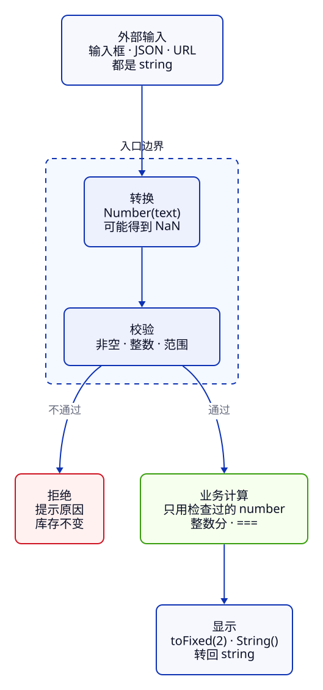

import CodeCompare from '../../../components/CodeCompare.astro';
import CodeExcerpt from '../../../components/CodeExcerpt.astro';
import Effect from '../../../components/Effect.astro';
import LessonTask from '../../../components/LessonTask.astro';
import Predict from '../../../components/Predict.astro';
import RunSnippet from '../../../components/RunSnippet.astro';

## 这一课解决什么问题

P001 有 12 件，输入补货数量 3，卡片却显示 **123**。按钮已经接好，问题出在库存入口怎样处理输入。这一课只改 `src/core/inventory.js`：补 3 得到 15，非法输入不保存，售罄的 0 也要保住。

<Effect kind="page" preview="c03/after" caption="完成后的效果：12 补 3 得 15；提交空白会显示原因，库存不变" />

学完你能：

- 用 `typeof` 看清值的类型，解释 12 加输入的 3 为什么得到 123。
- 把输入文本按「判空、转换、校验」三步变成可靠的库存数字。
- 用 `??` 保留库存 0，用 `===` 区分类型、内容与身份。

<LessonTask lessonId="C03" />

## Java 程序员先看这里

<CodeCompare pairId="c03-input-number" />

两侧都先把文本变成数量，再参与计算。差别在失败时：Java 抛异常，JS 可能安静地得到 NaN 或 0，要你自己检查。

<a id="1-值有类型变量没有"></a>

## 1. 值有类型，输入框给的是文本

JS 的类型属于值，不属于变量。同一个变量可以先指向文本、再指向数字，运算前用 [`typeof`](https://developer.mozilla.org/zh-CN/docs/Web/JavaScript/Reference/Operators/typeof) 看清拿到的是什么。

<RunSnippet example="c03/types" />

变量 quantity 先指向文本、后指向数字，`typeof` 每次只看它此刻指向的值。

- 七种原始类型：String、Number、Boolean、Undefined、Null、BigInt、Symbol，其余都是对象，包括数组和函数。没有 char，单个字符也是字符串。
- `typeof null` 得到 object 是历史遗留。判断空值写 `value === null`，判断数组用 `Array.isArray(value)`。
- undefined 通常由语言给出：没赋值、属性不存在、函数没返回值。null 由你主动写出，表示「这里没有选择」。

**记住：** 输入框的 `value` 永远是字符串，写了 `type="number"` 也一样。

**Java 对照：** Java 的类型写在变量上，拼错字段编译不过。JS 的类型跟着值走，拼错的属性在运行时安静地得到 undefined。

<a id="2-number只有一种数字"></a>

## 2. Number、整数分与 BigInt

普通数字只有一种 Number，它是 64 位双精度浮点数。写成整数也不会变成 Java 的 int。

<Predict question="下面六行分别打印什么？">

```js
console.log(5 / 2);
console.log(0.1 + 0.2);
console.log(12 * 39900);
console.log((12 * 39900 / 100).toFixed(2));
console.log(2 ** 53 === 2 ** 53 + 1);
console.log(5n / 2n);
```

<div slot="answer">

<Effect kind="console" example="c03/number-predict" />

二进制浮点数存不准 0.1，所以库存和金额先用整数运算，显示时才格式化。超过 2⁵³ 以后，相邻的整数已经分不开。

</div>
</Predict>

- 金额统一存成「分」：39900 就是 399.00 元。`toFixed` 返回字符串，只用来显示。
- 安全整数指 ±(2⁵³−1) 以内的整数；输入和结果都在这个范围内时，加减乘是精确的。
- 后端的 long 型 ID 用字符串传，避免解析时丢掉末位。商品 ID P001 是业务标识，本来就是字符串。
- [BigInt](https://developer.mozilla.org/zh-CN/docs/Web/JavaScript/Reference/Global_Objects/BigInt) 是任意大的整数，没有小数，也不能和 Number 混算：`1n + 1` 抛 TypeError。
- 除零不报错：`1 / 0` 得 Infinity，`0 / 0` 得 NaN（Not a Number，「不是数字」）。要舍去小数，写 `Math.trunc(5 / 2)`。

**Java 对照：** Number 接近 `double`，BigInt 接近 `BigInteger`。Java 里两个 int 相除舍去小数，JS 的 `5 / 2` 是 2.5。

<a id="3-文本变数字转换以后还要校验"></a>

## 3. 文本先转换，再校验

`+` 碰到字符串会拼接，`-` 只做数值运算。显式转换以后，还要检查业务范围。

<Predict question="输入框读到文本「3」。下面七行分别打印什么？">

```js
const text = "3"; // 输入框读到的值
console.log(12 + text);
console.log(12 - text);
console.log(Number(" 3 "));
console.log(Number("3件"));
console.log(Number("  "));
console.log(Number.parseInt("3件", 10));
console.log(Number.parseInt("3.8", 10));
```

<div slot="answer">

<Effect kind="console" example="c03/convert-predict" />

`Number` 先去掉首尾空白，剩下的必须整段是数字，否则得到 NaN。只剩空白时它却得到 0。`parseInt` 只读开头的整数，会把「件」和小数部分悄悄丢掉。

</div>
</Predict>

所以入口要分三步：先判空，再转换，最后要求 0–99999 的整数。在工作区的 `src/core/inventory.js` 加入这个函数：

<CodeExcerpt snippetId="c03-parser" />

<Effect kind="console" example="c03/parse-stock" title="parseStock 对七种输入的结果" />

`Number.isInteger` 对 NaN、Infinity 和小数都返回 false。失败时抛出带原因的 RangeError，页面显示这个原因，商品保留上次的有效值。



从上往下读：外部文本只在入口处理一次，后面的计算只用检查过的数字。

**记住：** 先判空，再转换，最后校验整数和范围。

**Java 对照：** `Integer.parseInt("3件")` 抛 NumberFormatException，JS 的 `parseInt` 却返回 3。Java 的 DTO 校验也放在边界，但 JS 还要自己确认运行时类型。

<a id="4-truthyfalsy-与默认值"></a>

## 4. 默认值：库存 0 必须保留

truthy / falsy 指一个值在条件判断里被当成真还是假。falsy 只有八个：false、0、-0、0n、NaN、空字符串、null 和 undefined，其余都算真。

<RunSnippet example="c03/defaults" />

`||` 在左边是 falsy 时换成右边，[`??`](https://developer.mozilla.org/zh-CN/docs/Web/JavaScript/Reference/Operators/Nullish_coalescing) 只在 null 或 undefined 时换。售罄的 0 被 `||` 当成「没有值」，P002 就被复活成 12。

自己尝试：把片段里的 0 改成 undefined 再运行，两行都会得到 12。

这三个运算符返回的是操作数本身，不一定是布尔值。条件要写清楚想问什么：

- 有没有货：`stock > 0`
- 字段缺不缺：`stock === undefined`

不要让一个 `if (stock)` 同时回答这两个问题。

**记住：** 库存、价格、开关这类 0 和 false 有意义的字段，默认值用 `??`。

**Java 对照：** `??` 接近 `Objects.requireNonNullElse(stock, 12)`，同样只处理空值。

<a id="5-相等默认用-"></a>

## 5. 比较：类型、内容与身份

默认用 `===`，它不做类型转换。对象按身份比较，字符串这样的原始值按内容比较。

```js title="compare.js"
console.log(3 === "3");
console.log(3 == "3");
console.log(NaN === NaN, Number.isNaN(NaN));
const keyboard = { id: "P001", stock: 12 };
const alias = keyboard;
const copy = { id: "P001", stock: 12 };
console.log(keyboard === alias);
console.log(keyboard === copy);
console.log(keyboard.id === copy.id);
```

<Effect kind="console" example="c03/compare" />

两个 P001 内容相同，却是两份对象，所以 `keyboard === copy` 是 false。判断是不是同一件商品，比较 `id`。

- `==` 会先转换类型，规则难记：0 等于空字符串，0 也等于 "0"，空字符串却不等于 "0"。
- 唯一常用的 `==` 是 `value == null`，它同时匹配 null 和 undefined。
- NaN 不等于自己，要用 `Number.isNaN`。`Object.is` 还会区分 0 和 -0。

**记住：** 默认用 `===`，商品身份比 `id`，不比对象。

**Java 对照：** JS 对象的 `===` 接近 Java 对象的 `==`，比的是身份，没有自动的 equals。JS 字符串直接用 `===` 比内容。

## 常见错误与调试

### 补货得到 123

1. **现象**：在本课起点输入 3 再点补货，卡片显示 123，Console 没有任何报错。

<Effect kind="page" preview="c03/before" caption="本课起点：12 补 3，卡片显示 123，库存价值也跟着错" />

2. **工具**：按 F12 打开 Sources，找到 `src/core/inventory.js`，在 `restockProduct` 的 return 行单击行号设断点。刷新回 12，再补货一次。
3. **证据**：Scope 里 `text` 是字符串 "3"，`product.stock` 是数字 12。暂停时在 Console 输入 `typeof text`，得到 string。
4. **原因**：旧写法 `(product.stock || 12) + text` 把数字和文本拼成了 123。只改成 `Number(text)` 也不够：空白会变成 0，`||` 还会把售罄的 0 换成 12。
5. **修复**：加入第 3 节的 `parseStock`，再用练习参考答案里的两个函数替换旧的 `restockProduct`。
6. **确认**：刷新回 12，补货 3 得到 15。空白、3件、-1、3.5 都显示原因，库存保持 15。

## 练习

### 唯一任务：接通可靠的补货入口

:::tip[自己尝试 · 本地网页]
1. 在当前工作区的 `src/core/inventory.js` 加入第 3 节的 `parseStock`。
2. 自己写 `initialStock` 和新的 `restockProduct`，替换旧函数；写完再展开参考答案对照。
3. 按任务卡打开页面，依次输入 3、空白、3件、-1、3.5，再运行任务卡里的检查命令。

预期：12 补 3 是 15。非法输入显示原因，库存保持 15，初始数据文件不变。
:::

<details>
<summary>提示</summary>

读取默认值用 `??`，输入先交给 `parseStock`。

合计也要检查：99999 再补 1 不能保存。函数返回新商品，页面只在成功后替换当前值。

</details>

<details>
<summary>参考答案</summary>

第 3 节的 `parseStock` 保留，再加入这两个函数。

<CodeExcerpt snippetId="c03-restock" />

`parseStock` 同时检查输入和合计，`??` 保留 0，展开语法创建新商品。遇到 RangeError 时，页面已有的 catch 只显示原因，不写回失败的结果。

</details>

## 项目进度

完成本课后，L1 的第一段「C01–C03：输入 3 把 P001 从 12 补到 15」可以检查了。

<Effect kind="page" preview="c03/after" caption="L1 · C03 完成：12 补 3 得 15，提交空白被拒绝，库存不变" />

勾选前逐项确认：

- P001 补货 3 后为 15，库存价值 598500 分；刷新后回到固定起始值 12。
- 空白、3件、-1、3.5 和补货后超过 99999 都不保存。
- 库存 0 不会被默认值替换，任务卡里的检查命令通过。

下一步：回到 [L1 Lab 页](/js_web/labs/l1/) 记下这一段，再进入 C04，在同一个文件里加入循环统计。

## 小结

- 类型属于值；输入框的 value 是字符串。
- Number 接近 Java 的 double；金额用安全范围内的整数分，long ID 用文本。
- 输入先判空、显式转换，再校验整数与范围。
- `??` 保留 0；`===` 区分类型，对象比较身份。

自测：

- 为什么 12 加输入的 3 会变成 123？
- 为什么只调用 Number 不能完成表单校验？
- 库存 0 怎样保留？
- 为什么两个 P001 对象并不严格相等？

## 延伸阅读

- [MDN：JavaScript 数据类型和数据结构](https://developer.mozilla.org/zh-CN/docs/Web/JavaScript/Guide/Data_structures)
- [MDN：Number](https://developer.mozilla.org/zh-CN/docs/Web/JavaScript/Reference/Global_Objects/Number)
- [MDN：相等比较和相同性](https://developer.mozilla.org/zh-CN/docs/Web/JavaScript/Guide/Equality_comparisons_and_sameness)
- [Chrome DevTools：调试 JavaScript](https://developer.chrome.com/docs/devtools/javascript)
- [旧版机制示例与验证记录](https://github.com/socoo123/js_web/tree/main/examples/c03)（按需参考，主线继续当前工作区）
