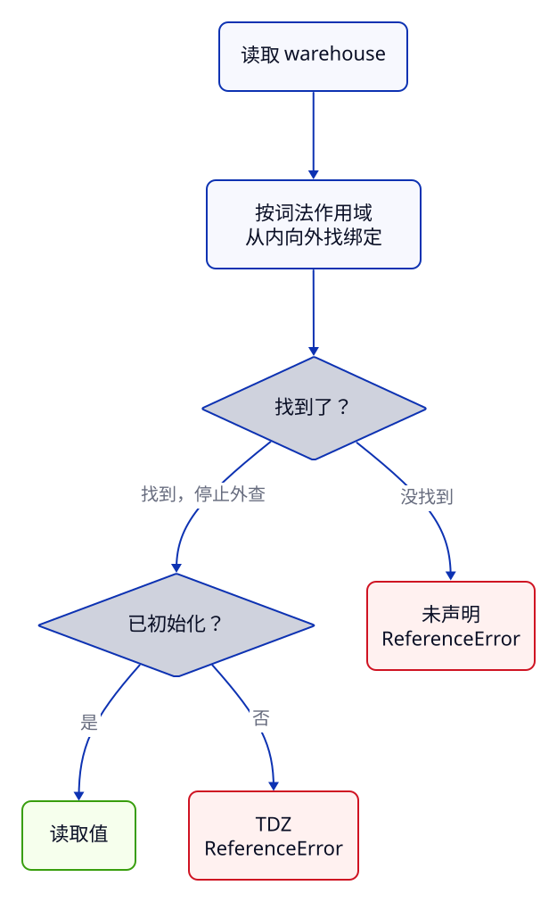

> **第 1 周 · 第 2 天** · 阅读跟做约 45 分钟 · 练习约 40 分钟\
> 前置：C03 · 运行：浏览器 Console 或 Node 24 · 示例已运行验证

## 这一课解决什么问题

现在要统计前四件商品的库存：`[12, 0, 7, 3]`，总数应该是 22。你把 Java 的循环迁到 JS，不小心把 `<` 写成 `<=`，结果没有数组越界异常，最后只打印了 `NaN`。

另一个地方，消息明明在 `if` 里赋过值，出了花括号却提示 `message is not defined`。把 `const` 改成 `let` 也没用。

这一课沿着库存统计，把声明、作用域与控制流连起来。

学完你能：

- 为累计量选 `let`，为当前元素和固定绑定选 `const`，读懂旧代码里的 `var`
- 沿代码的嵌套关系查找变量，解释遮蔽、提升和暂时性死区 TDZ
- 区分 `for...of` 的元素与 `for...in` 的属性名，把 Java 统计方法迁到 JS
- 在 Sources 的 Scope 和 Call Stack 中找到错误证据，分清 `NaN` 与异常

例子在仓库的 [examples/c04](https://github.com/socoo123/js_web/tree/main/examples/c04)。和 C03 一样，在 Chrome 的 Console 粘贴完整代码块即可；重复声明报错时刷新页面再运行。已有 Node 的话，可以在该目录运行 `node stats.js`。

## Java 程序员先看这里

| Java | JavaScript | 差异 |
| --- | --- | --- |
| 局部变量、`final` 引用 | `let`、`const` | `const` 限制重新赋值，对象属性仍可修改 |
| 块内的局部变量 | `let` / `const` 块作用域 | JS 允许在内层块声明同名变量，遮蔽外层 |
| 声明前使用局部变量编译失败 | `var` 提前读到 `undefined`；`let` / `const` 抛异常 | 要区分绑定已建立和已初始化 |
| 增强 `for` 遍历元素 | `for...of` | `for...in` 遍历的是字符串属性名 |
| 越界抛异常；受检异常要声明或捕获 | 缺失下标读到 `undefined`；无受检异常机制 | `NaN` 是一个值，`try/catch` 捕获不到它 |

## 1. let 和 const：限制的是重新赋值

默认用 [`const`](https://developer.mozilla.org/zh-CN/docs/Web/JavaScript/Reference/Statements/const)；一个名字后面还要重新赋值，才用 `let`。这里的「绑定」就是变量名与值的关联。

**先猜一猜：** 为什么下面两次库存修改都成功，最后一次却报错？

```js title="bindings.js"
let stock = 12; // P001 机械键盘，售出 3 件
const sold = 3;
stock = stock - sold;
console.log(stock); // → 9

const product = { id: "P001", stock: 12 };
product.stock = product.stock - sold;
console.log(product.stock); // → 9
try {
  product = { id: "P002", stock: 0 };
} catch (error) {
  console.log(error.name); // → TypeError
}
```

输出依次是 `9`、`9`、`TypeError`。`stock = stock - sold` 给变量重新赋值，`stock` 要用 `let`。`sold` 始终是 3，用 `const` 表达这个约定。

`product.stock = ...` 改的是对象属性，`product` 仍绑定到原来的对象；`product = ...` 才是把这个名字换绑到另一个对象，所以抛出 `TypeError`。`try/catch` 让例子打印错误名称后继续运行，第 5 节再讲它。

这与 Java 的 `final Product product` 相似：引用不能替换，对象的可变字段仍能改。JS 的 `const` 也不会给值加上 Java 式的静态类型。

普通的 `const` 声明必须立刻给值。

## 2. 作用域与 TDZ：先找到绑定，再看能不能读

### 花括号建立块作用域

`let` 和 `const` 声明在块内，就只在这个块及其内部可见。读取一个名字时，先找当前作用域，没有再找外层。

```js title="scope.js"
const warehouse = "默认仓";
{
  const warehouse = "杭州仓";
  const quantity = 12;
  {
    console.log(warehouse, quantity); // → 杭州仓 12
  }
}
console.log(warehouse); // → 默认仓
```

输出是 `杭州仓 12`、`默认仓`。最里面的块没有自己的 `warehouse`，向外一层找到「杭州仓」，查找就停了。离开这层块后，读到的仍是外层的「默认仓」。

两个 `warehouse` 是两个独立绑定，内层同名绑定**遮蔽**了外层。它没有修改外层的值。`quantity` 只属于内层块，块外读取它会抛 `ReferenceError`。

按代码嵌套关系确定查找路径的规则叫**词法作用域**。Java 的普通局部变量块不允许这样重声明同名变量，JS 允许。

### var：函数作用域，声明前可以读

旧教程常见的 [`var`](https://developer.mozilla.org/zh-CN/docs/Web/JavaScript/Reference/Statements/var) 不受普通 `if` 块限制。在函数内，它的作用域是整个函数。

这里先用最少的函数语法：`function showLegacy() { ... }` 定义一段有名字的代码，`showLegacy()` 执行它。

```js title="var.js"
function showLegacy() {
  console.log(legacy); // → undefined
  if (true) {
    var legacy = 12;
  }
  console.log(legacy); // → 12
}
showLegacy();
```

两行分别打印 `undefined`、`12`。进入函数时，`legacy` 的绑定已建立，并初始化为 `undefined`；执行到 `var legacy = 12` 才赋值为 12。`if` 结束后仍能读到它，因为这个绑定属于函数。

这叫**提升**：声明的效果提前可见，赋值仍在原来的位置。源码并没有真的搬家。

### let / const：初始化前处于暂时性死区

`let` / `const` 的绑定也会提前建立，但执行到声明并初始化之前不能读取。这段时间叫 **Temporal Dead Zone，暂时性死区（TDZ）**。

**先猜一猜：** 外层已经有 `label`，下面是打印「外层」，还是抛异常？

```js title="tdz.js"
const label = "外层";
try {
  console.log(label);
  const label = "内层";
} catch (error) {
  console.log(error.name); // → ReferenceError
}
let pending;
console.log(pending); // → undefined
```

输出是 `ReferenceError`、`undefined`。`try` 的花括号里有自己的 `const label`，所以查找在内层停止。但执行 `console.log(label)` 时，它还没初始化，读取就抛异常，后面的赋值也没机会执行。

**找到未初始化的绑定，会直接报错，不会退回外层。** 内层绑定已经影响了前面的读取。

最后的 `let pending;` 已经执行完声明，把变量初始化为 `undefined`，因此可以读取。`undefined` 是一个可读取的值，TDZ 则是尚不能读取的状态。



箭头表示查找路径：未声明与 TDZ 是两个不同的报错出口。

C03 的 `typeof notDeclared` 返回 `"undefined"`，针对的是没有声明过的名字。对 TDZ 中的 `label` 使用 `typeof label`，仍会抛 `ReferenceError`。可以把例子中的 `console.log(label)` 改成 `console.log(typeof label)` 试一下。

## 3. 分支：先确定结果要被谁读取

`if` 的结构和 Java 相同。库存状态按三条互斥规则处理：0 件售罄，1–5 件低库存，其余可售。先判断 0，再判断上限 5。

```js title="branches.js"
for (const currentStock of [0, 3, 12]) {
  let status;
  if (currentStock === 0) {
    status = "售罄";
  } else if (currentStock <= 5) {
    status = "低库存";
  } else {
    status = "可售";
  }
  console.log(currentStock, status); // → 0 售罄 / 3 低库存 / 12 可售
}
```

三行输出是 `0 售罄`、`3 低库存`、`12 可售`。进入一个分支后，后面的 `else if`、`else` 就不再执行；因此检查 `<= 5` 时，0 已经被前一条排除了。

`let status` 放在 `if` 前，分支内赋值，分支后读取。若漏写 `else`，库存 12 的那条路径就会留下 `undefined`。

和 Java 的差别是：JS 的条件会做 truthy / falsy 转换。沿用 C03 的规则，明确写 `currentStock === 0` 或 `currentStock > 0`，库存 0 就不会被误当成「没返回数据」。

### switch 匹配固定值

按「售出 / 补货」这类固定操作分派时，可以用 [`switch`](https://developer.mozilla.org/zh-CN/docs/Web/JavaScript/Reference/Statements/switch)。

```js title="switch.js"
const action = "restock";
switch (action) {
  case "sell": {
    const message = "执行售出";
    console.log(message);
    break;
  }
  case "restock": {
    const message = "执行补货";
    console.log(message); // → 执行补货
    break;
  }
  default: {
    console.log("未知操作");
  }
}
```

输出 `执行补货`。`case` 按严格相等规则匹配，字符串 `"0"` 与数字 `0` 不匹配。匹配后从那里向下执行；遗漏 `break` 会继续执行后面的分支。

`case` 标签本身不建立块作用域。这里每个分支都加 `{ ... }`，所以两处 `const message` 各属于自己的块，可以同名。`default` 则把未知操作变成明确的结果。

## 4. 循环：先选值，再决定要不要下标

### 把 Java 统计方法迁过来

先看熟悉的 Java。数组中放的是 P001–P004 的库存，统计方法只负责把它们加起来。

```java title="StockStats.java"
public class StockStats {
    static int sumStock(int[] quantities) {
        int total = 0;
        for (int index = 0; index < quantities.length; index++) {
            total = total + quantities[index];
        }
        return total;
    }

    public static void main(String[] args) {
        System.out.println("total " + sumStock(new int[] {12, 0, 7, 3}));
        System.out.println("empty " + sumStock(new int[] {}));
        System.out.println("zero " + sumStock(new int[] {0}));
    }
}
```

输出 `total 22`、`empty 0`、`zero 0`。已有 JDK 的话，在示例目录运行 `java StockStats.java` 即可。

JS 可以直接定义函数，省去类和 `main`，循环结构保持不变：

```js title="stats.js"
function sumStock(quantities) {
  let total = 0;
  for (let index = 0; index < quantities.length; index++) {
    const quantity = quantities[index];
    total = total + quantity;
  }
  return total;
}

const quantities = [12, 0, 7, 3]; // P001–P004 的库存
console.log("total", sumStock(quantities)); // → total 22
console.log("empty", sumStock([]));         // → empty 0
console.log("zero", sumStock([0]));         // → zero 0
```

输出仍是 `total 22`、`empty 0`、`zero 0`。`quantities` 是函数的输入参数；`return total` 把结果交回调用处并结束函数。

函数接收已校验的非负整数数组。`[12, 0, 7, 3]` 长度为 4，下标从 0 到 3，条件是 `index < quantities.length`。

`total` 在循环外初始化一次，每轮累加；若把它移进循环体，每轮都会从 0 开始。`index++` 会更新下标，所以 `index` 用 `let`。`quantity` 每轮只取一次当前值，用 `const`。

空数组长度为 0，第一次检查 `0 < 0` 就失败，直接返回初始总数 0。

### for...of 拿值，for...in 拿属性名

只需要元素、不需要下标时，优先用 [`for...of`](https://developer.mozilla.org/zh-CN/docs/Web/JavaScript/Reference/Statements/for...of)，相当于 Java 的增强 `for`。

**先猜一猜：** 把 `of` 换成 `in`，每轮拿到的值和类型会怎样变化？

```js title="iteration.js"
const values = [12, 0, 7]; // P001–P003 的库存
for (const quantity of values) {
  console.log("of", quantity, typeof quantity);
}
// → of 12 number / of 0 number / of 7 number
for (const key in values) {
  console.log("in", key, typeof key);
}
// → in 0 string / in 1 string / in 2 string
```

前一组打印库存数字 12、0、7；后一组打印字符串属性名 `"0"`、`"1"`、`"2"`。`for...in` 还可能枚举数组的附加属性和继承来的可枚举属性，因此遍历数组元素选 `of`。

把 `sumStock` 的计数循环改成 `for (const quantity of quantities) { total = total + quantity; }`，结果相同，还省去了维护下标。这里 `const quantity` 每轮建立新绑定。

### continue 跳过一轮，break 结束循环

找第一件有货商品时，遇到 0 应该继续找，找到非零库存后才结束：

```js title="search.js"
let firstAvailable = null;
for (const quantity of [0, 7, 3]) { // P002–P004 的库存
  if (quantity === 0) continue;
  firstAvailable = quantity;
  break;
}
console.log(firstAvailable); // → 7
```

输出是 `7`。`continue` 跳过本轮剩余部分，`break` 退出最内层循环；把 `continue` 换成 `break`，遇到第一个 0 就结束，结果会留下 `null`。

`while (条件)` 先判断再执行，`do { ... } while (条件)` 先执行一次再判断，都和 Java 相同。次数由过程决定时用它们，遍历数组先选 `for...of`。

## 5. 异常：中断执行，并留下调用链

[`throw` 与 `try/catch/finally`](https://developer.mozilla.org/zh-CN/docs/Web/JavaScript/Reference/Statements/try...catch) 的结构和 Java 相似。校验发现非法库存时，可以抛出一个带说明的错误，由调用者处理。

```js title="errors.js"
function requireStock(quantity) {
  if (!Number.isInteger(quantity) || quantity < 0 || quantity > 99999) {
    throw new RangeError("库存必须是 0–99999 的整数");
  }
  return quantity;
}
function readStock() {
  return requireStock(-1);
}

try {
  console.log("库存", readStock());
} catch (error) {
  console.log(error.name, error.message);
  // → RangeError 库存必须是 0–99999 的整数
} finally {
  console.log("本次检查结束"); // → 本次检查结束
}
```

输出依次是 `RangeError 库存必须是 0–99999 的整数`、`本次检查结束`，没有那行正常的「库存」输出。

执行 `readStock()` 时，`requireStock(-1)` 抛错，正常返回路径被中断。错误沿调用链传到 `catch`，`error.name` 是错误类别，`error.message` 是说明；`finally` 在这段流程结束前执行，适合放必要的收尾代码。收尾块里写 `return` 或再次抛错，会覆盖原来的结果或错误。

Java 的受检异常需要在方法签名中声明或处理；JS 没有这道编译检查。业务代码优先抛 `Error` 或它的子类，让调用者拿到消息与堆栈。

**错误堆栈（stack）**记录调用如何走到抛错处。在 Chrome 查看 `error.stack`，靠上的业务函数依次是 `requireStock`、`readStock`、调用处，旁边有文件名和行号。先看类型与消息，再从上往下读业务调用。

`SyntaxError` 看语法，`ReferenceError` 看名字与初始化，`TypeError` 看操作对象，`RangeError` 看范围。本例主动抛出范围错误；数组越界读取则得到 `undefined`。

## 常见错误与调试

### 总数变成 NaN：找到第一个错误元素

:::tip[自己尝试 · 本地网页]
1. 在终端进入仓库的 `examples/c04` 目录，运行 `python3 -m http.server 8000 --bind 127.0.0.1`。
2. 用 Chrome 打开 `http://127.0.0.1:8000/`，按 F12。Console 正常应显示 `total 22`、`empty 0`、`zero 0`。
3. 在编辑器中把 `stats.js` 的 `<` 改成 `<=`，保存后刷新。按下面六步定位，再恢复正确条件。

预期：错误版三行都是 `NaN`；修好后三行恢复 22、0、0。
:::

完整的故障版本也保存在 `stats-broken.js`：

```js title="stats-broken.js"
// 有问题的写法：循环把 length 当成了最后一个有效下标
function sumStock(quantities) {
  let total = 0;
  for (let index = 0; index <= quantities.length; index++) {
    const quantity = quantities[index];
    total = total + quantity;
  }
  return total;
}

const quantities = [12, 0, 7, 3];
console.log("total", sumStock(quantities)); // → total NaN
console.log("empty", sumStock([]));         // → empty NaN
console.log("zero", sumStock([0]));         // → zero NaN
```

1. **现象**：Console 打印 `total NaN`，却没有红色的异常。空数组和单个 0 的统计也变成了 `NaN`。
2. **工具**：打开 Sources → 左侧文件树中的 `stats.js`，单击 `total = total + quantity;` 的行号设断点，刷新。右侧展开 Scope，看 Local 中的 `index`、`quantity`、`total`；Call Stack 顶部应是 `sumStock`。暂停时，这一行还没执行。
3. **证据**：第一轮总数为 0，点 Step over 后变成 12。点 Resume 回到断点，按下表检查，第五轮首次出现 `undefined`。
4. **原因**：长度 4 不等于最后下标 3，`<=` 多读了一项。这里 `quantities[4]` 得到 `undefined`，数字与它相加得到 `NaN`。这是运算结果，`try/catch` 捕获不到。
5. **修复**：在编辑器把条件恢复为 `index < quantities.length`，保存。需要的只是元素时，也可以改为 `for...of`。
6. **确认**：移除断点并刷新，三行恢复 `total 22`、`empty 0`、`zero 0`。空数组不会再进入循环体。

| index | quantity | 本行执行前 total | 单步后 total |
| --- | --- | --- | --- |
| 0 | 12 | 0 | 12 |
| 1 | 0 | 12 | 12 |
| 2 | 7 | 12 | 19 |
| 3 | 3 | 19 | 22 |
| 4 | `undefined` | 22 | `NaN` |

在暂停时输入 `quantities.length`，直接确认它是 4。给 `quantity` 加 `?? 0` 会遮住第五轮的异常数据，修复应落在循环边界。

Scope 展示当前能访问的绑定，Call Stack 展示这次执行的调用链。函数返回后，在全局 Console 输入 `total` 读不到局部变量；观察它要在函数暂停期间进行。[Chrome 单步与作用域参考](https://developer.chrome.com/docs/devtools/javascript/reference)有对应的面板说明。

### 主动抛错：从暂停位置读回调用者

:::tip[自己尝试 · 本地网页]
1. 在编辑器打开同目录的 `index.html`，把脚本路径 `./stats.js` 改成 `./errors.js`，保存。
2. 在 Sources 右侧启用 **Pause on exceptions**，再勾选 **Pause on caught exceptions**，刷新。
3. 按下面步骤查看堆栈，结束后恢复脚本路径并关闭异常暂停。

预期：先停在 `throw new RangeError(...)`，继续后进入 `catch`，Console 打印错误消息和「本次检查结束」。
:::

1. **现象**：Console 没有正常的「库存」日志，只有错误与收尾消息。
2. **工具**：停在 `throw` 后，查看 Call Stack，点击 `readStock` 帧回到调用处。
3. **证据**：顶部帧的 `quantity` 是 -1。在 `catch` 内日志行再设断点，Resume 后，在 Console 查看 `error.name`、`error.message`、`error.stack`。
4. **原因**：校验抛错，`readStock()` 没正常返回，日志的参数求值被打断。
5. **修复**：把 `readStock` 中的测试输入 -1 改成合法库存 12，保存刷新。
6. **确认**：异常断点不再命中，输出 `库存 12`、`本次检查结束`；还原 -1 又能复现。

## 练习

### 练习 1：预测名字与循环的结果

先写出四行输出及其类型，再运行 `prediction.js`，解释每行结果。

```js title="prediction.js"
let count = 0;
for (const quantity of [12, 0, 7]) {
  if (quantity === 0) continue;
  count++;
}
console.log(count);
const zone = "默认仓";
{
  const zone = "杭州仓";
  console.log(zone);
}
console.log(zone);
console.log([12, 0, 7][3]);
```

<details>
<summary>提示</summary>

`count` 统计进入累加语句的次数；`continue` 会跳过 0。两个 `zone` 各自属于不同的块。数组长度为 3，最后一个有效下标是 2。

</details>

<details>
<summary>参考答案</summary>

| 行 | 输出 | 类型 | 原因 |
| --- | --- | --- | --- |
| `count` | `2` | number | 只有 12、7 两轮执行 `count++` |
| 内层 `zone` | `杭州仓` | string | 当前块的同名绑定遮蔽外层 |
| 外层 `zone` | `默认仓` | string | 内层声明没有改外层值 |
| 下标 3 | `undefined` | undefined | 这一项不存在，读取没有抛异常 |

`continue` 让库存 0 跳过计数；内层声明只影响内层的查找。

</details>

### 练习 2：让分支后的消息可读

运行 `message-broken.js`，它会抛 `ReferenceError`。保留 `let` / `const`，修到库存 0 打印「售罄」，库存 3 打印「可售」，两种情况都在 `if` 后打印。

```js title="message-broken.js"
// expect-error: ReferenceError
// 有问题的写法：message 只属于 if 块，块外无法读取
const messageStock = 0;
if (messageStock === 0) {
  const message = "售罄";
}
console.log(message); // → 抛出 ReferenceError
```

<details>
<summary>提示</summary>

先圈出消息的使用范围。分支要给它赋值，分支后的日志要读取它，所以声明应放在同时包含两处的外层块。只把内层 `const` 改成 `let`，作用域不会变。

</details>

<details>
<summary>参考答案</summary>

```js title="message-answer.js"
for (const messageStock of [0, 3]) {
  let message;
  if (messageStock === 0) {
    message = "售罄";
  } else {
    message = "可售";
  }
  console.log(messageStock, message); // → 0 售罄 / 3 可售
}
```

输出 `0 售罄`、`3 可售`。`let message` 每轮在分支外建立，两条路径都赋值，日志才能得到确定的结果。

如果输出仍是 `undefined`，检查是否在分支里又写了 `let message = ...`：那会新建内层绑定，外层的同名变量仍然没有被赋值。

</details>

### 练习 3：迁移一个库存报告

新建 `summary.js`，写 `summarize(quantities)`，打印总库存和有货商品数。用 `for...of` 遍历，不维护下标；输入已经是非负整数。

验收：六件商品的库存 `[12, 0, 7, 3, 25, 5]` 打印 `总库存 52 有货商品数 5`；`[]` 和 `[0]` 都打印 `总库存 0 有货商品数 0`。0 件商品仍存在，只是不计入「有货商品数」。

<details>
<summary>提示</summary>

需要两个累计量，都在循环外初始化。每个数量都进入总库存，只有 `quantity > 0` 时才增加有货商品数。

</details>

<details>
<summary>参考答案</summary>

```js title="summary-answer.js"
function summarize(quantities) {
  let total = 0;
  let availableCount = 0;
  for (const quantity of quantities) {
    total = total + quantity;
    if (quantity > 0) availableCount++;
  }
  console.log("总库存", total, "有货商品数", availableCount);
}

summarize([12, 0, 7, 3, 25, 5]); // → 总库存 52 有货商品数 5
summarize([]);                  // → 总库存 0 有货商品数 0
summarize([0]);                 // → 总库存 0 有货商品数 0
```

两个累计量用 `let`，当前元素用 `const`。空数组不进入循环，保留两个初始值 0；库存 0 会参与总数相加，但不会增加有货商品数。

</details>

## 小结

- 默认用 `const`，需要重新赋值才用 `let`；修改对象属性不等于替换绑定。
- 读取名字按词法作用域从内向外找，找到即停止；内层同名声明会遮蔽外层。
- `var` 提前初始化为 `undefined`，`let` / `const` 初始化前处于 TDZ，读取会抛 `ReferenceError`。
- 数组元素用 `for...of`；需要下标时用普通 `for`，条件是下标小于长度。
- `NaN` 是值，异常才走 `catch`；调试时先找第一次错误的数据，再沿调用链回看来源。

自测：

1. `const product` 为什么能修改库存，却不能换成另一个商品对象？
2. 内层声明还没执行，为什么也会遮蔽外层同名变量？
3. `for...of` 每轮用 `const`，为什么不会第二轮就报错？
4. `<= length` 造成的 `NaN`，为什么不能靠 `try/catch` 发现？
5. Scope 和 Call Stack 分别回答什么问题？

下一课把这些库存数字装进商品对象，讲属性访问、复制与 JSON 数据交换。

## 延伸阅读

- [MDN：let 与暂时性死区](https://developer.mozilla.org/zh-CN/docs/Web/JavaScript/Reference/Statements/let)
- [MDN：const](https://developer.mozilla.org/zh-CN/docs/Web/JavaScript/Reference/Statements/const)
- [MDN：循环与迭代](https://developer.mozilla.org/zh-CN/docs/Web/JavaScript/Guide/Loops_and_iteration)
- [MDN：控制流与错误处理](https://developer.mozilla.org/zh-CN/docs/Web/JavaScript/Guide/Control_flow_and_error_handling)
- [Chrome DevTools：使用断点暂停代码](https://developer.chrome.com/docs/devtools/javascript/breakpoints)
- [ECMAScript：声明与控制流](https://tc39.es/ecma262/2026/multipage/ecmascript-language-statements-and-declarations.html)
