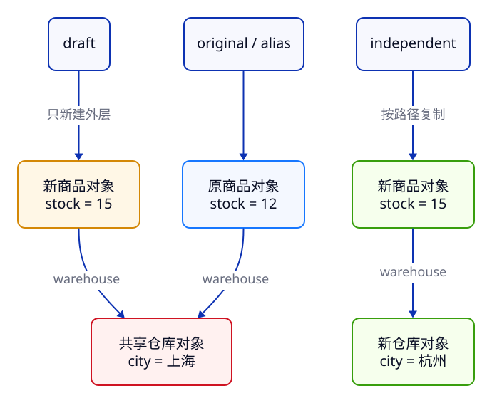

> **课号 C05 · 第 1 周 / 第 3 天 · 必修**  
> 前置：[C03 值、类型、转换与比较](../c03-values-types/) 与 [C04 变量、作用域与控制流](../c04-scope-control/)；会读条件、循环、`try/catch`，知道 `const` 不冻结对象。  
> 时间：阅读与跟做约 50 分钟，独立练习约 40–50 分钟。4 周路线与 C06 同一天，8 周路线可拆开完成。  
> 资料核查：2026-10-15。浏览器 Console 为主线，无需安装 Node 或第三方包。操作方式、验证状态分别标注。

## 1. 为什么编辑草稿会改到原商品？

C02 的卡片只有一个 `stock` 数字。商品多几个字段之后，我们自然会把它们放进一条记录：编号、名称、价格分、库存，以及仓库城市。接着会遇到两个业务问题：

- 编辑前想保存一份草稿，为什么草稿里的城市一改，原记录也变了？
- 导入文件已经通过 `JSON.parse`，为什么库存仍可能是字符串、负数，甚至整份数据是 `null`？

本课把**对象的身份**与**数据的格式**分开处理。你会创建商品、读取可缺省的字段、为修改路径创建新对象，并把外部 JSON 变成一条经过校验的内部记录。最后补齐编号清洗与日期交换的基础。

### 从 Java 带来哪些经验？

| Java 中的经验 | JS 中怎样理解 | 类比的边界 |
| --- | --- | --- |
| 用 DTO/record 聚合字段 | 用对象字面量写一条记录 | 本课对象无需先声明类或字段类型；字段也不会自动通过运行时校验 |
| 两个变量可指向同一对象 | `alias = original` 也保留同一对象身份 | 赋值不会自动复制字段，更不会递归复制嵌套对象 |
| 传递对象时可修改其字段 | 参数收到对象引用值的副本，仍能找到同一对象 | Java 与 JS 都是传值；修改字段与给参数重新赋值是两件事 |
| 字符串不可变 | `trim()` 等返回字符串，不修改原字符串 | `length` 统计 UTF-16 码元，未必等于用户眼中的字符数 |
| JSON 库反序列化 DTO | `JSON.parse` 把文本解析成 JS 值 | 它不会替你声明 DTO、校验业务字段或恢复 `Date` 实例 |

本课只借用最小的命名函数语法：`function importProduct(text) { ... }` 表示“给这段处理命名，接收 `text`，用 `return` 交回结果”；另一个短函数用于观察参数。函数作为值、闭包和箭头函数留给 C06，数组批量变换留给 C08。

## 2. 跟做环境与文件

**操作方式：自己尝试 · 浏览器 Console。**  
**验证状态：本课 O01、O02、J01、J02、S01 与参考答案，已在 Chrome 155.0.8059.40、Node 24.22.0 运行验证；完整记录见第 12 节。**

打开自己的 C02 本地页面，再打开 DevTools → Console。每次复制一个完整代码块；保留最外层 `{ ... }`，它利用 C04 的块作用域，避免反复跟做时重复声明同名 `const`。Console 最后可能额外显示表达式求值结果 `undefined`，本课列的是 `console.log` 输出。

所有文件见[仓库 examples/c05](https://github.com/socoo123/js_web/tree/main/examples/c05)，可以分别复制，互不依赖：

```text
c05-lab/
├── properties.js          对象属性与可选链
├── references.js          别名、浅复制与参数
├── json-boundaries.js     JSON 保留什么、丢失什么
├── import-product.js      完整导入器及失败输入
├── strings-dates.js       字符串与明确时区的日期
└── answers.js             独立练习 A、B 参考答案
```

**可选操作：自己尝试 · 本地 Node。** 若已经有 Node 24.22.0，进入实际的 `c05-lab` 目录执行 `node properties.js`，再把文件名换成其余文件；本课没有依赖，无需 `npm install`。没有 Node 就沿用 Console，运行时安装放到 C17。网站仓库的 npm 构建命令不属于这套练习。

## 3. 对象字面量：一条记录，不必先写 class

### 3.1 属性名和变量名是两件事

`{ id: "KB-001", stock: 12 }` 是对象字面量，逗号分隔属性，冒号左边是属性名，右边是表达式值。`{ id }` 是 `{ id: id }` 的简写，只有同名变量已经存在时才成立。

- `product.name` 固定读取名为 `name` 的属性。
- `product[field]` 先计算变量 `field`，再用它的值读取属性。
- `product.field` 固定找名为 `field` 的属性，不会替你读取变量。
- 名称包含连字符时，写 `product["display-name"]`；`product.display-name` 会被解析为减法。

本课普通对象的属性名都是字符串；对象也允许 Symbol 键，C09 再讨论字典选择与键类型。暂时不用 Java `Map.get` 的规则套所有属性行为。

**操作方式：自己尝试 · 浏览器 Console，O01。验证状态：已验证。**

```js title="properties.js"
{
  const id = "KB-001";
  const product = {
    id,
    name: "键盘",
    stock: 12,
    "display-name": "机械键盘",
    warehouse: { city: "上海", shelf: "A-03" },
    note: undefined,
  };
  const field = "stock";
  console.log(product.name, product[field], product["display-name"]);
  console.log(product.field);
  console.log(Object.hasOwn(product, "note"), Object.hasOwn(product, "missing"));

  const { name: productName, stock, category = "未分类" } = product;
  product.stock = 9;
  console.log(productName, stock, product.stock, category);
  const { note = "暂无备注" } = { note: null };
  console.log(note);

  console.log(product.supplier?.address?.city ?? "未提供");
  const supplier = null;
  console.log(supplier?.address?.city ?? "未提供");
  try {
    console.log((supplier?.address).city);
  } catch (error) {
    console.log(error.name);
  }
  product.category = "外设";
  delete product.note;
  console.log(product.category, Object.hasOwn(product, "note"));
}
```

预期日志：

```text
键盘 12 机械键盘
undefined
true false
键盘 12 9 未分类
null
未提供
未提供
TypeError
外设 false
```

`note` 存在且值是 `undefined`，`missing` 则不存在；单看读取结果区分不了。`Object.hasOwn(product, "note")` 检查对象**自身**是否具有这个属性。它不把原型上继承的属性算进去；原型在 C07 再展开。

普通对象可以添加、改写、删除属性。这里添加 `category`，再用 `delete product.note` 删除备注。`const product` 限制名字重新绑定，不限制这些属性操作。

### 3.2 解构是在读取当时的值

```js
const { name: productName, stock, category = "未分类" } = product;
```

这行从已有对象读取属性，声明三个局部变量：把 `name` 改名为 `productName`，把 `stock` 保持同名，给 `category` 设置默认值。它没有修改对象中的字段名，也没有创建会自动跟着对象变化的“绑定视图”。因此随后 `product.stock = 9`，局部 `stock` 仍为读取时的 12。

默认值只在读取结果为 **`undefined`** 时生效。例子里 `note: null` 不触发默认值，输出 `null`；这与 C03 的 `??` 会同时接管 `null` 和 `undefined` 不同。对 `null` 或 `undefined` 直接解构会抛错；先明确缺值策略，再解构。

### 3.3 可选链处理缺值，不验证完整格式

`product.supplier?.address?.city` 在相应接收者为 `null` 或 `undefined` 时短路，结果为 `undefined`；然后 `?? "未提供"` 给显示默认值。若最外层 `product` 也可能为空，应写 `product?.supplier?.address?.city`。

例子故意用 `(supplier?.address).city` 触发 `TypeError`：括号先结束了可选链，接着是在 `undefined` 上做普通 `.city` 访问。沿着可能缺失的整条路径安排 `?.`，不要凭视觉上有一个问号就认为都安全。

可选链也不负责声明不存在的变量、不负责把数字变成字符串，更不保证字段满足业务要求。城市是 `42` 时，`?.` 不会把它变成合法城市；导入时仍要校验。[可选链规范](https://tc39.es/ecma262/2026/multipage/ecmascript-language-expressions.html#sec-optional-chains)

## 4. 别名、浅复制与按路径更新

**操作方式：自己尝试 · 浏览器 Console，O02。验证状态：已验证。**

先预测前三行输出，再运行。`...original` 出现在对象字面量内，是**对象展开**：把源对象的自有可枚举属性复制到新对象。这里的普通数据属性都符合这个范围。

```js title="references.js"
{
  const original = { id: "KB-001", stock: 12, warehouse: { city: "上海" } };
  const alias = original;
  const draft = { ...original, stock: 9 };
  console.log(alias === original, draft === original);
  console.log(draft.warehouse === original.warehouse);
  alias.stock = 10;
  draft.warehouse.city = "杭州";
  console.log(original.stock, draft.stock, original.warehouse.city);

  const independent = {
    ...original,
    warehouse: { ...original.warehouse, city: "苏州" },
  };
  console.log(independent.warehouse === original.warehouse);
  console.log(original.warehouse.city, independent.warehouse.city);
  console.log(({ stock: 9, ...original }).stock);
  console.log(({ ...original, stock: 9 }).stock);

  function change(record) {
    record.stock = 7;
    record = { stock: 0 };
    console.log("参数改绑后", record.stock);
  }
  change(original);
  console.log("调用后", original.stock);
}
```

预期日志：

```text
true false
true
10 9 杭州
false
杭州 苏州
10
9
参数改绑后 0
调用后 7
```

### 4.1 为何两个外层不同，里面的城市仍会联动？

`const alias = original` 只把值复制给另一个绑定，两个名字仍指向同一对象。`alias.stock = 10` 就是在原对象上改库存。

`const draft = { ...original, stock: 9 }` 创建了新外层，`draft !== original`。但复制 `warehouse` 属性时，复制的是指向仓库对象的值，不是重新创建整个仓库。于是 `draft.warehouse === original.warehouse` 为 `true`，通过任意一侧修改城市，另一侧都读到杭州。



图只表达对象身份关系，不代表实际内存地址或引擎的内存布局。图中两个外层指向同一仓库；改仓库就是改共享对象。外层各自的数字库存则可以不同。

要独立改城市，用 `warehouse: { ...original.warehouse, city: "苏州" }` **把修改路径上的每层对象都重新创建**。本例只需新外层和新仓库；若仓库内还有可变地址对象，而你要修改地址，地址这一层也要重建。这个做法以后直接用于 React 状态更新。

### 4.2 后出现的同名属性覆盖前面的

`{ stock: 9, ...original }` 的库存被后面的源数据覆盖为 10；`{ ...original, stock: 9 }` 才把库存设成 9。看到展开时，按从左到右读，不要只检查有没有写期望值。

对象展开是浅复制，不是通用克隆器：它不递归复制内层对象，也不会把源对象的原型和所有隐藏属性原样搬过去。本课对象是普通业务数据，足够用显式路径更新；不靠 JSON 往返伪装通用深复制。[对象展开的规范算法](https://tc39.es/ecma262/2026/multipage/ecmascript-language-expressions.html#sec-object-initializer)

## 5. 参数传值：改字段与改参数各影响谁？

在 O02 的 `change(original)` 中，参数 `record` 收到对象引用值的副本。一开始它与外面的 `original` 都能找到同一个对象：

1. `record.stock = 7` 改的是共享对象的属性，调用方随后能读到 7。
2. `record = { stock: 0 }` 只让函数内的参数改为指向另一个新对象。
3. 调用方的 `original` 没有被重新赋值，所以最终仍为 7，不是 0。

这与 Java 对象参数的核心结论一致：**两者都是传值。** “调用中能改对象”不足以证明“按引用传参”。如果真能通过形参直接替换调用方的变量，第二步就会替换外面的 `original`；本例已经给出了相反证据。Java 具体的类型检查、字段访问控制和 JS 仍不同。[Oracle：对象参数也按值传递](https://docs.oracle.com/javase/tutorial/java/javaOO/arguments.html)

调试时同时问两个问题：“两个名字是否指向同一对象？”和“这一行是改属性，还是重新赋值某个名字？”比“对象会共享”更容易定位具体影响。

## 6. JSON 文本与 JS 对象分别负责什么？

JSON 是数据文本格式；JS 对象是运行中的值。下面两种写法外观相似，作用不同：

| 内容 | 含义 |
| --- | --- |
| `{ id: "KB-001", stock: 12 }` | JS 对象字面量，可用变量、表达式等 JS 语法 |
| `'{"id":"KB-001","stock":12}'` | 一个 JS 字符串，字符串内容遵循 JSON 语法 |
| `JSON.parse(text)` | 从合法 JSON 文本解析出 JS 值；不保证结果是商品对象 |
| `JSON.stringify(value)` | 尝试生成 JSON 文本；不保证保留 JS 值的所有信息 |

JSON 的键必须用双引号；不能加注释、尾逗号、`undefined` 或函数。它允许对象、数组、字符串、数值、布尔值和 `null`，因此 `JSON.parse("null")` 成功不奇怪。解析数据用 `JSON.parse`，不把数据文本当代码运行。

**操作方式：自己尝试 · 浏览器 Console，J01。验证状态：已验证。**

```js title="json-boundaries.js"
{
  const text = '{"id":"KB-001","stock":12}';
  const parsed = JSON.parse(text);
  console.log(typeof text, typeof parsed, parsed.stock);
  console.log(JSON.stringify({ id: "KB-001", note: undefined, stock: NaN }));
  console.log(JSON.stringify([undefined, NaN, Infinity]));
  console.log(JSON.stringify(undefined));
  const dated = { updatedAt: new Date("2026-10-15T01:30:00Z") };
  const restored = JSON.parse(JSON.stringify(dated));
  console.log(restored.updatedAt, typeof restored.updatedAt);
  const first = { stock: 12 };
  const pair = { left: first, right: first };
  const roundTrip = JSON.parse(JSON.stringify(pair));
  console.log(pair.left === pair.right, roundTrip.left === roundTrip.right);
  try {
    JSON.stringify({ stock: 12n });
  } catch (error) {
    console.log("BigInt", error.name);
  }
  const cycle = {};
  cycle.self = cycle;
  try {
    JSON.stringify(cycle);
  } catch (error) {
    console.log("循环", error.name);
  }
}
```

预期日志：

```text
string object 12
{"id":"KB-001","stock":null}
[null,null,null]
undefined
2026-10-15T01:30:00.000Z string
true false
BigInt TypeError
循环 TypeError
```

这里没有自定义 `toJSON` 或替换器，观察的是默认行为：对象中值为 `undefined` 的属性被省略，数组相应位置变为 `null`；`NaN` 与无穷大也会转为 `null`。顶层 `undefined` 的结果是 JS 的 `undefined`，并非字符串 `"undefined"`。函数与 Symbol 值也不能靠默认 JSON 表达。

日期实例往返后是字符串，两个属性原先共享的对象往返后成了两个独立对象。默认序列化遇到 BigInt 或循环引用会抛 `TypeError`。所以 `JSON.parse(JSON.stringify(value))` 只适合你明确接受这些数据约束的场景，不能称作“任何对象的深复制”。

确实需要复制受支持的数据图时，可以另查宿主提供的 [`structuredClone` 规则](https://html.spec.whatwg.org/multipage/structured-data.html#structured-cloning)，但它也不复制任意函数、任意类行为。本课先把记录结构设计清楚，不引入通用复制工具。[JSON 解析与序列化规范](https://tc39.es/ecma262/2026/multipage/structured-data.html#sec-json-object)

## 7. 商品导入：解析、校验、转换三步走

**操作方式：自己尝试 · 浏览器 Console，J02。验证状态：正常记录与七条失败输入已验证。**

内部商品约定：编号与名称是非空字符串；库存与价格分是非负安全整数；仓库可省略，提供时必须是带非空城市的对象。省略仓库得到“未提供”；明确写 `warehouse: null` 则报错，这是本导入格式的业务约定。

我们不把库存字符串 `"12"` 自动当 12。C03 学过的 `Number` 转换适合表单等已知场景；导入格式既然约定数字，类型写错就报告，让数据提供方修正。价格继续使用整数分，避免通过小数金额计算引入额外误差。

```js title="import-product.js"
{
  function importProduct(text) {
    const raw = JSON.parse(text);
    if (raw === null || typeof raw !== "object" || Array.isArray(raw)) {
      throw new Error("商品必须是对象");
    }
    if (typeof raw.id !== "string" || raw.id.trim() === "") {
      throw new Error("编号必须是非空字符串");
    }
    if (typeof raw.name !== "string" || raw.name.trim() === "") {
      throw new Error("名称必须是非空字符串");
    }
    if (!Number.isSafeInteger(raw.stock) || raw.stock < 0) {
      throw new Error("库存必须是非负安全整数");
    }
    if (!Number.isSafeInteger(raw.priceCents) || raw.priceCents < 0) {
      throw new Error("价格分必须是非负安全整数");
    }
    let city = "未提供";
    if (raw.warehouse !== undefined) {
      if (raw.warehouse === null || typeof raw.warehouse !== "object"
          || Array.isArray(raw.warehouse)) {
        throw new Error("仓库必须是对象");
      }
      if (typeof raw.warehouse.city !== "string" || raw.warehouse.city.trim() === "") {
        throw new Error("仓库城市必须是非空字符串");
      }
      city = raw.warehouse.city.trim();
    }
    return {
      id: raw.id.trim().toUpperCase(),
      name: raw.name.trim(),
      stock: raw.stock,
      priceCents: raw.priceCents,
      warehouse: { city },
    };
  }

  const good = '{"id":" kb-001 ","name":" 键盘 ","stock":12,"priceCents":19900,"warehouse":{"city":" 上海 "},"debug":true}';
  const product = importProduct(good);
  console.log(JSON.stringify(product));
  console.log(Object.hasOwn(product, "debug"));

  const badInputs = [
    '{"stock":12,}',
    'null',
    '[]',
    '{"id":"KB-001","name":"键盘","stock":"12","priceCents":19900}',
    '{"id":"KB-001","name":"键盘","stock":-1,"priceCents":19900}',
    '{"id":"KB-001","name":"键盘","stock":1.5,"priceCents":19900}',
    '{"id":"KB-001","name":"键盘","stock":12,"priceCents":19900,"warehouse":null}',
  ];
  for (const text of badInputs) {
    try {
      importProduct(text);
    } catch (error) {
      console.log(error.name === "SyntaxError" ? "JSON 语法错误" : error.message);
    }
  }
}
```

预期日志：

```text
{"id":"KB-001","name":"键盘","stock":12,"priceCents":19900,"warehouse":{"city":"上海"}}
false
JSON 语法错误
商品必须是对象
商品必须是对象
库存必须是非负安全整数
库存必须是非负安全整数
库存必须是非负安全整数
仓库必须是对象
```

### 怎样读这段导入器？

第一步 `JSON.parse` 只处理语法。失败会抛 `SyntaxError`，文件末尾用统一中文信息显示，避免依赖某个浏览器的英文报错措辞。

第二步检查形状与字段。`typeof null === "object"`，数组的 `typeof` 也为 `"object"`，所以对象入口检查必须单独排除它们。`Array.isArray` 在这里仅判断数组；数组遍历 API 在 C08 再学。字符串先检查类型，才调用 `trim()`；条件的短路避免了对数字调用字符串方法。`Number.isSafeInteger` 同时排除字符串、小数、非有限值和不安全整数，再检查不能小于 0。

第三步用新的对象字面量构造内部记录。我们逐个选择需要的字段、清理首尾空白、统一 ASCII 编号大写。输入里的 `debug` 没被带入，输入仓库也没有直接共享给输出。今后加字段要同步修改格式约定、校验与构造部分，不是直接把任意输入展开进商品。

**JSON 合法不等于业务合法；业务数值看起来像整数，也不保证原始文本没发生精度丢失。** 超过安全整数范围的大编号应约定用字符串传输；`JSON.parse` 把 JSON 数字转成 Number 后，无法推回已经舍入的原始数字。这里把商品编号规定为字符串、数值字段限制在安全整数范围。

本课只转换一条内存记录，不处理文件选择、存储或服务器提交。C14 再把这条边界接到页面存储；后续有 TypeScript 类型时，外部数据的运行时校验仍然需要保留。

## 8. 字符串：清洗、查找和截取都返回什么？

**操作方式：自己尝试 · 浏览器 Console，S01。验证状态：以下完整文件已验证，且 UTC 与 Pacific/Honolulu 两个 Node 时区下日志一致。**

字符串在这里主要承担编号、名称、JSON 文本与日期文本。先看同一文件的字符串部分，再读日期部分。

```js title="strings-dates.js"
{
  const rawId = " kb-001 ";
  const id = rawId.trim().toUpperCase();
  console.log(id, rawId === " kb-001 ");
  console.log(id.startsWith("KB-"), id.includes("001"));
  console.log(id.slice(3), "001".padStart(5, "0"));
  console.log("键盘/黑色".replace("黑色", "白色"));
  console.log(JSON.stringify("键盘,鼠标".split(",")));
  console.log(`商品 ${id}，剩余 ${12} 件`);
  console.log("😀".length);

  const utc = new Date("2026-10-15T01:30:00Z");
  const offset = new Date("2026-10-15T09:30:00+08:00");
  console.log(utc.getTime() === offset.getTime());
  console.log(offset.toISOString());
  console.log(utc.getUTCFullYear(), utc.getUTCMonth() + 1, utc.getUTCDate());
  console.log(Number.isNaN(new Date("not-a-date").getTime()));
  const nearMidnight = new Date("2026-10-15T00:30:00+08:00");
  console.log(nearMidnight.toISOString().slice(0, 10));
}
```

完整预期日志：

```text
KB-001 true
true true
001 00001
键盘/白色
["键盘","鼠标"]
商品 KB-001，剩余 12 件
2
true
2026-10-15T01:30:00.000Z
2026 10 15
true
2026-10-14
```

常用操作按输入/输出记，比一次背全 API 更有用：

| 操作 | 本例作用 | 返回值与边界 |
| --- | --- | --- |
| `trim()` | 去掉编号首尾空白 | 新字符串；中间的空格不会全删掉 |
| `toUpperCase()` / `toLowerCase()` | 统一编号/搜索文本大小写 | 新字符串；本课 ASCII 编号规则不能直接当所有语言的人名规范 |
| `startsWith()` / `includes()` | 检查编号前缀/包含片段 | 布尔值；默认区分大小写 |
| `slice(start, end)` | 取编号后缀 | 从 0 开始，终点不包含；省略终点取到末尾 |
| `padStart(5, "0")` | 给短序号补零 | 新字符串，不会把数值本身改成别的数 |
| `replace("黑色", "白色")` | 替换第一个匹配片段 | 新字符串；这里传普通字符串，只替换第一次出现 |
| `split(",")` | 按分隔符拆成片段 | 返回数组；它不是通用 CSV 解析器，不处理引号内逗号等规则 |
| 模板字符串 | 用反引号和 `${表达式}` 组合显示内容 | 返回字符串；普通单引号不会插值 |

第一行的 `true` 证明 `rawId` 仍是原字符串。与 Java 的 `String` 相似，改的是接收结果的变量，不是原字符串的内部内容。

`"😀".length` 为 2，因为 JS 的字符串长度按 UTF-16 码元计数。不要把 `length` 直接承诺为“用户看到的字数”；组合字符和 emoji 还会让这个问题更复杂。字符串方法与码元定义可查 [ECMAScript 字符串章节](https://tc39.es/ecma262/2026/multipage/text-processing.html#sec-string-objects)。

## 9. 日期：时刻、时区和业务日期分开保存

`new Date(...)` 创建日期对象，内部表示一个以毫秒为单位的时间值；它不会保留输入时的 `+08:00` 作为对象专属时区。`getTime()` 可用来比较这两个对象是否表示同一时刻。

S01 中的 `01:30:00Z` 和 `09:30:00+08:00` 相差八小时的钟表读数，却是同一时刻，所以比较结果为 `true`。`Z` 表示 UTC；`toISOString()` 统一输出 UTC，并带 `Z`，于是结果固定为 `2026-10-15T01:30:00.000Z`。

### 哪些写法容易让不同电脑得出不同结果？

- `getFullYear()`、`getMonth()` 等不带 `UTC` 的方法使用当前环境本地时区；`toString()` 和默认本地化显示也可能因环境而异。本课固定输出用 `getUTC...` 与 `toISOString()`。
- `getUTCMonth()` 从 0 计数，所以显示十月要加 1；日期 `getUTCDate()` 则直接返回日号。
- 在标准日期时间字符串里，只有日期的 `"2026-10-15"` 按 UTC 解释，而不带偏移的日期时间 `"2026-10-15T09:30:00"` 按本地时区解释。交换“时刻”时明确带 `Z` 或偏移，避免把这两种情况混用。
- `"10/15/2026"` 之类自选格式不作为本课的交换格式；日期文本的宽松解析不能替代业务日历校验。

非法文本会产生无效 Date；`Number.isNaN(date.getTime())` 可以检查它。无效日期直接调用 `toISOString()` 会抛异常；实际导入日期字段时，先约定格式并校验，再转换。

最后一条日志值得单独看：上海时区 10 月 15 日凌晨 00:30 对应 UTC 的 **10 月 14 日**。直接 `toISOString().slice(0, 10)` 得到 `2026-10-14`，不能当作上海业务日期。

因此库存记录可这样设计：

| 业务含义 | 建议约定 | 例子 |
| --- | --- | --- |
| 某次变更发生的时刻 | 带时区的 ISO 文本，统一传 UTC | `updatedAt: "2026-10-15T01:30:00.000Z"` |
| 盘点属于哪一天 | 独立保存并校验的业务日期文本 | `countedOn: "2026-10-15"`，不先转换为时刻再截 UTC 日期 |
| 展示给哪个地区的人 | 显式选择展示时区 | 显示层可用 `Intl.DateTimeFormat` 的 `timeZone` 选项；本课没有执行本地化展示验收 |

不要用“加固定毫秒数”概括所有地区的日历加一天；夏令时等规则可能影响本地时间。这里先把交换格式与业务含义区分清楚。[Date 与标准日期时间字符串规范](https://tc39.es/ecma262/2026/multipage/numbers-and-dates.html#sec-date-objects)

## 10. 自己尝试：先留下证据，再看答案

以下起始数据与参考答案均已运行；你自己修改后的版本需要重新验收。面板入口延续 C02；本课实际执行的是 Console 代码，没有把手动点击面板写成已测试。

### 练习 A：编辑城市，保留原记录（必做，约 15 分钟）

**操作方式：自己尝试 · 浏览器 Console。验证状态：起始故障及参考答案 A01 已验证。**

```js
{
  const original = { id: "KB-001", stock: 12, warehouse: { city: "上海", shelf: "A-03" } };
  const draft = { ...original };
  draft.warehouse.city = "杭州";
  draft.stock = 9;
  console.log(original.stock, original.warehouse.city);
  console.log(original.warehouse === draft.warehouse);
}
```

故障输出是 `12 杭州` 和 `true`。目标是原记录保持 `12 / 上海 / A-03`，草稿为 `9 / 杭州 / A-03`，两个外层和两个仓库都不同。不要为修复这个问题修改原记录，也不要使用 JSON 往返。

先在更改前比较两个仓库身份，再更改城市，最后用 `JSON.stringify(original)` 留下当时的文本结果。观察对象时，DevTools 可能在展开时读取后来的属性值；身份比较和当时的文本能把证据说清楚。若放到本地 JS 文件，用 C02 的 Sources 断点停在改城市那一行，查看两个表达式是否相等，再单步。

<details>
<summary>提示 A：哪条路径被修改了？</summary>

<p>目标属性路径是 <code>draft.warehouse.city</code>。已有新外层，仍缺一个新的 <code>warehouse</code>。复制仓库现有字段，再覆盖城市；否则容易在修城市时丢掉货架号。</p>

</details>

<details>
<summary>参考答案 A：为外层和仓库各创建一个对象</summary>

```js
{
  // 练习 A：只为要改的路径创建新对象。
  const original = { id: "KB-001", stock: 12, warehouse: { city: "上海", shelf: "A-03" } };
  const draft = { ...original, warehouse: { ...original.warehouse, city: "杭州" } };
  draft.stock = 9;
  console.log(original.stock, original.warehouse.city, original.warehouse.shelf);
  console.log(draft.stock, draft.warehouse.city, draft.warehouse.shelf);
  console.log(original !== draft, original.warehouse !== draft.warehouse);
}
```

```text
12 上海 A-03
9 杭州 A-03
true true
```

<p>新仓库保留原货架。只复制发生变化的路径就满足当前需求；这不意味着对象里未来新增的每个嵌套值都已独立复制。</p>

</details>

### 练习 B：深层字段缺失与错误类型分开（必做，约 15 分钟）

**操作方式：自己尝试 · 浏览器 Console。验证状态：数据与参考答案 A02 已验证。**

依次处理 `{}`、`{ supplier: null }`、`{ supplier: { address: { city: " 上海 " } } }`、`{ supplier: { address: { city: 42 } } }`。

预期依次显示 `未提供 / 未提供 / 上海 / 城市格式错误`。要求使用可选链读取；只允许 `null`、`undefined` 进入缺值默认分支；数字和空白城市应报告格式错误。可以用 C04 的 `for...of` 和条件判断，不需要 `map` 或回调。

<details>
<summary>提示 B：先取得值，再决定它属于哪一种情况</summary>

<p>不要一口气写 <code>product.supplier?.address?.city.trim()</code>。保存城市值；先判断缺值，再验证字符串，最后调用 <code>trim()</code>。可选链和类型校验各处理一类问题。</p>

</details>

<details>
<summary>参考答案 B：缺值默认，错误类型显式报告</summary>

```js
{
  // 练习 B：缺值可有默认，错误类型必须暴露出来。
  const records = [{}, { supplier: null }, { supplier: { address: { city: " 上海 " } } },
    { supplier: { address: { city: 42 } } }];
  for (const product of records) {
    const city = product.supplier?.address?.city;
    if (city === undefined || city === null) {
      console.log("未提供");
    } else if (typeof city !== "string" || city.trim() === "") {
      console.log("城市格式错误");
    } else {
      console.log(city.trim());
    }
  }
}
```

```text
未提供
未提供
上海
城市格式错误
```

<p>练习 B 的数据用于展示深层读取策略；J02 的导入器采用另一条明确的仓库格式约定，不应把“任何坏数据一律默认”当通用修复。</p>

</details>

### 练习 C：独立核对一份导入记录（必做，约 10–15 分钟）

**操作方式：自己尝试 · 浏览器 Console，修改 J02 的输入后重跑整个块。验证状态：第 12 节列出的这些变体已验证。**

从正常 JSON 起，每次只改变一个字段：

1. 去掉整个 `warehouse`，库存设为 0。应保留 0，并创建城市为“未提供”的新仓库。
2. `priceCents` 改成字符串 `"19900"`。应报价格分错误。
3. `id` 改成全空格。应报编号错误。
4. 库存改成 `9007199254740992`。应报库存错误，不接收不安全整数。
5. 增加 `"__proto__":{"polluted":true}`。输出仍只有约定字段，不把未知字段并入内部记录。

验收时比较返回 JSON 文本，而不只看有没有抛错。正常数据应完整，错误数据应在相应边界被拒绝；不是每个失败都写成“JSON 语法错误”。

<details>
<summary>参考答案 C：按三步边界解释结果</summary>

<ol>
<li>省略仓库是格式允许的缺省；库存 0 是合法业务值，不应该被 <code>||</code> 换成默认库存。</li>
<li>数字字符串未满足 <code>Number.isSafeInteger</code>，因此拒绝，不自动转换。</li>
<li>空格经过 <code>trim()</code> 变为空串，编号校验失败。</li>
<li>输入库存不在安全整数范围，不能作为本课允许的库存值。</li>
<li><code>JSON.parse</code> 只解析出数据属性；导入器随后逐字段重建记录，未知属性不进入结果。不要把这一练习解读成可以随意合并任何外部对象。</li>
</ol>

</details>

## 11. 带走什么，下一课用在哪里？

现在库存已经有了内部记录格式：外部文本先解析、再验证、再构造；编辑时判断共享路径；显示时把字符串和日期的业务含义说清楚。这几条边界会延续到 React 的编辑草稿、UI5 的数据模型，以及任何接口返回的数据。

合上本文，尝试独立回答：

1. `product[field]` 与 `product.field` 分别读取哪个属性？
2. 解构默认值遇到 `null` 会怎样？可选链能否校验城市类型？
3. 为什么 `{ ...original }` 的外层不同，仓库仍共享？怎样只重建要改的路径？
4. 参数内改属性与给参数赋新对象，哪个会改变调用方看到的原对象？
5. JSON 解析成功以后还缺哪些校验？默认 JSON 往返丢失了哪些信息？
6. UTC 日期为何可能与上海业务日期差一天？

上一课：[C04 变量、作用域与控制流](../c04-scope-control/)。下一课 C06「函数、闭包与高阶操作」会把记录转换封装成可复用函数，再解释函数为什么能保存外部变量；该课尚未发布时，按目录进度继续即可。

## 12. 验证记录与官方来源

核查日期 **2026-10-15**。以下来源采用正式 ECMAScript 2026 分章版核对已有语言能力；不是把这些能力都说成 ES2026 新增功能，也不把编辑草案和运行环境支持当成同一件事。

| 示例 | 操作方式 | 验证状态与结果 |
| --- | --- | --- |
| O01 `properties.js` | 自己尝试 · Console；Node 可选 | 已验证：属性读取、自有属性、解构快照、`null` 默认边界、可选链与分组 `TypeError` |
| O02 `references.js` | 自己尝试 · Console；Node 可选 | 已验证：别名、浅复制共享仓库、路径更新独立、覆盖顺序、参数改绑不替换调用方变量 |
| J01 `json-boundaries.js` | 自己尝试 · Console；Node 可选 | 已验证：省略/转 `null`、顶层 `undefined`、Date 变字符串、别名关系丢失、BigInt/循环错误 |
| J02 `import-product.js` | 自己尝试 · Console；Node 可选 | 已验证：正常投影与七个失败输入；另验库存 0/缺省仓库、价格字符串、空编号、不安全库存、未知字段 |
| S01 `strings-dates.js` | 自己尝试 · Console；Node 可选 | 已验证：字符串操作、UTF-16 长度、同一时刻、固定 UTC 输出、非法日期与跨日；Node UTC/Honolulu 日志一致 |
| 练习 A 起始故障、A/B 答案 | 自己尝试 · Console；Node 可选 | 已验证：原城市被误改可复现；修复后原记录完整、两层身份独立；深层缺值与错误类型分开 |
| Sources 断点跟做、Intl 展示建议 | 自己尝试 / 讲解 | 已核对资料，未逐项执行手动面板操作或本地化展示验收 |

执行环境：macOS arm64，Chrome **155.0.8059.40**，Node **24.22.0**；浏览器协议执行六个完整文件并与 Node 日志逐行比较，结果一致。额外导入边界与起始故障使用同一运行时验证，命令、实际输出和边界记录在[示例 README](https://github.com/socoo123/js_web/blob/main/examples/c05/README.md)。Edge、Safari、Windows、真实手机上的这些代码未逐项执行，不据此宣称跨浏览器测试全部通过。

- [ECMAScript 2026：对象初始化与展开](https://tc39.es/ecma262/2026/multipage/ecmascript-language-expressions.html#sec-object-initializer)；[可选链](https://tc39.es/ecma262/2026/multipage/ecmascript-language-expressions.html#sec-optional-chains)；[绑定与解构初始化](https://tc39.es/ecma262/2026/multipage/ecmascript-language-statements-and-declarations.html#sec-destructuring-binding-patterns)。
- [ECMAScript 2026：Object.hasOwn](https://tc39.es/ecma262/2026/multipage/fundamental-objects.html#sec-object.hasown)。
- [ECMAScript 2026：JSON.parse 与 JSON.stringify](https://tc39.es/ecma262/2026/multipage/structured-data.html#sec-json-object)。
- [ECMAScript 2026：Date、日期时间字符串与 Date.parse](https://tc39.es/ecma262/2026/multipage/numbers-and-dates.html#sec-date-objects)。
- [ECMAScript 2026：字符串及常用方法](https://tc39.es/ecma262/2026/multipage/text-processing.html#sec-string-objects)；[字符串类型与 UTF-16](https://tc39.es/ecma262/2026/multipage/ecmascript-data-types-and-values.html#sec-ecmascript-language-types-string-type)。
- [Oracle Java 教程：对象参数也按值传递](https://docs.oracle.com/javase/tutorial/java/javaOO/arguments.html)。该页基于 JDK 8，引用的是稳定的参数机制，不作为当前 Java 工具安装指南。
- [WHATWG：结构化克隆](https://html.spec.whatwg.org/multipage/structured-data.html#structured-cloning)；[ECMA-402：Intl.DateTimeFormat](https://tc39.es/ecma402/2026/#sec-intl-datetimeformat-constructor)。
