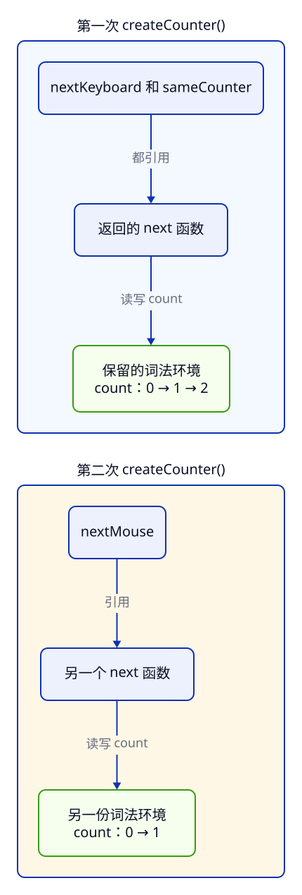

> **第 1 周 · 第 3 天** · 阅读跟做约 45 分钟 · 练习约 40 分钟  
> 前置：C04、C05 · 运行：Node 24；断点练习用 Chrome · 示例已运行验证

## 这一课解决什么问题

库存页要按「外设」「配件」筛选。同事为每个分类复制了一段循环，你想把循环留下，只替换判断规则。规则能像商品对象一样，直接作为参数传进去吗？

再往前一步：能不能先指定分类，得到一个以后拿来就用的判断函数？生成它的函数已经执行完了，它又从哪里找到原来的分类？

学完你能：

- 在函数声明、函数表达式和箭头函数之间选择，分清函数与调用结果
- 使用默认参数和 rest 参数，解释漏写 `return` 后的 `undefined`
- 用词法作用域解释闭包，写出独立计数器和共享状态
- 把判断规则交给高阶函数，完成分类筛选工厂
- 在 Scope 中观察绑定，修复循环里三个函数都读到 3 的错误

### 准备 Node 和示例

本课使用 **Node 24 LTS**（长期支持版）。[官方版本表](https://nodejs.org/en/about/previous-releases)目前把 Node 26 列为 Current、Node 23 列为 EOL（已结束支持）；开始学习时选择仍受支持的 LTS，安装该主版本的最新补丁。

1. 首次安装：打开 [Node 官方下载页](https://nodejs.org/en/download)，选择 **Node 24 LTS** 和你的操作系统。
2. Windows/macOS 可下载官方安装包并按向导安装；已有 Node 的电脑沿用原来的安装工具，Homebrew 用户见下面的步骤。
3. 重开终端，运行 `node --version` 和 `npm --version`；前者应以 `v24.` 开头，后者应打印版本号。
4. 下载或克隆 [课程仓库](https://github.com/socoo123/js_web)，在终端进入 `examples/c06`。
5. 运行 `node function-values.js`；下面带文件名的 JS 代码都可以这样运行，无需安装第三方包。

<details>
<summary>macOS 已经用 Homebrew 安装过 Node：升级并切换到 Node 24</summary>

在任意目录的终端执行，安装 [Homebrew 的 node@24](https://formulae.brew.sh/formula/node@24)：

```sh
brew install node@24
export PATH="$(brew --prefix node@24)/bin:$PATH"
node --version
npm --version
```

`node@24` 安装 Node 24 的最新补丁；第二行让当前终端优先使用它。把第二行也加入 `~/.zshrc`，新开的 zsh 终端才会保持这个选择。预期 `node --version` 以 `v24.` 开头；如果仍显示旧版本，运行 `command -v node` 检查命令路径，应指向 Homebrew 的 `opt/node@24/bin/node`。

</details>

Node 是运行 JS 的程序。这里先把它当成 Java 的 `java` 命令：把文件交给运行时执行。阅读课程和运行这些例子，也不需要先启动网站工程。每个文件单独运行，变量相互独立；短片段也能粘贴到浏览器 Console。

## Java 程序员先看这里

| Java 经验 | JavaScript 写法 | 关键差异 |
| --- | --- | --- |
| 用函数式接口承接 lambda | `const rule = stock => stock > 0` | 函数本身就是值，不需要声明接口 |
| `predicate.test(product)` | `predicate(product)` | 用括号直接调用，返回值由函数体决定 |
| 重载方法提供默认值 | `function label(name = "未命名")` | 省略或传 `undefined` 才启用默认值 |
| `int... stocks` 可变参数 | `...stocks` | 得到普通数组，参数没有静态类型约束 |
| lambda 捕获 final / effectively final 局部变量 | 闭包可以读写外层 `let` 绑定 | 读到的是绑定当前的值；每次工厂调用各有一份 |

## 1. 函数是值：先分清函数和调用

函数可以赋给变量、传给别的函数，也可以作为返回值。这叫函数是「一等值」。先看三种常见写法：

```js title="function-values.js"
console.log(isAvailable(12)); // → true
function isAvailable(stock) {
  return stock > 0;
}

const isSoldOut = function (stock) {
  return stock === 0;
};
const stockLabel = stock => `库存 ${stock} 件`;
const savedLabel = stockLabel;
console.log(isSoldOut(0)); // → true
console.log(savedLabel(12)); // → 库存 12 件
console.log(typeof savedLabel, savedLabel === stockLabel); // → function true
```

`function isAvailable(...)` 是**函数声明**；`function (stock) { ... }` 放在赋值右边，是**函数表达式**；`stock => ...` 是**箭头函数表达式**。三种写法都创建可调用的函数对象，`typeof` 得到 `"function"`。

第一行在声明前调用仍然得到 `true`：在这段顶层代码所在的作用域里，函数声明会在执行语句前建立并初始化。后两种写法先经过变量初始化，才能使用；如果把 `isSoldOut(0)` 移到它的 `const` 之前，会遇到 C04 的暂时性死区。

**函数名后面有没有括号，含义不同。** `stockLabel` 表示函数值，`stockLabel(12)` 表示现在调用它，得到字符串 `"库存 12 件"`。`const savedLabel = stockLabel` 只复制函数引用，所以最后一行比较是 `true`。这和 C05 把对象赋给另一个变量一样，两个名字指向同一对象。

箭头函数适合短判断和回调：一个参数可以省略参数外的括号；没有参数或多个参数要加括号，例如 `() => 1`、`(stock, amount) => stock + amount`。表达式函数体直接返回表达式结果，写成花括号函数体时则要显式 `return`。没有返回值的调用结果是 `undefined`。

Java 的 `Product::getName` 可以交给函数式接口；JS 直接传函数值，用 `fn(...)` 调用。[箭头函数](https://developer.mozilla.org/zh-CN/docs/Web/JavaScript/Reference/Functions/Arrow_functions) 没有自己的 `this` 和 `arguments`，也不能用 `new` 调用；本课的判断函数只使用明确的参数。

## 2. 参数：缺省值、默认值和 rest

少传参数时，对应形参得到 `undefined`；默认参数只在这个位置是 `undefined` 时生效。额外的实参可以用 [`...rest`](https://developer.mozilla.org/zh-CN/docs/Web/JavaScript/Reference/Functions/rest_parameters) 收成数组，按需处理。

**先猜一猜：** 空字符串和 `null` 会换成「未命名」吗？不传库存给 `sumStock` 呢？

```js title="parameters.js"
function label(name = "未命名") {
  return name;
}
console.log(label());          // → 未命名
console.log(label(undefined)); // → 未命名
console.log(label(""));        // → 空行
console.log(label(null));      // → null

function sumStock(...stocks) {
  let total = 0;
  for (const stock of stocks) total += stock;
  return total;
}
console.log(sumStock(12, 0, 7, 3, 25, 5)); // → 52
console.log(sumStock());                  // → 0
```

前四行依次打印「未命名」「未命名」、一个空行、`null`。空字符串和 `null` 都是明确传入的值，保留原样；只有省略实参或传 `undefined` 才使用默认值。这与 C05 解构的默认值规则一致，也与 `??` 有区别：`??` 还会处理 `null`。

`...stocks` 放在形参列表末尾，把这一位置以后的实参收成一个真正的数组。六件商品的库存被收成 `[12, 0, 7, 3, 25, 5]`，所以结果是 52。没有实参时得到空数组，循环执行零次，返回初始总数 0。rest 前可以有普通参数，后面就不能再跟形参。

C05 的 `...product` 出现在对象字面量中，用来展开字段；这里的 `...stocks` 出现在函数形参中，用来收集实参。看它出现的位置，就能判断是在「收」还是「展开」。调用时写 `sumStock(...[12, 0, 7])` 则是把数组展开成三个实参，得到 19。

Java 的可变参数有元素类型，JS 数组能混放不同类型。这里约定 `sumStock` 接收已校验的数字库存；外部文本仍按 C03 的步骤先转换再校验。

## 3. 词法作用域：看定义位置，不看调用位置

函数读一个外部名字时，沿着**定义位置**的外层作用域查找。这叫词法作用域。「词法」在这里指代码写在哪里，和它从哪个函数里被调用无关。

**先猜一猜：** `readCategory()` 在声明了「配件」的函数内部调用，最终读到哪个分类？

```js title="lexical-scope.js"
const category = "外设";
function readCategory() {
  return category;
}
function showFromAnotherScope() {
  const category = "配件";
  return readCategory();
}
console.log(showFromAnotherScope()); // → 外设
```

输出是 `外设`。`readCategory` 定义在顶层，它查找 `category` 时，先查自己的局部作用域，再查定义处的顶层作用域，找到「外设」。`showFromAnotherScope` 的局部 `category` 只对那里的代码可见；它调用别的函数时，不会把自己的局部变量塞进对方的查找链。

C04 已讲过「从内向外找绑定」，这里补上重要的一点：**外层由源码嵌套关系确定**。同名变量的覆盖关系也由这条路径确定。调试时，Call Stack 回答「谁调用了谁」，Scope 回答「当前函数能读到哪些绑定」，两个面板看的关系不同。

Java 的 lambda 也能读取定义处可见的外部变量。JS 同样按定义位置查找名字，只是普通 JS 函数也普遍具有这种能力，无需先创建一个持有分类字段的类。

## 4. 闭包：函数返回以后，绑定仍然可用

[`闭包`](https://developer.mozilla.org/zh-CN/docs/Web/JavaScript/Guide/Closures) 是函数与它可访问的词法环境的组合。最容易看见它的场景是：把内部函数返回，等外层函数执行完，再调用内部函数。

### 每次调用工厂，创建独立的绑定

`createCounter` 每次调用建立一个局部 `count`，返回的 `next` 读写它。`createCounter` 返回的是函数，所以调用分成两步：先创建计数器，再用得到的函数取下一次计数。

**先猜一猜：** 第二个名字 `sameCounter` 和第二次 `createCounter()`，哪个会得到独立计数？

```js title="counter.js"
function createCounter(start) {
  let count = start ?? 0;
  return function next() {
    count += 1;
    return count;
  };
}
const nextKeyboard = createCounter();
const sameCounter = nextKeyboard;
const nextMouse = createCounter();
console.log(nextKeyboard()); // → 1
console.log(sameCounter());  // → 2
console.log(nextMouse());    // → 1
```

三行依次输出 **1、2、1**。`nextKeyboard` 与 `sameCounter` 指向同一个返回函数，第一次把 `count` 从 0 改到 1，第二次继续改到 2。`nextMouse` 来自另一次工厂调用，它有另一份 `count`，从 0 开始。



分开看两次工厂调用：每一组都沿着「变量引用 → 函数 → 保留的词法环境」读取。外层调用已经结束，返回的函数仍可访问所需的绑定；它们会随着这些引用继续可达。

把 `count` 放在工厂内部，调用方只能通过返回的函数改变计数。函数仍被引用时，运行时会保留它需要的环境。

:::tip[自己尝试 · Node]
1. 在 `examples/c06` 运行 `node counter.js`，确认输出 1、2、1。
2. 把 `const nextMouse = createCounter();` 改成 `const nextMouse = nextKeyboard;`，再运行。
3. 恢复这一行，把第二次工厂调用改为 `createCounter(12)`。

预期：第 2 步输出 1、2、3，因为三个名字共享一个函数；第 3 步输出 1、2、13，因为第二次工厂调用从 12 开始。尝试后恢复原文件。
:::

### 闭包读取绑定当前的值

同一次工厂调用产生的多个函数，也可以共享一个绑定。下面一个函数查询阈值，另一个修改阈值：

```js title="shared-binding.js"
function createStockLimit(initial) {
  let limit = initial;
  return {
    accepts: stock => stock <= limit,
    setLimit: value => { limit = value; },
  };
}
const lowStock = createStockLimit(5);
console.log(lowStock.accepts(3)); // → true
lowStock.setLimit(2);
console.log(lowStock.accepts(3)); // → false
```

输出先是 `true`，然后是 `false`。两个箭头函数都在同一次 `createStockLimit(5)` 中创建，都向外找到同一个 `limit`。`setLimit(2)` 修改后，`accepts(3)` 读取到 2，所以判断变成假。

闭包保留的不是创建时的值快照。即使 `limit` 是数字这样的原始值，只要同一个绑定被重新赋值，后续调用就能读到新值。

Java lambda 捕获的局部变量必须是 final 或 effectively final，因此你不能直接在 lambda 中对捕获的局部 `int count` 做 `count++`。Java 可以通过对象字段保存可变状态；JS 的闭包直接允许读写外层 `let` 绑定。这是类比最需要停下来的地方。

### 在 Scope 中看见闭包

:::tip[自己尝试 · 本地网页]
1. 在 `examples/c06` 运行 `python3 -m http.server 8000 --bind 127.0.0.1`。
2. 用 Chrome 打开 `http://127.0.0.1:8000/`，按 F12 打开 Sources，左侧选 `counter.js`。
3. 单击 `count += 1;` 的行号设置断点，再刷新页面。
4. 右侧 Scope 展开 **Closure (createCounter)**，观察 `count`；按 F10 单步越过加法，再看一次。
5. 按 F8 继续到下次命中，依次看第二次、第三次调用。

预期：每次暂停在加法执行前，`count` 分别是 0、1、0；单步后分别是 1、2、1。前两次 Call Stack 分别来自 `nextKeyboard()` 和 `sameCounter()`，第三次来自 `nextMouse()`。完成后删除断点。
:::

## 5. 高阶函数：把循环和业务规则分开

接收函数作为参数，或返回函数的函数，叫**高阶函数**。闭包描述「函数能访问什么」，高阶函数描述「函数如何被传递」，两者常一起出现，关注点却不同。

先写一个接收判断规则的筛选函数。`predicate` 是谓词，也就是返回真假结果的判断函数；这里约定它返回布尔值。

```js title="select-products.js"
function selectProducts(products, predicate) {
  const selected = [];
  for (const product of products) {
    if (predicate(product)) selected.push(product);
  }
  return selected;
}
const products = [{ id: "P001", stock: 12 }, { id: "P002", stock: 0 }];
const hasStock = product => product.stock > 0;
const selected = selectProducts(products, hasStock);
console.log(selected.length, selected[0].id); // → 1 P001
console.log(products.length);                 // → 2
```

第一行输出 `1 P001`，第二行是 `2`。`selectProducts` 负责遍历和收集结果，`hasStock` 负责判断库存。循环每次都调用 `predicate(product)`，只有返回 `true` 才加入结果。

`hasStock` 是传进去的函数值；如果写成 `hasStock(products[0])`，传入的就提前变成了布尔结果。调用时机属于使用它的函数：本例中 `selectProducts` 逐个商品同步调用，没有等待任务，也没有创建线程。传给别的函数、由它调用的函数叫**回调**；回调完全可以是同步的。

结果是新数组，原数组长度仍为 2。里面装的却是原商品的引用：对 `selected[0].stock` 赋值，原商品仍会改变。这延续 C05 的浅复制规则；「筛选没有修改输入」说的是筛选过程，得到新数组不会自动深复制商品。

Java 的 `Predicate<Product>` 搭配 `Stream.filter` 能表达同一分工。JS 无需声明接口或转换成 Stream，传一个函数就能使用。数组内置的 `filter` 也采用这种方式；C08 会系统处理数组方法。现在先把显式循环看懂。

### 分类筛选工厂：先给配置，再给商品

库存页需要多套分类规则。把分类放进闭包，就能先配置一次，之后反复判断不同商品：

```js title="filters.js"
function createCategoryFilter(category) {
  return function matchesCategory(product) {
    return product.category === category;
  };
}
const isPeripheral = createCategoryFilter("外设");
const isAccessory = createCategoryFilter("配件");
const keyboard = { id: "P001", category: "外设", stock: 12 };
console.log(typeof isPeripheral);       // → function
console.log(isPeripheral(keyboard));    // → true
console.log(isAccessory(keyboard));     // → false
console.log(isPeripheral({ id: "P002", category: "外设", stock: 0 })); // → true
```

输出依次为 `function`、`true`、`false`、`true`。第一步 `createCategoryFilter("外设")` 把分类交给工厂，得到 `matchesCategory` 函数。第二步 `isPeripheral(keyboard)` 才把商品交给这个函数，返回比较结果。

调用外层函数需要的是**分类**，调用返回函数需要的是**商品**。内部函数自己的参数只有 `product`，`category` 沿词法作用域从外层找。`isPeripheral` 和 `isAccessory` 都来自同一段源码，却属于两次调用，分别保留「外设」和「配件」。这和两个独立计数器是同一个机制。

最后一行是 `true`，因为 P002 虽然售罄，分类仍是外设。分类与有货是两条独立规则；需要同时满足时，可以把回调写成 `product => isPeripheral(product) && product.stock > 0`，交给前面的 `selectProducts`。

Java 也能返回 `Predicate<Product>`，JS 则直接使用函数值。这个工厂是高阶函数；它返回的内部函数通过闭包保存分类配置。

## 常见错误与调试

### 循环创建的三个函数，最后都读到 3

**现象**：运行 `node loop-broken.js`，原想得到 0、1、2，却打印三次 3。循环中创建函数时的下标不同，为什么读到一样？

```js title="loop-broken.js"
// 有问题的写法：三个函数共享同一个 var 绑定
const readers = [];
for (var index = 0; index < 3; index++) {
  readers.push(() => index);
}
for (const read of readers) console.log(read()); // → 3、3、3
```

**工具**：保持前面的本地服务运行，打开 `http://127.0.0.1:8000/loop.html`。Sources 选 `loop-broken.js`，在 `readers.push` 行设置断点并刷新；在右侧 Watch 添加 `index`，按 F8 观察三次循环。最后一次暂停时，按 F10 越过循环体和自增，直到停在后面的读取循环。

**证据**：三次停在 `push` 时，下标确实是 0、1、2；退出循环时，Scope 的 Script 分组里 `index` 已变成 3。此时在暂停的 Console 逐个输入 `readers[0]()`、`readers[1]()`、`readers[2]()`，全部得到 3。它们执行前，循环已经结束。

**原因**：`var` 在这里创建的是整个脚本共享的一个绑定。三个箭头函数都读它，而不是复制创建时的数字。循环结束后它的当前值是 3；这个错误完全发生在同步代码中。

**修复**：把循环头的 `var` 改成 `let`，完整文件见 `loop-fixed.js`：

```js title="loop-fixed.js"
const readers = [];
for (let index = 0; index < 3; index++) {
  readers.push(() => index);
}
for (const read of readers) console.log(read()); // → 0、1、2
```

在这种 `for (let index = ...; ...; ...)` 写法中，语言会为各次迭代建立新的 `index` 绑定。每个函数保留自己那一轮的绑定，后续读取就分别得到 0、1、2。关键是循环头里声明 `let`；只在外面声明一个 `let index`，循环里反复赋值，仍然是共享同一个绑定。

**确认**：运行 `node loop-fixed.js` 应输出 0、1、2。再把 `loop.html` 中的脚本名换成 `loop-fixed.js`，刷新页面，在 Sources 重新设断点；循环结束后用同样的三个表达式核对。Java 的普通 `for` 自增变量也不满足 lambda 捕获要求，通常要在循环体里复制给 effectively final 局部变量；JS 的循环头 `let` 已替你创建每轮绑定。

### 箭头函数加了花括号，所有商品都筛没了

**现象**：有货商品的判断函数返回 `undefined`；把它交给筛选函数后，结果是空数组。

```js title="return-broken.js"
// 有问题的写法：花括号函数体里漏了 return
const hasStock = product => { product.stock > 0; };
console.log(hasStock({ id: "P001", stock: 12 })); // → undefined
```

**工具**：在终端进入 `examples/c06`，运行 `node return-broken.js`，然后在浏览器 Console 输入 `hasStock` 的定义和 `hasStock({ id: "P001", stock: 12 })`。展开函数或查看其源码，检查花括号内是否有 `return`。

**证据**：单独执行比较 `12 > 0` 得到 `true`，调用函数却得到 `undefined`；函数体中只有一个比较表达式，没有返回语句。

**原因**：箭头函数的花括号是语句块。表达式虽已计算，结果没有被返回。`undefined` 又是 falsy，筛选时就像每个商品都没通过。

**修复**：短判断用表达式函数体；需要返回对象字面量时，在对象外加圆括号，让 `{}` 被解析为表达式：

```js title="return-fixed.js"
const hasStock = product => product.stock > 0;
console.log(hasStock({ id: "P001", stock: 12 })); // → true
const toRow = product => ({ id: product.id, stock: product.stock });
console.log(JSON.stringify(toRow({ id: "P001", stock: 12 }))); // → {"id":"P001","stock":12}
```

**确认**：运行 `node return-fixed.js`，得到 `true` 和 `{"id":"P001","stock":12}`；再把修复后的 `hasStock` 交给 `selectProducts`，P001 会保留，P002 会排除。若需要多条语句，保留花括号并写 `return product.stock > 0;` 即可。

## 练习

### 练习 1：闭包保存了什么

先在纸上写出三行输出，并解释哪几次创建了新的函数对象。再运行 `node prediction.js` 核对。

```js title="prediction.js"
function createReader() {
  let stock = 12;
  const read = () => stock;
  stock = 3;
  return read;
}
const firstReader = createReader();
const secondReader = createReader();
console.log(firstReader());
console.log(firstReader === secondReader);
const aliasReader = firstReader;
console.log(aliasReader === firstReader);
```

<details>
<summary>提示</summary>

区分「函数对象是否相同」和「函数返回的值是否相同」。`read` 创建后，外层绑定还会被改一次；工厂也会被调用两次。

</details>

<details>
<summary>参考答案</summary>

依次是 **3、false、true**。`read` 读取同一个 `stock` 绑定，返回之前它已从 12 改成 3，所以不是 12。两次调用 `createReader()` 各创建一个内部函数，即使都返回 3，函数对象的身份仍不同。`aliasReader` 只是复制 `firstReader` 的引用，身份相同。

</details>

### 练习 2：函数怎么变成了 boolean

运行 `node filters-broken.js`，它输出 `boolean` 和 `2`。保留工厂和循环的分工，修复规则传递与调用；不能把循环里的判断直接写死为 `product.stock > 0`。

```js title="filters-broken.js"
// 有问题的写法：提前调用筛选函数，再把布尔值当作筛选规则
function createStockFilter(minimum = 1) {
  return product => product.stock >= minimum;
}
function selectProducts(products, predicate) {
  const selected = [];
  for (const product of products) {
    if (predicate) selected.push(product);
  }
  return selected;
}
const products = [{ id: "P001", stock: 12 }, { id: "P002", stock: 0 }];
const hasStock = createStockFilter(1)(products[0]);
console.log(typeof hasStock); // → boolean
console.log(selectProducts(products, hasStock).length); // → 2
```

验收：默认输出 `function` 和 `1`；把阈值改成 0 后匹配 2 件，改成 13 后匹配 0 件。起始的商品数据保持不变。

<details>
<summary>提示</summary>

先看 `hasStock` 接住的是返回的函数，还是调用这个函数后的结果。再看循环里判断的是函数对象本身，还是对当前商品调用它的结果。函数对象总是 truthy。

</details>

<details>
<summary>参考答案</summary>

```js title="filters-answer.js"
function createStockFilter(minimum = 1) {
  return product => product.stock >= minimum;
}
function selectProducts(products, predicate) {
  const selected = [];
  for (const product of products) {
    if (predicate(product)) selected.push(product);
  }
  return selected;
}
const products = [{ id: "P001", stock: 12 }, { id: "P002", stock: 0 }];
const hasStock = createStockFilter(1);
console.log(typeof hasStock); // → function
console.log(selectProducts(products, hasStock).length); // → 1
```

删掉赋值处的第二组调用括号，让 `hasStock` 保持为函数；循环里加上 `(product)`，让它对每件商品分别判断。阈值 1 时只有 P001 通过，阈值 0 时两件都通过，阈值 13 时没有商品通过。

原来的两处错误刚好互相遮掩：提前调用得到了 `true`，循环又反复判断这个 `true`，所以商品全部入选。即使第一处已修好，单写 `if (predicate)` 也仍会让商品全部入选，因为函数对象是 truthy。

</details>

## 项目进度

从本课开始，把可复用的库存逻辑放到 [examples/inventory/01-core](https://github.com/socoo123/js_web/tree/main/examples/inventory/01-core)。这是阶段 1 的起点，今天只加入分类筛选；后续课程会在这里继续推进。

### 保存分类筛选工厂

新建 `inventory.js`，把第 5 节的工厂放进去，在声明前加上 `export`：

```js
export function createCategoryFilter(category) {
  return function matchesCategory(product) {
    return product.category === category;
  };
}
```

`export` 表示把函数提供给其他文件。新建同目录的 `demo.js`，读取准备好的固定数据和工厂，运行两个独立的分类规则：

```js
import { products } from "../../shared/products.js";
import { createCategoryFilter } from "./inventory.js";

const isPeripheral = createCategoryFilter("外设");
const isAccessory = createCategoryFilter("配件");
const peripherals = [];
const accessories = [];
for (const product of products) {
  if (isPeripheral(product)) peripherals.push(product.id);
  if (isAccessory(product)) accessories.push(product.id);
}
console.log("外设：", peripherals.join(", "));
console.log("配件：", accessories.join(", "));
console.log("原始商品数：", products.length);
```

这里的 `import` 表示读取另一个文件提供的值；路径从当前文件所在目录计算。先沿用这两行连接文件的写法，C16 再系统讲模块。

在终端进入 `examples/inventory/01-core`，运行 `node demo.js`，输出：

```text
外设： P001, P002
配件： P004, P005
原始商品数： 6
```

验收时再把第一个工厂的分类改成「音频」，应只得到 P006；恢复「外设」后，P002 虽然库存为 0 仍被选中。判断分类的函数只负责分类，原始六条数据保持不变。这个阶段的最新参考文件与运行说明都保存在同一目录，后续直接从这里接着写。

## 小结

- 函数是值：`fn` 表示函数，`fn()` 表示现在调用并取得返回结果。
- 默认参数只处理 `undefined`；rest 收集实参；花括号函数体用 `return` 返回结果。
- 名字按定义位置向外查找；闭包让函数在外层调用结束后继续访问所需的绑定。
- 同一次调用创建的函数可以共享绑定；重新调用工厂会创建独立的绑定。
- 高阶函数接收或返回函数，用它把遍历过程与库存规则分开。

自测：

1. `createCategoryFilter("外设")` 返回什么？还要传入什么，才能得到布尔结果？
2. 为什么 `sameCounter` 接着数，`nextMouse` 却从头数？
3. 闭包创建后把外层 `let` 改了，后续调用会读到什么？
4. 为什么 `if (predicate)` 和 `if (predicate(product))` 的筛选结果不同？
5. `for (var ...)` 改成循环头声明的 `let`，到底改变了哪个绑定？

下一课讲 this、原型与 class，看清同一个函数为什么换一种调用方式就会读到不同的 this。

## 延伸阅读

- [MDN：函数](https://developer.mozilla.org/zh-CN/docs/Web/JavaScript/Guide/Functions)
- [MDN：箭头函数表达式](https://developer.mozilla.org/zh-CN/docs/Web/JavaScript/Reference/Functions/Arrow_functions)
- [MDN：默认参数](https://developer.mozilla.org/zh-CN/docs/Web/JavaScript/Reference/Functions/Default_parameters)
- [MDN：闭包](https://developer.mozilla.org/zh-CN/docs/Web/JavaScript/Guide/Closures)
- [Chrome DevTools：查看局部、闭包和全局作用域](https://developer.chrome.com/docs/devtools/javascript/reference#scope)
- [Java 语言规范：lambda 体与局部变量捕获](https://docs.oracle.com/javase/specs/jls/se25/html/jls-15.html#jls-15.27.2)
