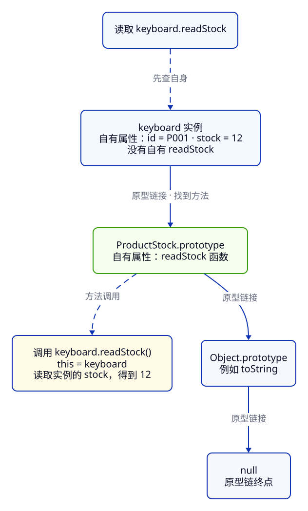

> **第 1 周 · 第 4 天** · 阅读跟做约 45 分钟 · 练习约 40 分钟  
> 前置：C05、C06 · 运行：Node 24；断点练习用 Chrome · 示例已运行验证

## 这一课解决什么问题

库存报告里有个 `report.readStock()`，直接调用能得到 12。把 `report.readStock` 传给另一个函数，准备需要时再调用，却出现 `TypeError`。商品没变，方法的代码也没变，为什么突然读不到库存？

再看同事写的类：实例上只有商品数据，明明找不到 `readStock`，调用却又成功。这一课把「怎样调用函数」与「怎样查找属性」分开讲清。

学完你能：

- 根据调用方式判断普通函数的 this，解释方法脱离对象后的结果
- 区分 `call`、`apply`、`bind`，为回调保留接收对象
- 用词法作用域解释箭头函数为什么继续读取外层 this
- 沿原型链查找属性，分清实例的原型和构造函数的 `prototype`
- 用 class、私有字段和组合扩展库存模块，继续复用分类筛选工厂

例子在 [examples/c07](https://github.com/socoo123/js_web/tree/main/examples/c07)。沿用上一课安装的 Node，在终端进入该目录，运行 `node method-call.js`。每个文件独立执行，不需要安装依赖。

## Java 程序员先看这里

| Java 经验 | JavaScript 写法 | 关键差异 |
| --- | --- | --- |
| 实例方法的 this 是当前实例 | `obj.method()` | 普通函数的 this 随调用方式变化；复制方法不会绑定原对象 |
| `product::readStock` 绑定接收对象 | `product.readStock.bind(product)` | 单写 `product.readStock` 只取得函数值 |
| lambda 的 this 沿用外层实例 | `() => this.stock` | 箭头函数也沿用外层 this；对象字面量本身不建立 this |
| 通过类继承复用行为 | 对象沿原型链查找属性 | 共享方法通常存放在原型对象上 |
| `private int stock` | `#stock` | 由运行时限制访问；`_stock` 只是普通属性的命名约定 |

## 1. 普通函数的 this：先看怎样调用

普通函数里的 [`this`](https://developer.mozilla.org/zh-CN/docs/Web/JavaScript/Reference/Operators/this) 可以当成调用时额外传入的一个值。参数从括号里来，this 则由调用方式决定。

### 方法调用：点号前的对象是接收者

把同一个函数放到两件商品上，通过不同对象调用，它就读取不同对象的库存。

**先猜一猜：** `dock.readStock` 来自 `keyboard`，它会读取 12 还是 3？最后一行比较函数身份，会相等吗？

```js title="method-call.js"
"use strict";
const keyboard = {
  id: "P001", stock: 12,
  readStock() { return this.stock; },
};
const dock = { id: "P004", stock: 3, readStock: keyboard.readStock };
console.log(keyboard.readStock()); // → 12
console.log(dock.readStock());     // → 3
console.log(keyboard.readStock === dock.readStock); // → true
```

依次输出 **12、3、true**。两个属性保存的是同一个函数对象，函数体没有复制。`keyboard.readStock()` 的 this 是 `keyboard`；`dock.readStock()` 的 this 是 `dock`。函数最初写在哪个对象里，不会替它永久登记接收者。

`readStock() { ... }` 是对象里的方法简写。用 `keyboard["readStock"]()` 调用，接收者也仍是 `keyboard`。

Java 的实例方法依附某个实例执行；JS 可以把方法取成普通函数值，所以要分别判断函数身份和本次接收者。

### 普通调用：严格模式下 this 是 undefined

`fn()` 这样的调用没有接收对象。在严格模式下，它的 this 就是 `undefined`。

```js title="plain-call.js"
"use strict";
function readThis() {
  return this;
}
console.log(readThis()); // → undefined
```

函数正常返回 `undefined`。如果函数体改成 `return this.stock`，就会在读取属性时抛 `TypeError`。同理，`const read = keyboard.readStock; read()` 的最后一步是普通调用；赋值只复制函数引用，`keyboard` 没有跟着一起被保存。

本课普通脚本开头写 `"use strict"`，让运行结果明确。ES 模块和 class 内部自动使用严格模式。旧的非严格普通函数在没有接收者时会使用全局对象，这是有些旧教程打印出 `window` 的原因；现代代码按严格模式的规则理解。

C06 的词法作用域仍然成立：普通变量按定义位置查找。普通函数的 this 有单独的调用规则，两者各管一件事。Java 的 `this` 没有这里这种「先取出方法，再作为普通函数执行」的用法。

## 2. call、apply、bind：明确给出接收者

已有一个依赖 this 的函数时，可以直接指定它要读取哪件商品。下面只计算补货后的数量，商品本身保持原样。

```js title="explicit-this.js"
"use strict";
function stockAfterRestock(amount) {
  return this.stock + amount;
}
const keyboard = { id: "P001", stock: 12 };
const dock = { id: "P004", stock: 3 };
console.log(stockAfterRestock.call(keyboard, 3));    // → 15
console.log(stockAfterRestock.apply(dock, [2]));    // → 5
const readLater = stockAfterRestock.bind(keyboard, 3);
console.log(typeof readLater);                     // → function
console.log(readLater());                          // → 15
console.log(readLater.call(dock));                 // → 15
```

前两行立即得到 15 和 5；后面先得到 `function`，再得到两次 15。三种方法的差别集中在这里：

| 写法 | 什么时候执行原函数 | 实参怎么给 |
| --- | --- | --- |
| [`fn.call(obj, a, b)`](https://developer.mozilla.org/zh-CN/docs/Web/JavaScript/Reference/Global_Objects/Function/call) | 现在 | 从第二个位置逐个传入 |
| [`fn.apply(obj, [a, b])`](https://developer.mozilla.org/zh-CN/docs/Web/JavaScript/Reference/Global_Objects/Function/apply) | 现在 | 第二个位置用数组装实参 |
| [`fn.bind(obj, a)`](https://developer.mozilla.org/zh-CN/docs/Web/JavaScript/Reference/Global_Objects/Function/bind) | 返回新函数，等以后调用 | 预先固定 this，也可固定开头几个参数 |

`readLater` 保存了 `keyboard` 和参数 3。`bind` 那一行只创建函数，没有执行补货计算。以后写 `readLater()` 才执行；即使用 `.call(dock)` 调它，原函数的 this 仍然是已经绑定的 `keyboard`。本课绑定的函数都作为普通回调调用。

绑定保存对象引用，后续读到的是对象当前的字段。每次调用 `bind` 都创建新函数，需要反复使用同一个回调时，先保存下来。

Java 的 `product::readStock` 已携带接收对象，JS 的 `.bind(product)` 可以得到相近效果。纯计算也可以沿用 C06 的写法，直接把商品作为显式参数传入。

## 3. 箭头函数：沿用创建处外层的 this

箭头函数没有自己的 this 绑定，它像读取外层变量一样，读取外层的 this。适合在方法内部创建需要继续访问当前对象的回调。

**先猜一猜：** `read` 已经脱离 `keyboard`，还会得到 12 吗？用 `call(dock)` 能把它切换成扩展坞吗？

```js title="arrow-this.js"
"use strict";
const keyboard = {
  id: "P001", stock: 12,
  createReader() { return () => this.stock; },
};
const dock = { id: "P004", stock: 3 };
const read = keyboard.createReader();
console.log(read());           // → 12
console.log(read.call(dock));  // → 12
keyboard.stock += 3; // 模拟补货，回调仍然读取同一件商品
console.log(read());           // → 15
```

结果是 **12、12、15**。先发生 `keyboard.createReader()`，这次普通方法调用让外层 this 指向 `keyboard`。然后创建箭头函数，它继续使用这一外层 this；后面从哪里调用 `read`，都不会给箭头另建 this。

`call`、`apply`、`bind` 都无法替换箭头函数使用的 this。最后得到 15，则说明箭头保留的也不是库存数字的快照：它仍从 `keyboard` 读取当前的 `stock`。这延续了 C06「闭包继续读取绑定」的思路。

看见箭头函数时，向源码外层找最近能够提供 this 的环境。本例是 `createReader` 这次调用。对象字面量的花括号只是在创建对象，不建立 this；因此把方法直接改成 `readStock: () => this.stock`，不会自动让 this 指向包着它的对象。练习 2 会让你亲手修这个错误。

Java lambda 内的 this 也沿用外层实例；JS 里还要先根据外层普通方法的调用，确定箭头沿用谁。

:::tip[自己尝试 · Node]
1. 在 `examples/c07` 运行 `node arrow-this.js`，确认输出 12、12、15。
2. 把创建回调的一行改为 `const read = keyboard.createReader.call(dock);`，再运行。
3. 解释为什么最后一行也变了，再恢复原文件。

预期：第二步三行都打印 3。创建箭头时，外层 this 已经是 `dock`；后面给键盘补货，不会改变扩展坞的库存。
:::

## 4. new 与原型：每个实例存数据，共享对象存方法

构造调用 `new ProductStock(...)` 会创建实例，并让构造函数的 this 指向新实例。下面先用普通函数构造对象，方法只在一个共享对象上保存一次。

```js title="constructor-stock.js"
"use strict";
function ProductStock(id, stock) {
  this.id = id;
  this.stock = stock;
}
ProductStock.prototype.readStock = function () {
  return this.stock;
};
const keyboard = new ProductStock("P001", 12);
const mouse = new ProductStock("P002", 0);
console.log(keyboard.readStock(), mouse.readStock()); // → 12 0
console.log(Object.hasOwn(keyboard, "stock"));         // → true
console.log(Object.hasOwn(keyboard, "readStock"));     // → false
console.log(keyboard.readStock === mouse.readStock);  // → true
```

输出说明：两份数据各自属于实例，`readStock` 却没有复制到每个实例上。它们查到的是同一个函数，所以最后比较为 `true`。

在这个构造函数没有显式返回对象的例子里，`new` 做了四件事：创建对象，把对象的原型链接到 `ProductStock.prototype`，以新对象作为 this 执行构造函数，最后返回这个对象。`prototype` 是构造函数上的一个属性，它指向那个供实例共享的对象。

### 查不到自有属性，就沿原型继续找

普通对象有一个内部的原型链接，用 `Object.getPrototypeOf(obj)` 查看。读取属性时，先找对象自己的属性，再沿原型链逐层找，遇到匹配就停；一路到 `null` 仍没找到，才得到 `undefined`。



沿实线看原型链接，沿虚线看这次查找与调用。找到 `readStock` 就停止查找；如果整个链都没有所需属性，才会查到终点。

**查找函数时沿原型走，调用函数时仍按接收者确定 this**。方法保存在 `ProductStock.prototype` 上，`keyboard.readStock()` 的 this 仍是 `keyboard`。

不用构造函数，也能用 [`Object.create(proto)`](https://developer.mozilla.org/zh-CN/docs/Web/JavaScript/Reference/Global_Objects/Object/create) 创建以某个对象为原型的新对象。这让查找规则更容易单独观察：

```js title="prototype-lookup.js"
const stockMethods = {
  label: "库存",
  readStock() { return this.stock; },
};
const keyboard = Object.create(stockMethods);
keyboard.id = "P001";
keyboard.stock = 12;
console.log(keyboard.readStock());                    // → 12
console.log(Object.hasOwn(keyboard, "readStock"));     // → false
console.log("readStock" in keyboard);                 // → true
console.log(Object.getPrototypeOf(keyboard) === stockMethods); // → true
keyboard.label = "现货";
console.log(keyboard.label);                         // → 现货
delete keyboard.label;
console.log(keyboard.label);                         // → 库存
console.log(keyboard.missing);                       // → undefined
```

`Object.hasOwn` 只查自身，所以方法不是自有属性；`in` 会查原型链，所以仍然返回 `true`。给 `keyboard.label` 赋值，创建了同名自有属性「现货」，遮住原型的「库存」；删除这个自有属性后，原型上的值重新可见。原型对象始终没有被改动。

**实例的原型**与**函数的 `prototype` 属性**是两个位置：前者是 `Object.getPrototypeOf(keyboard)`，后者是 `ProductStock.prototype`。构造调用把它们连接起来。在前一个例子中两者相等，而 `keyboard.prototype` 通常只是一个不存在的普通属性。

Java 通过类层次复用实例方法；JS 的实例通过对象链接复用属性，普通对象也能成为原型。共享原型里的数组或对象仍遵循 C05 的引用规则，所以每件商品的数据放在实例里，共享方法放在原型上。

## 5. class 与私有字段：写法像 Java，机制仍是原型

[`class`](https://developer.mozilla.org/zh-CN/docs/Web/JavaScript/Reference/Classes) 把构造、字段和方法组织到一起。`constructor` 初始化实例；普通实例方法放在类的 `prototype` 上，依然通过原型链共享。

```js title="class-stock.js"
class ProductStock {
  #stock;
  constructor(id, stock) {
    this.id = id;
    this.#stock = stock;
  }
  readStock() { return this.#stock; }
  restock(amount) {
    if (!Number.isInteger(amount) || amount < 1 || this.#stock + amount > 99999) {
      throw new RangeError("补货数量无效");
    }
    this.#stock += amount;
  }
}
const keyboard = new ProductStock("P001", 12);
const mouse = new ProductStock("P002", 0);
keyboard.restock(3);
console.log(keyboard.readStock(), mouse.readStock()); // → 15 0
console.log(keyboard.stock);                         // → undefined
console.log(Object.hasOwn(keyboard, "#stock"));       // → false
console.log(Object.getPrototypeOf(keyboard) === ProductStock.prototype); // → true
console.log(keyboard.readStock === mouse.readStock);  // → true
```

补货后键盘是 15 件，无线鼠标仍为 0，两份私有状态相互独立。后两行的 `true` 证明：换成 class 后，实例仍通过原型找到同一个方法。

[`#stock`](https://developer.mozilla.org/zh-CN/docs/Web/JavaScript/Reference/Classes/Private_elements) 是私有字段，先在类体中声明，再在类体内通过 `this.#stock` 访问。外部直接写 `keyboard.#stock` 会产生语法错误。`keyboard.stock` 读取的是另一个普通属性；没有创建它，就得到 `undefined`。`"#stock"` 这个字符串也无法访问私有字段，因此 `Object.hasOwn` 得到 `false`。

`id` 是外部可读的普通属性；`#stock` 的修改入口则收进 `restock`，校验后再更新。本例构造时接收已校验的初始库存，补货时检查正整数与库存上限。私有字段管访问，方法管业务规则。

和 Java 的 private 字段一样，`#stock` 可以隐藏状态，`_stock` 则只是普通属性的命名约定。私有字段也要求合法接收者：`keyboard.readStock.call({ stock: 12 })` 会抛 `TypeError`，因为那个普通对象没有该类的 `#stock`。

### 继承仍然沿原型查找

`extends` 表达「一种更具体的类型」，`super.method()` 复用父类方法。读懂它与 Java 相似的外形，再看它建立的原型关系：

```js title="inheritance.js"
class StockLabel {
  constructor(product) { this.product = product; }
  label() { return `${this.product.name}：${this.product.stock} 件`; }
}
class LowStockLabel extends StockLabel {
  label() { return `${super.label()}（需补货）`; }
}
const dock = new LowStockLabel({ id: "P004", name: "USB-C 扩展坞", stock: 3 });
console.log(dock.label()); // → USB-C 扩展坞：3 件（需补货）
console.log(Object.getPrototypeOf(LowStockLabel.prototype) === StockLabel.prototype); // → true
```

先找到子类的 `label`，里面用 `super.label()` 调用父类实现；父类方法中的 this 仍是当前的 `dock`，因此能读取它的商品数据。子类没有写构造函数时，默认构造会把参数交给父类。自己写子类构造函数时，要先执行 `super(...)`，再使用 this。

这段关系对应 `dock → LowStockLabel.prototype → StockLabel.prototype`。Java 的继承依赖类定义；JS 的 class 也会把这种共享关系落实为原型链接。class 还要求用 `new` 创建实例，内部自动严格；它并没有替每个实例自动绑定所有方法。

## 6. 组合：库存对象保存数据，函数提供规则

如果只为了切换分类就写 `PeripheralInventory`、`AccessoryInventory` 两个子类，很快还会出现「有货外设」「低库存配件」。这些变化适合表达为可替换的判断函数。

沿用 C06 的 `createCategoryFilter(category)`。在阶段 1 的 `inventory.js` 末尾新增下面的类，让对象保存数据，让传入的函数决定选谁：

```js
export class Inventory {
  #products;
  constructor(products) {
    this.#products = [...products];
  }
  count() { return this.#products.length; }
  select(predicate) {
    const selected = [];
    for (const product of this.#products) {
      if (predicate(product)) selected.push(product);
    }
    return selected;
  }
}
```

调用 `inventory.select(createCategoryFilter("外设"))`，会得到 P001、P002；换成「配件」，会得到 P004、P005。下一节就把这两个结果打印出来。

这就是**组合**：库存对象持有数据，与判断函数协作筛选。`Inventory` 管数据和遍历，分类工厂管规则；换规则无需新增子类。Java 里传入 `Predicate<Product>` 也能这样分工。

构造函数用展开语法复制数组，`select` 又创建结果数组，所以向这些数组增删元素，不会直接增删原始数据数组里的元素。数组里的商品对象仍然共享引用；如果改 `selected[0].stock`，对应原商品也会改变。这是 C05 的浅复制规则，并不会因为数组放进私有字段就改变。

`select` 依赖 this 找到 `#products`，作为回调交出去时仍需保留接收对象。下面用更小的报告函数定位这个问题。

## 常见错误与调试

### 直接调用成功，作为回调却报 TypeError

**现象**：报告本应打印 12，运行 `node detached-broken.js` 却只打印 `TypeError`。示例捕获错误后打印名字；错误发生在 `readStock` 读取 `this.product` 的位置。

```js title="detached-broken.js"
// 有问题的写法：传出方法时，没有保留接收对象
class StockReport {
  constructor(product) { this.product = product; }
  readStock() { return this.product.stock; }
}
function runReport(callback) {
  return callback();
}
const report = new StockReport({ id: "P001", stock: 12 });
try {
  console.log(runReport(report.readStock));
} catch (error) {
  console.log(error.name); // → TypeError
}
```

:::tip[自己尝试 · 本地网页]
1. 在 `examples/c07` 运行 `python3 -m http.server 8000 --bind 127.0.0.1`。
2. 用 Chrome 打开 `http://127.0.0.1:8000/`，按 F12 打开 Sources。
3. 左侧选中 `detached-broken.js`，单击 `readStock` 方法所在行的行号设置断点，再刷新。
4. 按下面的证据检查 this 和调用栈；修复时把 `index.html` 中的脚本名换成 `detached-fixed.js`，刷新并重新设置断点。

预期：修复前 this 是 `undefined`，Console 打印 `TypeError`；修复后 this 是报告对象，两次调用都打印 12。完成后移除断点。
:::

**工具**：暂停在 `readStock` 后，展开右侧 Scope 的 Local 查看 this，也可以在暂停的 Console 输入 `this`。再看 Call Stack，点击上一层 `runReport`，查看它最后怎样调用回调。

**证据**：`readStock` 的 this 是 `undefined`。`runReport` 里的 `callback` 确实是 `readStock` 函数，调用语句却是 `callback()`。在页面没有暂停时输入 `report.readStock()`，仍然能得到 12。

**原因**：`report.readStock` 只是函数，`callback()` 是普通调用，class 方法又始终严格，所以 this 是 `undefined`。

**修复**：在调用方保存正确的调用关系，下面两种都可以：

```js title="detached-fixed.js"
class StockReport {
  constructor(product) { this.product = product; }
  readStock() { return this.product.stock; }
}
function runReport(callback) {
  return callback();
}
const report = new StockReport({ id: "P001", stock: 12 });
console.log(runReport(() => report.readStock())); // → 12
console.log(runReport(report.readStock.bind(report))); // → 12
```

第一种在箭头回调里显式通过 `report` 调用方法；第二种提前用 `bind` 保存接收对象。两者都保留了「对哪个对象执行」。

**确认**：运行 `node detached-fixed.js`，得到两次 12。网页换脚本后，断点中 this 是 `StockReport` 实例，`this.product.stock` 是 12，继续执行也得到两次 12。再改成 `runReport(report.readStock())` 会先执行方法，把数字当回调传入；这与 C06 混淆函数和调用结果是同一类错误。

## 练习

### 练习 1：找到方法以后，this 是谁

先写出四行输出，分别解释「函数从哪里找到」与「本次 this 是谁」，再在 `examples/c07` 运行 `node prediction.js` 核对。

```js title="prediction.js"
"use strict";
const stockMethods = { readStock() { return this.stock; } };
const keyboard = Object.create(stockMethods);
keyboard.stock = 12;
const dock = { stock: 3, readStock: keyboard.readStock };
const read = keyboard.readStock;
console.log(dock.readStock());
console.log(Object.hasOwn(keyboard, "readStock"));
console.log(read.call(dock));
try {
  console.log(read());
} catch (error) {
  console.log(error.name);
}
```

<details>
<summary>提示</summary>

赋值时，先沿原型找到函数，再把函数引用放到新位置。`Object.hasOwn` 只检查自身；普通调用和 `.call(dock)` 则分别用自己的 this 规则。

</details>

<details>
<summary>参考答案</summary>

依次是 **3、false、3、TypeError**。`dock.readStock()` 的接收者是 `dock`，即使函数最初从 `keyboard` 的原型上找到，也只读 `dock.stock`。`keyboard` 自身没有这个方法，所以第二行是 `false`。第三行显式指定 `dock`。最后是严格模式的普通调用，this 为 `undefined`，读取 `.stock` 时抛错，再被捕获并打印名字。

</details>

### 练习 2：对象里的箭头为什么没有读到对象

起始文件 `arrow-method-broken.js` 会打印 `TypeError`。把 `readStock` 改成普通方法，保持 `createStockView()` 的调用方式不变。

```js title="arrow-method-broken.js"
// 有问题的写法：把对象属性里的箭头函数当成普通方法
"use strict";
function createStockView() {
  return { stock: 12, readStock: () => this.stock };
}
const view = createStockView();
try {
  console.log(view.readStock());
} catch (error) {
  console.log(error.name); // → TypeError
}
```

验收：`view.readStock()` 返回 12；`view.readStock.call({ stock: 3 })` 返回 3。说明你修好的是接收者规则，而不是把 12 写死。

<details>
<summary>提示</summary>

箭头外层能提供 this 的是 `createStockView`，而它以普通函数方式调用。对象字面量本身没有建立新的 this。对象方法简写可以让调用时的对象成为接收者。

</details>

<details>
<summary>参考答案</summary>

```js title="arrow-method-fixed.js"
"use strict";
function createStockView() {
  return { stock: 12, readStock() { return this.stock; } };
}
const view = createStockView();
console.log(view.readStock()); // → 12
console.log(view.readStock.call({ stock: 3 })); // → 3
```

箭头沿用外层普通调用中的 `undefined`，所以原先读属性失败。改成普通方法后，`view.readStock()` 才在调用时接收 `view`；用 `call` 指定另一个对象，也能正常读取。和第 3 节一样，决定行为的是函数种类及调用方式，花括号的视觉嵌套不会替对象绑定 this。

</details>

### 练习 3：把库存筛选作为回调交出去

完成下面的项目步骤后，在 `demo.js` 增加一个只筛选「音频」的回调。回调不接收参数，调用时应返回只含 P006 的数组；还要让 `new Inventory([]).count()` 返回 0。

<details>
<summary>提示</summary>

先用 `createCategoryFilter("音频")` 得到谓词，再用箭头回调保存方法调用，或用 `bind` 同时固定接收者与第一个参数。空库存应创建新实例，不改动六件商品的数据。

</details>

<details>
<summary>参考答案</summary>

可写 `const selectAudio = inventory.select.bind(inventory, createCategoryFilter("音频"));`，调用 `selectAudio()` 后检查长度为 1、第一项 id 为 P006。箭头形式 `() => inventory.select(createCategoryFilter("音频"))` 也成立。`new Inventory([])` 有自己独立的私有数组，计数为 0；原来的 `inventory.count()` 仍为 6。

</details>

## 项目进度

从 C06 的 [examples/inventory/01-core](https://github.com/socoo123/js_web/tree/main/examples/inventory/01-core) 继续。保留 `inventory.js` 原有的分类工厂，追加第 6 节的 `Inventory` 类；固定商品数据沿用 `examples/shared/products.js`。

在 `demo.js` 中把导入改为 `import { Inventory, createCategoryFilter } from "./inventory.js";`，新增 `const inventory = new Inventory(products);`。保留两个分类规则与收集 id 的数组，把原来的筛选循环换成：

```js
for (const product of inventory.select(isPeripheral)) peripherals.push(product.id);
for (const product of inventory.select(isAccessory)) accessories.push(product.id);
```

原来的前两行输出保留；第三行改用 `inventory.count()`，再追加回调和实例检查：

```js
console.log("原始商品数：", inventory.count());
const selectAccessories = inventory.select.bind(inventory, isAccessory);
console.log("回调筛选配件：", selectAccessories().length);
console.log("实例自有 select：", Object.hasOwn(inventory, "select"));
console.log("独立空库存：", new Inventory([]).count());
```

在终端进入 `examples/inventory/01-core`，运行 `node demo.js`，输出：

```text
外设： P001, P002
配件： P004, P005
原始商品数： 6
回调筛选配件： 2
实例自有 select： false
独立空库存： 0
```

验收时确认：分类筛选仍包含售罄的 P002；配件回调能独立调用；实例通过 `Inventory.prototype` 找到 `select`；新建空库存不影响原来的六件商品。再完成练习 3 的音频回调。阶段目录保存了完整文件，无需手动拼接正文片段。

## 小结

- 普通函数的 this 随调用方式确定：方法调用用接收对象，严格模式普通调用用 `undefined`。
- `call`、`apply` 立即指定 this 调用；`bind` 返回保存接收者的新函数，供以后调用。
- 箭头函数沿用外层 this；对象字面量本身不建立 this。
- 属性先查自身，再沿原型链查；函数在哪里找到，与调用时 this 是谁分别判断。
- class 的普通方法共享在原型上，私有字段保存在各自实例中；可变化的筛选规则通过组合传入。

自测：

1. 为什么 `dock.readStock = keyboard.readStock` 后，调用读到的是扩展坞库存？
2. `bind` 返回的函数再用 `call` 换对象，本课的普通回调会读谁？
3. 箭头函数脱离方法返回后，为什么仍能读取原来的 this？
4. `Object.hasOwn(instance, "select")` 为 false，方法调用为什么还能成功？
5. `Inventory` 和分类工厂分别负责什么？为什么切换分类无需新增子类？

下一课讲 Array 与业务数据处理，用数组方法简化筛选、排序和统计，并分清哪些操作会修改输入。

## 延伸阅读

- [MDN：this](https://developer.mozilla.org/zh-CN/docs/Web/JavaScript/Reference/Operators/this)
- [MDN：继承与原型链](https://developer.mozilla.org/zh-CN/docs/Web/JavaScript/Guide/Inheritance_and_the_prototype_chain)
- [MDN：类](https://developer.mozilla.org/zh-CN/docs/Web/JavaScript/Reference/Classes)
- [MDN：私有元素](https://developer.mozilla.org/zh-CN/docs/Web/JavaScript/Reference/Classes/Private_elements)
- [Chrome DevTools：查看作用域中的值](https://developer.chrome.com/docs/devtools/javascript/reference#scope)
- [ECMAScript 2026：函数与类](https://tc39.es/ecma262/2026/multipage/ecmascript-language-functions-and-classes.html)
