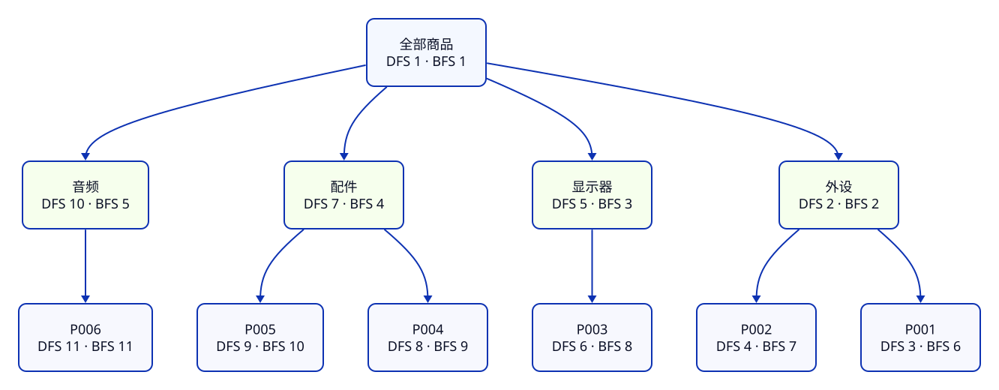

import CodeCompare from '../../../components/CodeCompare.astro';
import CodeExcerpt from '../../../components/CodeExcerpt.astro';
import LessonTask from '../../../components/LessonTask.astro';

> **第 1 周 · 第 5 天** · 阅读跟做约 45 分钟 · 实作约 40 分钟<br />
> 前置：C05–C09 的引用、闭包、Array、Map · 运行：Node 24，浏览器 Console 可选 · 示例已运行验证

## 这一课解决什么问题

给同一份库存规则加上“补货后撤销”，再让操作按先入先出处理，并按分类浏览六商品。Java 里的 Deque 与树遍历你已经会了，这次重点是 JS 用什么值表示它们，以及保存引用为什么可能破坏撤销。

完成后，P001 从 12 补到 15 可以撤回 12，分类树的两种遍历都只访问每个节点一次。这也是第一个 Lab 的收尾。

<LessonTask lessonId="C10" />

在当前工作区用 `npm run lab -- console` 打开 Node 库存控制台；inventory 是实际模块，products 是固定输入副本。改完文件后退出并重新进入以加载新代码。

## Java 程序员先看这里

<CodeCompare pairId="c10-queue-tree" />

<a id="1-撤销栈保存旧值再改当前值"></a>

## 1. 用 Array 表达栈：先保存旧字段，再修改

JS 的 Array 可以用 push/pop 表达后进先出。这里保存的是撤销所需的旧库存，顺序应与补货相反。

把下面两部分接在同一个 inventory.js 里，组成完整的 createHistory。它先复制数据，把历史与当前库存放进自己的闭包。

<CodeExcerpt snippetId="c10-history-start" />

<CodeExcerpt snippetId="c10-history-end" />

**先猜一猜：** 从 12 连续补 3、补 2，再撤销两次，库存依次是什么？

```js
const journal = inventory.createHistory(products);
journal.restock("P001", "3"); // 当前 15
journal.restock("P001", "2"); // 当前 17
journal.undo(); // 当前 15
journal.undo(); // 当前 12
console.log(journal.getProducts()[0].stock); // → 12
console.log(journal.undo()); // → false，历史已空
```

栈顶先弹出第二次操作前的 15，再弹出第一次操作前的 12。undo 不再向历史入栈，因此不会来回振荡。

getProducts 每次返回独立对象与标签数组。调用者看到的是快照，闭包持有自己的当前数据；Java 的封装同样需要决定哪些可变对象可以交给外部。

<a id="2-任务队列移动头索引保留处理顺序"></a>

## 2. 用数组和头索引表达 FIFO

Array 的 shift 从头部移除元素。想连续处理许多任务时，用头索引前进，避免每次都重新安排后面的下标。

<CodeExcerpt snippetId="c10-queue" />

**先猜一猜：** 两个商品任务进入后，三次出队会得到什么？

```js
const tasks = inventory.createTaskQueue();
tasks.enqueue("P001");
tasks.enqueue("P004");
console.log(tasks.dequeue()); // → P001
console.log(tasks.dequeue()); // → P004
console.log(tasks.dequeue()); // → null
```

enqueue 从尾部加入，dequeue 读取 head 再前进；读取过的位置写成 undefined，释放对旧任务的引用。null 表示没有任务，因此入队拒绝 null/undefined。

Java ArrayDeque 已封装这些行为。JS 这里用小闭包展示数组索引，不把 Array 当成 Java 固定长度数组。

<a id="3-分类树同一份对象dfs-和-bfs-两种顺序"></a>

## 3. 用普通对象表达分类树

节点用 name 和 children 表达，叶子也保留空 children。数据来自前一课的分类分组，库存商品仍是同一组 P001–P006。

<CodeExcerpt snippetId="c10-category-tree" />

调用 buildCategoryTree(products) 得到“全部商品→外设/显示器/配件/音频→商品 id”三层结构，一共 11 个节点。树结构是数据模型，显示菜单由后面的界面负责。

深度优先先访问当前节点，再逐个进入子树：

<CodeExcerpt snippetId="c10-dfs" />

回调收集出的次序是：全部商品、外设、P001、P002、显示器、P003、配件、P004、P005、音频、P006。传 null 不调用回调。

Java 可以为节点写类；JS 也可以直接用形状一致的对象和数组表达关系。

<a id="4-数据很深时把递归换成显式栈"></a>

## 4. DFS 与 BFS：栈和队列决定下一步去哪里

Java/JS 对照卡给出了 BFS：处理当前节点后，把它的孩子放到队尾。它先访问根，再访问四个分类，最后访问六个商品。

<figure class="diagram-scroll" tabindex="0" aria-label="分类树遍历图，可横向滚动">



</figure>

窄屏可在图内横向滚动；序号与上面的六商品访问结果一致。

看同一棵树的两条路径：DFS 先把一个分支读完，BFS 先处理整层。节点、边和访问顺序分别观察，就能决定需要哪一种。

树特别深时，递归可能超过调用栈限制。迭代 DFS 可用数组栈保存待访问节点，弹出后逆序压入 children，仍保持从左到右的深度优先次序；思路与 Java 的显式栈相同。完整示例保留在旧机制参考中。

在 Node 库存控制台收集结果：

```js
const tree = inventory.buildCategoryTree(products);
const depthNames = [], breadthNames = [];
inventory.walkDepthFirst(tree, (node) => depthNames.push(node.name));
inventory.walkBreadthFirst(tree, (node) => breadthNames.push(node.name));
console.log(depthNames.length, breadthNames.length); // → 11 11
console.log(new Set(depthNames).size); // → 11
```

计数只是第一步，还要核对具体次序。Java 的遍历算法仍然适用；变化的是节点的表达方式和函数回调。

<a id="5-复杂度跟着操作走"></a>

## 5. 复杂度：用增长量解释成本

这棵树每个节点访问一次、每条父子边处理一次，所以 DFS/BFS 为 O(V+E)。数组 push/pop 的常见用法摊销为 O(1)，从头反复 shift 处理长队列则可能反复移动元素。

用真实任务规模判断选择：查一次六商品可直接 find；频繁按 id 查找可建 Map。建立索引本身也有时间与内存成本。Java 的复杂度经验可以直接使用，具体实现与运行器的常数仍要测量。

图与链表只看表示方法：图可用邻接表保存边，链表节点通过 next 连接。

```js
const neighbors = new Map([
  ["P001", ["P004"]], // 商品关联，不是分类树
  ["P004", ["P001"]],
]);
const tail = { id: "P004", next: null };
const head = { id: "P001", next: tail };
console.log(neighbors.get("P001")[0]); // → P004
console.log(head.next.id); // → P004
```

一般图可能有环，遍历要用 visited Set 防止重复访问；由分类构建出的树没有这类回边。链表的 next 是对象引用，换一个变量名不会复制节点，这与前面学习的引用规则一致。

## 常见错误与调试

### 补了三件，撤销后还是 15

**现象与触发**：把 restock 中的 `history.push({ id, stock: product.stock })` 临时改成 `history.push(product)`。从 12 补 3，再 undo，库存仍是 15。

**工具**：在当前库存页的 Sources 搜索 inventory.js，在 push 行设断点。Console 建立 journal，再调用补货和撤销；Node 的 check 同时验证相同业务行为。

**证据**：错误版本中 history[0] 与 product 是同一个对象，修改 product.stock 时，所谓“旧库存”也一起变成了 15。

**原因**：历史保存了之后仍会变化的引用。

**修复**：恢复保存旧 id 与 stock 值，或保存独立快照；撤销时只恢复旧值，不再记录一条撤销历史。

**确认**：补 3、补 2 后能依次撤回 15、12，空栈返回 false；固定原始数据和已取出的快照不被污染。

## 练习

### 唯一任务：完成 L1 的可撤销库存规则

:::tip[自己尝试 · Node]
1. 在同一个 inventory.js 接上 history 的两部分、任务队列、分类树构建和 DFS/BFS；BFS 使用并排卡右侧的函数。
2. 在 Node 库存控制台按正文尝试连续补货、两次撤销、FIFO 和两种遍历。
3. 按调试节保存错误引用，记录撤销仍为 15 的证据，再恢复旧字段快照。
4. 运行 npm run lab -- check C10，最后在 notes/next.md 记录“L1 完成，下一步把六商品规则接到原生列表”。

预期：初始总库存 52、价值 2634800 分，P001 补 3 后撤销回 12，遍历顺序与节点数量符合正文。
:::

<details>
<summary>提示</summary>

先写操作前需要保留哪些旧值，再写修改。队列负责选择下一件任务；树节点仍是普通数据。让每个接口都处理空输入，遇到异常从同一个库存文件收集证据。

</details>

<details>
<summary>参考答案</summary>

正文片段与并排卡组成完整增量。createHistory 复制输入，保存旧库存值；队列通过 head 前进；DFS 递归访问孩子，BFS 逐层入队。完整源码在任务卡中；[旧机制文件与验证记录](https://github.com/socoo123/js_web/tree/main/examples/c10)保留作按需参考。

</details>

## 项目进度

- 第一个 Lab 的语言与数据规则已经齐备，原始商品仍保持固定值。
- 空列表、非法输入、稳定 id、排序、索引与可撤销操作均有对应检查。
- 下一阶段复用这些函数构建六商品页面，继续当前工作区。

## 小结

- Array 的 push/pop 可以表达栈，头索引可以表达队列。
- 撤销保存旧值或独立快照，不能保存会继续变化的别名。
- 对象与 children 数组表达树，函数回调接收访问结果。
- DFS/BFS 的算法经验保留，JS 的值与引用决定实现细节。

自测：为什么保存 product 引用会破坏撤销？为什么重复 shift 可能增加成本？两种遍历的顺序哪里不同？一般图为何需要 visited？

## 延伸阅读

- [MDN：Array](https://developer.mozilla.org/zh-CN/docs/Web/JavaScript/Reference/Global_Objects/Array)
- [MDN：Map](https://developer.mozilla.org/zh-CN/docs/Web/JavaScript/Reference/Global_Objects/Map)
- [MDN：Set](https://developer.mozilla.org/zh-CN/docs/Web/JavaScript/Reference/Global_Objects/Set)
- [MDN：闭包](https://developer.mozilla.org/zh-CN/docs/Web/JavaScript/Guide/Closures)
