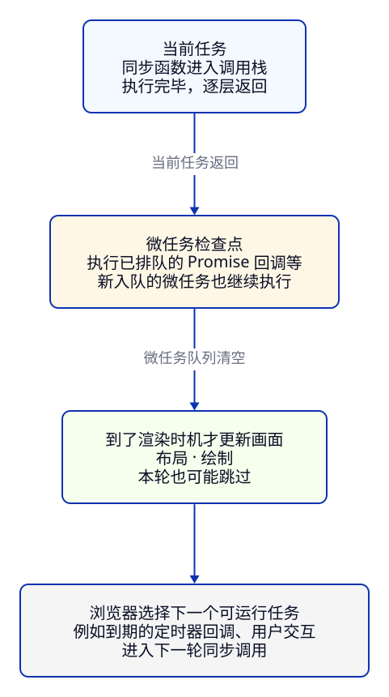

> **第 1 周 · 第 6 天** · 阅读跟做约 45 分钟 · 练习约 40 分钟  
> 前置：C06、C10、C11 · 运行：Node 24 与本地网页 · 示例已运行验证

## 这一课解决什么问题

库存页刚打开时，你先显示「加载中」，再去读取商品。结果日志里的「加载结束」比商品先出现，页面还拿到了 `undefined`。你把读取放进 Promise，发现一条链有时继续得太早，另一条明明失败了，却还显示「成功」。

这些问题都和**哪段代码现在执行、哪段代码以后执行，以及下一步等待谁**有关。C11 的事件处理函数已经是回调；这一课把等待结果的代码也组织起来。

学完你能：

- 用调用栈解释同步回调，用任务和微任务预测浏览器日志顺序。
- 区分 Promise 对象、成功值与失败原因，说明构造器和 `then` 各在何时执行。
- 用 `return` 把异步步骤连成链，按业务选择恢复或继续传播错误。
- 用 `finally` 收尾，并解释为什么 Promise 里的重计算仍会卡页面。
- 完成阶段 1 的模拟异步加载，核对本周库存报告。

示例在 [examples/c12](https://github.com/socoo123/js_web/tree/main/examples/c12)。纯 JS 例子在该目录运行 `node order.js` 这样的命令；模块导入路径已写好，直接运行文件即可。本课用定时器模拟等待，数据都来自仓库，不需要后端。

## Java 程序员先看这里

| Java 经验 | JavaScript 对应 | 差异 |
| --- | --- | --- |
| 方法调用栈 | 同步调用栈 | 当前调用返回前，后面的异步回调不会插进来 |
| lambda / 回调接口 | 回调函数 | 是否异步由调用它的 API 决定，`map` 的回调同步执行 |
| `CompletableFuture<T>` | Promise | 都能表达未来结果；Promise 没有阻塞式 `get()` |
| `thenApply` / `thenCompose` | `then` | 返回普通值就传值，返回 Promise 就跟随其结果 |
| 线程池提交任务 | 浏览器事件循环 | `then` 不会提交到线程池，回调仍占用主线程 |

## 1. 调用栈：回调只是一个函数

函数调用时进入调用栈，返回时退出。把一个函数传给另一个函数，只改变了调用方式；它可以立刻被调用，也可以由宿主留到以后调用。

```js title="sync-callback.js"
console.log("开始");
const ids = ["P001", "P002"].map(id => {
  console.log("map", id);
  return id;
});
console.log("结束", ids.length);
```

输出依次是 `开始`、`map P001`、`map P002`、`结束 2`。`map` 在返回新数组之前，已经调用完两个回调。调用路径是当前脚本 → `map` → 你的回调；回调返回后，`map` 才能继续处理下一个元素。这和 Java Stream 的同步变换很像。

### 异步回调的 return 返回给谁

`callback-api.js` 的 `readProducts` 用定时器等一会儿，再调用 `callback(error, rows)`；成功时 `error` 是 `null`，失败时是 Error。这是这份 API 约定的「错误优先」回调形式。

**先猜一猜：** 回调里已经 `return rows`，外面的 `result` 会是商品数组吗？

```js title="callback-return.js"
import { readProducts } from "./callback-api.js";

const result = readProducts((error, rows) => {
  if (error) console.log(error.message);
  else console.log("回调收到", rows.length);
  return rows;
});
console.log("同步返回", result);
```

输出先是 `同步返回 undefined`，随后是 `回调收到 6`。

`readProducts` 只安排了定时器，随后就返回；它没有同步的返回值。等到回调执行，外层的 `console.log` 早已结束。回调里的 `return` 返回给调用回调的那一层，无法穿回已经结束的 `readProducts` 调用。

需要商品的代码应当写在回调里，或者订阅后面要学的 Promise。Java 里给异步 API 传一个 lambda，也不能用 lambda 的返回值改变早已返回的外层方法。

## 2. 浏览器：先执行当前代码，再处理微任务

浏览器主线程会处理一项项**任务**，例如脚本执行、定时器回调、用户交互。Promise 的反应回调走**微任务**，`queueMicrotask` 也能显式排入微任务。它们最终都要执行 JS，都需要调用栈。

本课从一个浏览器脚本任务开始，只追踪这里注册的回调：先把同步代码执行完，再在微任务检查点清空已排队的微任务，之后才有机会执行下一个任务。详细规则见 [MDN 微任务指南](https://developer.mozilla.org/en-US/docs/Web/API/HTML_DOM_API/Microtask_guide)。

**先猜一猜：** `setTimeout` 写在最前面，等待时间还是 0；它会早于 Promise 回调吗？`resolve` 会让构造器立刻返回吗？

```js title="order.js"
console.log("开始");
setTimeout(() => {
  console.log("定时器");
}, 0);
const ready = new Promise(resolve => {
  console.log("构造器");
  resolve(12);
  console.log("resolve 后");
});
ready.then(() => {
  console.log("Promise 回调");
  queueMicrotask(() => console.log("新微任务"));
});
queueMicrotask(() => console.log("排队的微任务"));
console.log("结束");
```

输出顺序：`开始` → `构造器` → `resolve 后` → `结束` → `Promise 回调` → `排队的微任务` → `新微任务` → `定时器`。

逐步看排队过程：

| 执行位置 | 当时发生了什么 |
| --- | --- |
| `setTimeout(..., 0)` | 注册定时器，达到等待门槛后回调任务才能等待执行 |
| `new Promise(...)` | 执行器同步运行；打印构造器，`resolve(12)` 交付结果后继续打印 |
| `ready.then(...)` | 此时 Promise 已成功，把成功回调排入微任务 |
| `queueMicrotask(...)` | 在它后面排入另一项微任务 |
| 打印结束，当前脚本返回 | 开始处理微任务队列 |
| Promise 回调执行 | 打印后，给微任务队尾追加「新微任务」 |
| 微任务检查点继续 | 先处理原来排队的一项，再处理新加的一项 |
| 微任务队列清空后 | 定时器回调才可能作为下一项任务执行 |

[`setTimeout`](https://developer.mozilla.org/en-US/docs/Web/API/Window/setTimeout) 的延迟参数表示等待门槛，实际执行还要等主线程空出来。因此 0 不是「马上运行」，20 也不是「精确在 20 毫秒运行」。在长循环里等定时器改一个变量，循环会一直占着主线程，回调就得不到执行机会。



沿主线从上往下读，再回到当前任务；渲染是机会，浏览器可以跳过。图把多种任务来源简化到一起，真实浏览器会选择可运行的任务，不是把所有事件排进一个全局 FIFO 队列。

这是一张主线示意图；微任务检查点也可能出现在浏览器调用脚本后且调用栈为空的其他位置。自己在任务尾持续追加微任务，会延迟后面的任务与画面更新，所以微任务适合短小的后续工作。

**Node 的差异。** Promise 的语言规则在两边相同，但 Node 没有页面渲染，它按宿主的事件循环阶段处理计时器与 I/O，还有 `process.nextTick`、`setImmediate`。本课这些小例子可在 Node 核对；涉及 I/O 与这些专用 API 时，应查 [Node 事件循环文档](https://nodejs.org/en/learn/asynchronous-work/event-loop-timers-and-nexttick)，不能照搬浏览器图。C17 再结合文件读取观察。

:::tip[自己尝试 · 本地网页]
1. 在仓库根目录运行 `python3 -m http.server 8000 --bind 127.0.0.1`。
2. 打开 `http://127.0.0.1:8000/examples/c12/order.html`，按 F12，进入 Sources，打开 `order.js`。
3. 在「结束」「Promise 回调」「定时器」三处日志的行号上设断点，刷新。每次按 Resume 继续，观察 Call Stack。

预期：依次停在结束、Promise 回调、定时器。异步回调执行时，最初的脚本调用已经返回；DevTools 展示的异步来源可以帮助追踪注册位置，它不表示旧调用还留在活动栈里。
:::

## 3. Promise：把一次未来结果变成对象

Promise 是一份可以订阅的结果。调用异步函数时，马上拿到的是 Promise 对象；结果就绪后，才把值交给 `then` 注册的函数。成功和失败都能在对象上继续订阅，结果已到达以后再订阅也有效。

| 状态 | 含义 | 后续 |
| --- | --- | --- |
| pending | 结果尚未确定 | 成功或失败处理器继续等待 |
| fulfilled | 成功，保存一个值 | 对应成功处理器排入微任务 |
| rejected | 失败，保存一个原因 | 对应失败处理器排入微任务 |

fulfilled 和 rejected 合称 settled，状态确定后就保持不变。`resolve(普通值)` 使它成功；`reject(error)` 使它失败。下面的 0 是库存结果，和「还没加载」是两回事。

```js title="settlement.js"
const stock = new Promise((resolve, reject) => {
  resolve(0);
  reject(new Error("太晚了"));
  resolve(12);
  console.log("执行器继续");
});
stock.then(value => console.log("库存", value));
```

输出是 `执行器继续`，然后是 `库存 0`。第一次 `resolve(0)` 已确定结果，后续 `reject` 和 `resolve` 都不再改变它；但执行器里的普通语句仍然继续运行。需要结束当前函数，就显式 `return`，和 Java 方法一样。

`resolve` 也能接收另一个 Promise，这时会跟随它的结果，仍可能继续等待。记住「交付了谁的结果」比把 `resolve` 机械翻译成「立即成功」更准确。

### 把旧式回调包装一次

[`new Promise`](https://developer.mozilla.org/en-US/docs/Web/JavaScript/Reference/Global_Objects/Promise/Promise) 接收的函数叫**执行器**，两个参数分别是交付结果与交付失败的函数。`mock-api.js` 把前面的错误优先回调转换成 Promise；其中 `loadProducts` 是：

```js
export function loadProducts(options) {
  return new Promise((resolve, reject) => {
    readProducts((error, rows) => {
      if (error) reject(error);
      else resolve(rows);
    }, options);
  });
}
```

调用 `loadProducts()` 马上返回 Promise；等待后，成功值是含 6 条商品的数组。下一节的 `chain.js` 会使用它。同文件的 `loadStock(id)` 按相同方式包装 `readStock`，成功值是库存数字，未知 id 则失败。

这里 Promise 负责统一交付方式，真正的等待由底层定时器负责。它和 Java 的 Future 都表达未来结果，但 `then` 是登记后续步骤，并不会阻塞当前线程等结果。对于已经返回 Promise 的 API，直接使用它即可。

## 4. 用链表达先后依赖，return 连接每一步

先读商品列表，再选出售罄商品，最后读取它的库存。用原来的 API 写成嵌套回调：

```js title="callback-nested.js"
import { readProducts, readStock } from "./callback-api.js";

readProducts((error, rows) => {
  if (error) {
    console.log(error.message);
    return;
  }
  const soldOut = rows.find(product => product.stock === 0);
  readStock(soldOut.id, (error, stock) => {
    if (error) {
      console.log(error.message);
      return;
    }
    console.log(soldOut.id, "库存", stock);
  });
});
```

输出 `P002 库存 0`。每一步都依赖前一步的数据，错误处理也跟着嵌套。Promise 的优势是让这条依赖变成从上到下的链：

```js title="chain.js"
import { loadProducts, loadStock } from "./mock-api.js";

loadProducts()
  .then(rows => rows.find(product => product.stock === 0))
  .then(product => loadStock(product.id))
  .then(stock => console.log("库存", stock))
  .catch(error => console.log(error.message));
```

输出 `库存 0`。先获得商品数组，再得到 P002，再等待它的库存结果；中间任意一步失败，都交给链尾的 `catch`。这正是 [MDN Promise 使用指南](https://developer.mozilla.org/en-US/docs/Web/JavaScript/Guide/Using_promises)里的链式组织方法。

每一次 [`then`](https://developer.mozilla.org/en-US/docs/Web/JavaScript/Reference/Global_Objects/Promise/then) 都马上返回一个**新的 Promise**，代表「上一份结果经过这一步处理后的结果」。新 Promise 怎样完成，由处理器的执行情况决定：

| 处理器做了什么 | 新 Promise 的结果 |
| --- | --- |
| `return 15` | 成功，下一步拿到 15 |
| 没有 `return` | 成功，下一步拿到 undefined |
| `return loadStock(id)` | 等待返回的 Promise，采用它的成功值或失败原因 |
| `throw error` | 失败，沿链寻找失败处理器 |

Java 的 `thenApply` 与 `thenCompose` 在这里合并成了 `then` 的返回值规则。箭头函数 `id => loadStock(id)` 有隐式返回；加上花括号后，就要写出 `return`。

**先猜一猜：** 第二个 `then` 会拿到 15，还是上一个 Promise 对象？第三个又会拿到什么？

```js title="chain-values.js"
const original = Promise.resolve(12);
const next = original.then(stock => stock + 3);
console.log("同一个 Promise", original === next);
next
  .then(stock => console.log("库存", stock))
  .then(value => console.log("下一步", value));
```

输出 `同一个 Promise false`、`库存 15`、`下一步 undefined`。第二步拿到的是前一步交付的数字，`console.log` 自身返回 undefined，于是第三步收到 undefined。`then` 不会自动保留前一个处理器的输入。

链式写法还表达了等待关系：先完成列表加载，才能知道要查哪个 id。把两个 `then` 分别注册在同一个原始 Promise 上，得到的是两个分支，而不是「第一个处理器完成后再运行第二个」。需要等待另一项异步操作时，把它返回到同一条链里。

## 5. 失败沿链传播，catch 决定是否恢复

Promise 里的失败会跳过只处理成功的 `then`，沿着链寻找 `catch`。`then` 处理器抛出的异常，会变成它返回的 Promise 的失败原因。

```js title="errors.js"
Promise.resolve({ id: "P002", stock: 0 })
  .then(product => {
    if (product.stock === 0) throw new Error("已售罄");
    return product.stock;
  })
  .then(stock => console.log("可销售", stock))
  .catch(error => {
    console.log("捕获", error.message);
    return 0;
  })
  .then(stock => console.log("恢复值", stock));
```

输出 `捕获 已售罄`、`恢复值 0`，没有「可销售」。这次 `catch` 返回 0，表示业务选择了恢复，后面的 `then` 因而正常执行。

失败处理也遵守返回值规则：返回普通值就是恢复；返回另一个 Promise 就跟随它；抛异常就是继续失败。把错误打印出来只是日志行为，是否恢复由返回值决定。Java 的 `exceptionally` 也能用备用值恢复，思路相近。

### finally 专门做收尾

成功后更新列表、失败后展示提示，这两件事有不同的业务含义；关闭加载状态却两边都要做，可以放在 [`finally`](https://developer.mozilla.org/en-US/docs/Web/JavaScript/Reference/Global_Objects/Promise/finally) 中。

```js title="finally.js"
let loading = true;
Promise.reject(new Error("库存加载失败"))
  .finally(() => {
    loading = false;
    console.log("关闭加载", loading);
    return [];
  })
  .then(() => console.log("成功"))
  .catch(error => console.log("仍然失败", error.message));
```

输出 `关闭加载 false`、`仍然失败 库存加载失败`。`finally` 的回调不接收结果参数；它正常完成时，原来的成功值或失败原因继续向后传。这里返回空数组也没有把失败变成成功，和 `catch` 的作用不同。

若 `finally` 自己抛错，或返回了失败的 Promise，新的失败会覆盖原来的结果。因此收尾代码应保持简单。Java 的 `finally` 也适合清理资源，但 JS 这一步是 Promise 链上的处理器，不是包在代码外层的同步语法块。

### 异常要在发生的位置进入链

执行器同步抛错，Promise 会自动转为失败；`then`、`catch`、`finally` 的处理器抛错，也会反映到它们返回的 Promise。定时器在另一个任务里执行，里面直接 `throw` 则是那次任务的异常，不能靠注册定时器时的外层 `try/catch` 接住。

包装回调 API 时，用 `reject(error)` 交付失败；定时器里要做可能抛错的转换，就在那个回调里 `try/catch` 再 `reject`。项目加载器会照这个规则实现。每条独立链都需要处理失败；漏掉末尾处理时，浏览器通常报告 `Uncaught (in promise)`，应沿堆栈找到最初出错的一步。

## 6. 异步等待让出主线程，重计算仍会阻塞

等待定时器或网络时，主线程可以继续处理其他工作；轮到回调执行，里面的 JS 仍要占用主线程。把循环放进 `then`，只是把它安排到微任务，没有把计算分配到另一个线程。

`rendering.html` 有一个按钮和状态文本，处理函数如下：

```js title="rendering.js"
const status = document.querySelector("#status");
document.querySelector("#run").addEventListener("click", () => {
  status.textContent = "加载中";
  console.log("同步 DOM", status.textContent);
  Promise.resolve().then(() => {
    console.log("微任务 DOM", status.textContent);
    const end = performance.now() + 300;
    while (performance.now() < end) { /* 模拟占用主线程的计算 */ }
    status.textContent = "完成";
    console.log("计算结束", status.textContent);
  });
});
```

点一次后，日志依次是 `同步 DOM 加载中`、`微任务 DOM 加载中`、`计算结束 完成`。这里特意忙等约 300 毫秒来观察阻塞，真实业务应拆分长任务，或把合适的计算交给 Worker。

两处日志都能读到「加载中」，说明 DOM 已改；但浏览器还要有渲染机会，用户才看到画面。微任务紧接着占用主线程，又把文字改成「完成」，这次操作通常只看到最后的状态。给 DOM 赋值和用户看见像素，是两个时间点；一次任务结束后也未必立刻绘制。

Java 的 UI 线程同样怕长计算。区别是 `CompletableFuture.supplyAsync` 可以把工作提交到执行器，`Promise.resolve().then(...)` 本身没有这项能力。

:::tip[自己尝试 · 本地网页]
1. 保持根目录的静态服务，打开 `http://127.0.0.1:8000/examples/c12/rendering.html`。
2. 打开 Console，点「开始计算」，观察日志顺序与状态文字。
3. 在计算尚未结束时尝试再点一次；第二次事件也要等待主线程处理。

预期：先读到两条「加载中」日志，再读到「完成」；画面更新与再次交互会被这段计算延后。Promise 没有让循环并行运行。
:::

## 常见错误与调试

### 漏 return：下一步先拿到了 undefined

**现象**：打开 `http://127.0.0.1:8000/examples/c12/missing-return.html`，先显示 `下一步 undefined`，后来才显示 `读取完成 0`。

```js title="missing-return-broken.js"
// 有问题的写法：启动了异步操作，却没把 Promise 返回给外层链
import { loadStock } from "./mock-api.js";

Promise.resolve("P002")
  .then(id => {
    loadStock(id).then(stock => console.log("读取完成", stock));
  })
  .then(stock => {
    console.log("下一步", stock);
  });
```

**工具**：在 Sources 打开 `missing-return-broken.js`，在第一个处理器中的 `loadStock` 调用和最后一行 `console.log` 设断点，刷新。停在第一个断点后，用 Step over 越过调用，再 Resume 到下一断点。

**证据**：最后一行的 Scope 中，`stock` 是 undefined；此时 `readStock` 的定时器还没有交付库存。Call Stack 里执行的是下一步处理器。页面后来才追加读取完成，证明读取确实启动了，却没有被外层等待。

**原因**：花括号里的处理器没有返回值，外层这一步立即以 undefined 成功；内部的 Promise 另成一条分支。

**修复**：返回 `loadStock(id)`，把日志挪到下一步，把失败留给外层链处理：

```js title="missing-return-fixed.js"
import { loadStock } from "./mock-api.js";

Promise.resolve("P002")
  .then(id => {
    return loadStock(id);
  })
  .then(stock => {
    console.log("下一步", stock);
  })
  .catch(error => console.log(error.message));
```

**确认**：打开同目录 `missing-return-fixed.html`，只输出 `下一步 0`。在下一步断点检查 `stock`，这次就是数字 0；它的执行依赖读取完成。

### catch 吞掉错误：失败后还显示成功

**现象**：打开 `swallow.html`，先显示加载失败，又显示 `成功结果 undefined`。

```js title="swallow-broken.js"
// 有问题的写法：只记录错误，后续就会走成功分支
import { loadProducts } from "./mock-api.js";

loadProducts({ fail: true })
  .catch(error => console.log("记录", error.message))
  .then(rows => {
    console.log("成功结果", rows);
  });
```

**工具**：Sources 打开 `swallow-broken.js`，在成功处理器一行设断点，刷新。在 Scope 查看 `rows`，再回到前一个 `catch` 检查它的返回值。

**证据**：`rows` 是 undefined，`catch` 的函数体只有 `console.log`。这一步正常结束，所以它返回的 Promise 已经成功。

**原因**：这段日志处理被当成了恢复操作。上层收到的是「已处理」，自然继续成功路径。

**修复**：需要上层显示错误时，记录后重新抛出同一个错误；末尾统一处理：

```js title="swallow-fixed.js"
import { loadProducts } from "./mock-api.js";

loadProducts({ fail: true })
  .catch(error => {
    console.log("记录", error.message);
    throw error;
  })
  .then(rows => {
    console.log("成功结果", rows);
  })
  .catch(error => console.log("显示错误", error.message));
```

**确认**：打开 `swallow-fixed.html`，输出 `记录 库存加载失败`、`显示错误 库存加载失败`，成功处理器的断点不再命中。若业务确实允许降级，应该显式返回约定的备用值，而不是让 undefined 混进来。

## 练习

### 练习 1：预测一个任务内部的微任务

先写出所有日志的顺序，再在 `examples/c12` 运行 `node prediction.js`。验收：解释为什么「任务内微任务」排在「任务尾」后面。

```js title="prediction.js"
setTimeout(() => {
  console.log("任务");
  Promise.resolve().then(() => console.log("任务内微任务"));
  console.log("任务尾");
}, 0);
Promise.resolve().then(() => {
  console.log("微任务一");
  queueMicrotask(() => console.log("微任务二"));
});
console.log("同步");
```

<details>
<summary>提示</summary>

先执行当前脚本，再清空它产生的微任务。定时器回调也是一段同步调用，必须运行到返回才进入下一次微任务检查点。

</details>

<details>
<summary>参考答案</summary>

`同步` → `微任务一` → `微任务二` → `任务` → `任务尾` → `任务内微任务`。

「微任务二」虽然在微任务执行期间才入队，仍会被本次检查点处理。定时器开始以后，它里面注册的 Promise 回调也要等定时器这段同步代码结束，不能抢在「任务尾」前面。

</details>

### 练习 2：给失败的加载一个明确的备用数量

从 `swallow-broken.js` 复制一份练习文件。目标是加载失败时显示错误、把商品数量降级为 0，并在成功或失败时都关闭 `loading`。失败验收顺序：`错误 库存加载失败`、`加载中 false`、`展示数量 0`；删掉 `fail: true` 后应展示 6，且没有错误日志。

<details>
<summary>提示</summary>

成功时先把数组变成数量，失败时用 `catch` 返回同一种类型的备用值。`finally` 只改变加载标志，让结果继续传给下一步。

</details>

<details>
<summary>参考答案</summary>

```js title="recovery-answer.js"
import { loadProducts } from "./mock-api.js";

let loading = true;
loadProducts({ fail: true })
  .then(rows => rows.length)
  .catch(error => {
    console.log("错误", error.message);
    return 0;
  })
  .finally(() => {
    loading = false;
    console.log("加载中", loading);
  })
  .then(count => console.log("展示数量", count));
```

这次恢复是业务要求，所以显式返回 0。成功处理器交付数量，失败处理器也交付数量，最后一层不用猜自己拿到的是数组、数字还是 undefined。`finally` 正常完成时会保留这个数量。

</details>

## 项目进度

回到阶段 1 的 [examples/inventory/01-core](https://github.com/socoo123/js_web/tree/main/examples/inventory/01-core)，在现有 `inventory.js` 末尾增加 `loadInventory`，并让 `demo.js` 追加一条 Promise 链。阶段 2 的原生页面暂时沿用上一课状态。

加载器接收固定商品数组，等待后创建独立商品对象与标签数组，再构造 Inventory；成功值是实例。`fail` 用来练习失败分支，`delayMs` 只控制模拟等待门槛。

```js
export function loadInventory(source, { fail = false, delayMs = 20 } = {}) {
  return new Promise((resolve, reject) => {
    setTimeout(() => {
      if (fail) {
        reject(new Error("库存加载失败"));
        return;
      }
      try {
        const snapshot = source.map(product => ({ ...product, tags: [...product.tags] }));
        resolve(new Inventory(snapshot));
      } catch (error) {
        reject(error);
      }
    }, delayMs);
  });
}
```

这个 `try/catch` 在定时器内部，负责把复制或构造实例时的异常交付给链。每次成功加载都有独立的商品、标签与撤销历史；编辑加载结果，不影响共享数据和前一次实例。副本在定时器执行时创建，演示期间保持输入数据只读。

`demo.js` 在已有导入中加入 `loadInventory`，最后追加：

```js
console.log("开始异步加载");
loadInventory(products)
  .then(loaded => {
    const report = loaded.summary();
    console.log("异步报告：", loaded.count(), report.totalStock, report.totalValueCents);
    loaded.setStock("P002", 3);
    console.log("异步副本编辑：", loaded.summary().totalStock);
    console.log("原模块总库存：", inventory.summary().totalStock);
    return loadInventory(products, { fail: true });
  })
  .catch(error => console.log("异步失败：", error.message))
  .finally(() => console.log("异步加载结束"));
console.log("同步代码继续");
```

在 `examples/inventory/01-core` 运行 `node demo.js`。先保留已有筛选、排序、撤销和树导航输出，再依次出现「开始异步加载」「同步代码继续」、异步报告 `6 52 2634800`、副本库存 55、原模块库存 52、失败提示和结束提示。

第一周交付按这张表核对，完整输出在 `demo.expected.txt`：

| 项目 | 初始结果 |
| --- | --- |
| 商品数 / 总库存 | 6 种 / 52 件 |
| 库存总价值 | 2634800 分，即 26348.00 元 |
| 售罄商品 | 1 种，P002 |
| 低库存商品（1–5 件） | 2 种，P004、P006 |
| 分类计数 | 外设 2、显示器 1、配件 2、音频 1 |
| 去重标签 | 热销、新品 |
| 异步副本编辑 P002 为 3 | 副本 55 件，原始数据仍 52 件 |
| 模拟失败 | 进入 catch，finally 仍执行 |

在仓库根目录运行 `npm run examples -- c12`，可以核对本课输出与项目边界；运行 `npm run examples`，也会连同前面课程与阶段 1 报告一起核对。

## 小结

- 回调是否异步由 API 决定；异步回调的返回值不能改变已返回的外层调用。
- 浏览器先执行当前同步代码，再处理微任务；定时器等待到期后还要等待主线程。
- Promise 对象立即可用；执行器同步执行，`then` 的处理器通过微任务运行。
- `return` 连接结果和等待关系；`catch` 返回值表示恢复，重新抛错表示继续失败。
- `finally` 负责收尾；Promise 里的长计算仍会阻塞页面。

自测：

1. 为什么 `map` 使用回调，却可以同步得到完整结果？
2. 为什么构造器里的 `resolve` 后面还能继续打印，而 `then` 要稍后执行？
3. 一个微任务再排一个微任务，它会排到定时器任务后面吗？
4. `catch` 只打印日志后，下一步会进入成功还是失败路径？
5. 为什么 DOM 日志已经显示「加载中」，用户却可能只看见「完成」？

下一课用 async/await 表达同样的依赖，再通过 fetch 和 Network 面板读取真实的静态商品文件。

## 延伸阅读

- [MDN：使用 Promise](https://developer.mozilla.org/zh-CN/docs/Web/JavaScript/Guide/Using_promises)
- [MDN：Promise 的 then](https://developer.mozilla.org/zh-CN/docs/Web/JavaScript/Reference/Global_Objects/Promise/then)
- [MDN：微任务指南](https://developer.mozilla.org/en-US/docs/Web/API/HTML_DOM_API/Microtask_guide)
- [MDN：Promise 的 finally](https://developer.mozilla.org/zh-CN/docs/Web/JavaScript/Reference/Global_Objects/Promise/finally)
- [Chrome DevTools：JavaScript 调试参考](https://developer.chrome.com/docs/devtools/javascript/reference)
- [Node：事件循环](https://nodejs.org/en/learn/asynchronous-work/event-loop-timers-and-nexttick)
