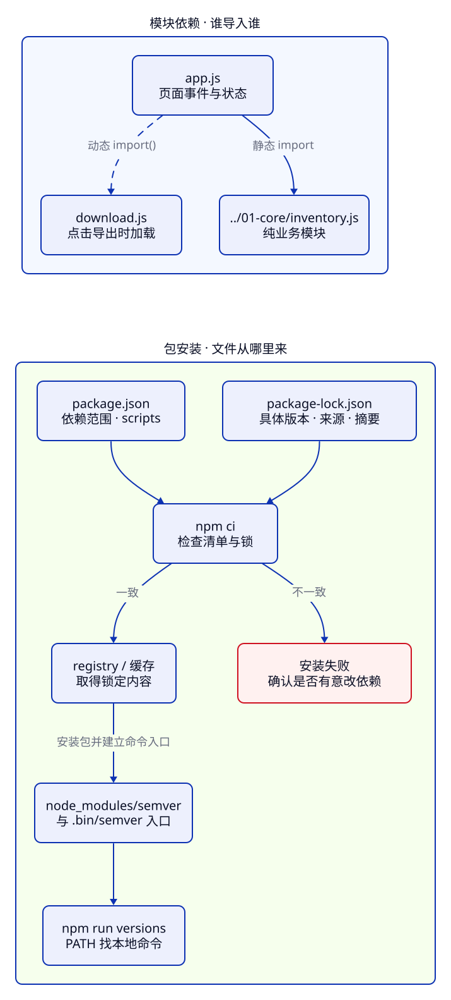

> **第 2 周 · 第 9 天** · 阅读跟做约 45 分钟 · 练习约 40 分钟\
> 前置：C16、C17 · 运行：Node 24 与 npm 11 · 示例已运行验证

## 这一课解决什么问题

C17 的库存报表已经能运行。把项目交给同事，还得说明要装什么、装哪个版本、怎样启动。

你写了 package.json，安装工具包。自己能用，同事却拿到另一个版本；CI 又说清单与锁文件不一致。怎样让别人复现同一个项目？

npm 管理依赖和项目命令，Node 执行 cli.js。本课把报表整理成可以重新安装的 npm 项目。

学完你能：

- 读懂 package.json，把长命令收进两个 scripts
- 按用途区分 dependencies、devDependencies 和 peerDependencies
- 判断精确版本、`^`、`~` 接受哪些版本
- 对照依赖树与锁文件，选择 npm install 或 npm ci
- 用 npm exec / npx 运行包命令，并定位一次真实安装失败

示例在 [examples/c18](https://github.com/socoo123/js_web/tree/main/examples/c18)，贯穿项目在 [examples/inventory/03-tooling](https://github.com/socoo123/js_web/tree/main/examples/inventory/03-tooling)。先用 `node --version` 和 `npm --version` 确认环境；Node 的安装通常已经带有 npm。

## Java 程序员先看这里

| Java 经验 | npm 中的对应 | 差异 |
| --- | --- | --- |
| pom.xml | package.json | 都描述项目和依赖；scripts 是任意命令，没有 Maven 的固定构建生命周期 |
| Maven Central | npm registry | 都提供包与版本信息；npm 包通常用包名或 `@scope/name` 标识 |
| dependency scope | 依赖类别 | devDependencies 按开发用途划分，和 Maven 的 test/provided scope 不能逐项对应 |
| dependency:tree | npm ls / npm explain | 看逻辑依赖关系；磁盘上可能提升、共享，也可能并存多个版本 |
| 固定依赖版本 | package-lock.json | 锁住整棵安装树，包括间接依赖、来源和完整性摘要 |

## 1. package.json：项目清单，也是命令入口

[package.json](https://docs.npmjs.com/cli/v11/configuring-npm/package-json/) 是严格的 JSON：键用双引号，没有注释或末尾多余的逗号。空项目在自己的目录用 `npm init -y` 创建；阶段 3 已有清单，直接编辑。

阶段 3 的完整清单：

**先猜一猜：** 这里的 `0.1.0` 和 `7.8.5` 分别是谁的版本？执行 `npm run report` 时，是 npm 解释 JS 吗？

```json
{
  "name": "inventory-tooling",
  "version": "0.1.0",
  "private": true,
  "type": "module",
  "scripts": {
    "report": "node cli.js",
    "versions": "semver -r \"^7.0.0\" 6.3.1 7.8.5 8.0.0"
  },
  "devDependencies": {
    "semver": "7.8.5"
  }
}
```

`version` 是库存项目自己的版本；devDependencies 中的值才是 semver 包的版本。`private: true` 阻止 npm 发布这个项目；`type: "module"` 让 Node 按 ESM 解释本项目的 .js 文件。

进入 `examples/inventory/03-tooling`，执行：

```sh
npm ci
npm run report
npm run
```

第一条按已有锁安装；第二条输出 C17 的报告：6 种商品、52 件、2634800 分；第三条列出两个可用脚本。

scripts 的键是命令名，值是交给 shell 执行的文本。`npm run report` 启动 `node cli.js`，Node 才开始加载 JS。以后入口文件改名，使用者仍可沿用 report 命令。

[`npm run`](https://docs.npmjs.com/cli/v11/commands/npm-run/) 会以当前包的根目录作为脚本工作目录。这里就是 03-tooling，传给 cli.js 的相对文件路径也从这里计算。脚本非零退出时，npm 命令同样失败，可以让 CI 停下来。

Java 的 Maven 插件通常接入 compile、test、package 等生命周期；npm 中的 report、versions 都是本项目自定的名称。`npm test` 是运行 test 脚本的简写，测试工具要由项目自己选择。

## 2. 依赖类别：按谁需要它来分

dependencies 表示应用运行需要的包，devDependencies 表示开发、构建、测试需要的工具。安装到项目本地后，依赖记录在清单中，同事才能一起安装。

当前报表只用 Node 内建模块和已有业务代码。本课添加 semver 练习版本匹配，把它放在 devDependencies。

在 `examples/inventory/03-tooling` 执行，添加或确认这个依赖：

```sh
npm install --save-dev --save-exact semver@7.8.5
```

结果：package.json 的 devDependencies 中记录 `"semver": "7.8.5"`，package-lock.json 记录安装结果，本目录的 node_modules 中出现 semver。`--save-dev` 可简写为 `-D`；`--save-exact` 保存精确版本。去掉 `--save-dev`，添加的包默认记入 dependencies。

三类声明表达不同的关系：

| 字段 | 谁需要它 | 典型场景 |
| --- | --- | --- |
| dependencies | 应用代码 | 程序运行时导入的第三方数据处理库 |
| devDependencies | 开发者与构建环境 | 版本检查工具、Vite、Vitest |
| peerDependencies | 使用这个库的宿主项目 | 组件库声明「我需要与你的 React 使用兼容版本」 |

peerDependencies 是**兼容要求**。组件库声明 `"react": "^19.0.0"`，表示它希望与应用提供的 React 协作，而不是各自随意拿一套。npm 11 默认会尝试安装 peer 依赖；要求无法协调时，可能报 ERESOLVE。排查时读错误里的包名和版本范围，再决定升级哪个包。

它与 Maven provided scope 在「依赖宿主」这一点相像，安装与冲突处理规则不同。

默认的开发安装会包含 devDependencies；`npm ci --omit=dev` 会在磁盘安装中省略开发依赖，锁文件仍保留它们的记录。用于生成网页的构建机需要 Vite 等开发工具，构建完成后上传静态产物即可；浏览器不会读取 package.json 来安装依赖。

### registry：包从哪里来

registry 提供包元数据和下载地址。npm 默认使用公共 registry，团队也可在 .npmrc 配置内部源。

在 `examples/inventory/03-tooling` 执行：

```sh
npm config get registry
npm view semver@7.8.5 version
```

默认配置返回 `https://registry.npmjs.org/`，第二条打印 `7.8.5`。npm view 只读元数据，install 才改变安装。公司内部源的配置可在项目或用户 .npmrc 中查看。

和 Java 下载 JAR 一样，下载不等于声明依赖。项目实际使用的包应直接声明，不靠别的包碰巧带进来。

## 3. 版本范围：允许什么，与装了什么分开看

语义化版本的三段是主版本、次版本、补丁版本。按约定，破坏兼容的变化升级主版本，兼容的新功能升级次版本，兼容的修复升级补丁版本。

package.json 可以写一个精确版本，也可以写**允许范围**。下面只讨论正式版本，范围规则用 npm 自己也使用的 [semver 包](https://github.com/npm/node-semver)来观察。

**先猜一猜：** `^7.0.0` 会接受 8.0.0 吗？`^0.2.3` 会接受 0.3.0 吗？

在 `examples/c18/install-lab/ranges.js` 中，四次判断分别演示一个范围：

```js
import semver from "semver";

console.log(semver.satisfies("7.8.5", "^7.0.0"));
console.log(semver.satisfies("8.0.0", "^7.0.0"));
console.log(semver.satisfies("7.9.0", "~7.8.5"));
console.log(semver.satisfies("0.3.0", "^0.2.3"));
```

```text
true
false
false
false
```

这些判断不要求候选版本已发布。按后面的「自己尝试」创建实验副本，在副本目录执行 `npm run ranges` 即可运行。

| 要求 | 对正式版本的允许范围 | 接受 / 拒绝 |
| --- | --- | --- |
| `7.8.5` | 只接受 7.8.5 | 接受 7.8.5，拒绝 7.8.6 |
| `~7.8.5` | `>=7.8.5 <7.9.0` | 接受 7.8.6，拒绝 7.9.0 |
| `^7.8.5` | `>=7.8.5 <8.0.0` | 接受 7.9.0，拒绝 8.0.0 |
| `^0.2.3` | `>=0.2.3 <0.3.0` | 接受 0.2.4，拒绝 0.3.0 |
| `^0.0.3` | 只接受 0.0.3 | 拒绝 0.0.4 |

`^` 保留最左边非零的那一段；所以不能记成「主版本不变就行」。`~` 在写全三段时只放行补丁更新。带 beta、rc 的预发布版本默认有额外的匹配限制，日常项目先选择明确的正式版本。

latest 是 registry 上可移动的标签，不是「永远使用这个具体版本」。安装时选择的范围描述意图，锁文件记录这次具体选中了谁。即便直接依赖写成精确版本，它的间接依赖也可能使用范围，仍然需要锁文件。

版本号传达兼容约定，升级后仍要运行项目与测试；Maven 项目也同样需要检查依赖图的变化。

## 4. 锁文件与安装：先确定这次有没有改依赖

[package-lock.json](https://docs.npmjs.com/cli/v11/configuring-npm/package-lock-json/) 记录具体安装树。对 registry 包，重要字段包括 version、resolved 和 integrity：具体版本、下载来源、包内容的完整性摘要。

在 `examples/c18` 执行 `node lock.js`，读取阶段 3 的实际锁文件：

```js title="lock.js"
import { readFile } from "node:fs/promises";

const lock = JSON.parse(await readFile(
  new URL("../inventory/03-tooling/package-lock.json", import.meta.url), "utf8",
));
const entry = lock.packages["node_modules/semver"];
console.log("锁文件格式", lock.lockfileVersion);
console.log("具体版本", entry.version);
console.log("开发依赖", entry.dev);
console.log("来源是 tarball", entry.resolved.endsWith(".tgz"));
console.log("有完整性摘要", entry.integrity.startsWith("sha512-"));
```

```text
锁文件格式 3
具体版本 7.8.5
开发依赖 true
来源是 tarball true
有完整性摘要 true
```

packages 的空字符串键表示项目自身，`node_modules/semver` 键表示一个安装位置。lockfileVersion 是锁文件的格式版本，与项目和依赖的版本无关。integrity 用于检查取得的内容是否与锁定摘要匹配，包的用途和质量仍需另外判断。

### install 和 ci 各用在哪里

| 当前任务 | 命令 | 对清单和锁的处理 |
| --- | --- | --- |
| 主动新增或调整依赖 | `npm install 包名@版本` | 保存要求并更新锁文件 |
| 本地安装，无意改变依赖 | `npm install` | 锁中版本满足要求就沿用；不满足时重新解析并更新锁 |
| 从已提交的项目复现安装 | `npm ci` | 要求已有锁且依赖要求一致；重建 node_modules，不改清单或锁 |

[`npm ci`](https://docs.npmjs.com/cli/v11/commands/npm-ci/) 适合新克隆项目和 CI。已有 node_modules 会被清理并重新安装，里面的手工改动会丢失。要添加包，使用 install；ci 的任务是执行已经确定的依赖选择。

调整依赖后，检查清单与锁的差异、运行项目再一起提交。node_modules 是可重新生成的结果，放进 .gitignore。

可复现安装还要对齐 Node/npm 与影响依赖树的配置；平台相关的可选包在不同系统上可能不同。锁文件负责固定依赖选择，项目的运行与构建仍受环境影响。

### 看树：是谁把包带进来的

在 `examples/inventory/03-tooling` 执行：

```sh
npm ls --depth=0
npm ls --all
npm explain semver
```

前两条都能看到项目下的 `semver@7.8.5`，因为当前它没有额外的运行依赖。第三条会显示 node_modules/semver，并指出它来自根项目的 dev 声明。

depth=0 看直接依赖，all 展开间接依赖，explain 解释安装原因。npm ls 画逻辑依赖树；磁盘目录可能提升兼容版本供多处共享，也可能并存不同版本，与 Maven 的「最近依赖优先」机制不同。

## 5. 本地命令、npm exec 与 npx

有些包除了能被 import，还提供命令行入口。semver 包的 bin 字段声明了 semver 命令，安装后 npm 会在 node_modules/.bin 下创建入口。

npm run 把本地 .bin 加入脚本的 PATH，versions 因而能直接写 semver，使用项目安装的版本。

在 `examples/inventory/03-tooling` 执行下面三条，效果相同：

```sh
npm run versions
npm exec --no -- semver -r "^7.0.0" 6.3.1 7.8.5 8.0.0
npx --no -- semver -r "^7.0.0" 6.3.1 7.8.5 8.0.0
```

每条的业务输出都是 `7.8.5`：`-r` 按版本范围筛选候选项，只有它符合。第一条还会打印脚本名与实际命令。`--` 结束 npm/npx 对选项的解析，后面的 `-r` 交给 semver。

[`npm exec`](https://docs.npmjs.com/cli/v11/commands/npm-exec/) 和 npx 可以执行包命令，不要求先给它起 script 名。`--no` 拒绝缺失包的临时安装请求；本例先用 ci 安装了项目本地版本。

允许临时安装时，工具会把缺失的包准备到 npm 缓存中执行，通常不会写入本项目的依赖清单；交互终端可能出现安装确认。长期要用的命令，应作为项目依赖安装，再写进 scripts，这样版本由项目的锁文件控制。全局安装的版本则独立于当前项目。



读下半部：清单写要求，锁文件写具体选择，node_modules 是安装结果。这里画本课的单个包及命令入口；包之间的依赖关系用 npm ls 阅读。上半部回顾模块之间的导入方向。

## 常见错误与调试

### 只改清单，npm ci 就失败了

:::tip[自己尝试 · Node]
1. 进入 `examples/c18`，按下面命令生成 .cache/install-lab 副本并安装。已有副本时会提示继续使用。
2. 改清单、观察失败并修复。
3. 练习只改这个副本中的文件。

预期：第一次 ci 成功；改成 6.3.1 后 ci 非零退出；更新锁后 ci 再次成功，ranges 的四行结果仍为 true、false、false、false。
:::

在 `examples/c18` 执行：

```sh
node prepare-lab.js
cd .cache/install-lab
npm ci
npm run ranges
```

首次安装得到 semver 7.8.5，ranges 输出第 3 节的四行布尔值。接下来始终留在这个副本目录。

**现象**：只把清单里的版本改成 6.3.1，安装失败：

```sh
npm pkg set devDependencies.semver=6.3.1
npm ci
```

**工具**：读取终端错误，再用 `npm pkg get devDependencies` 看清单，在编辑器打开同目录的 package-lock.json，搜索 `node_modules/semver`。

**证据**：清单要求 6.3.1，锁中却是 7.8.5。错误包含 `Invalid: lock file's semver@7.8.5 does not satisfy semver@6.3.1`，指出了冲突的两个具体版本。

**原因**：npm pkg set 只改了清单，ci 校验发现锁里的版本不满足新要求。它按约定停止，不替你重新选依赖。

**修复**：本次有意练习切换版本，在同一副本中运行：

```sh
npm install
npm ci
npm run ranges
npm ls --depth=0
```

install 按清单安装 6.3.1 并同步锁；ci 再按新锁重建。如果是误改清单，则恢复清单中的原版本后再 ci。

**确认**：ci 成功；依赖树显示 semver 6.3.1；ranges 的四行结果相同，说明本例所用 API 在两个版本上行为一致。

### 在仓库根目录运行，却提示找不到 report

**现象**：在仓库根目录执行 `npm run report`，得到 `Missing script: "report"`，而 cli.js 明明存在。

**工具**：在当前目录运行 `npm prefix` 查看 npm 识别的项目路径，再用 `npm run` 列出这个项目的脚本。

**证据**：路径是网站根目录，脚本列表里有 dev、build、examples，没有 report。

**原因**：网站和阶段 3 是两个独立 npm 项目，npm 正在读取网站的清单。

**修复**：进入 `examples/inventory/03-tooling` 再执行 `npm run report`。

**确认**：npm prefix 指向 03-tooling，报告打印总库存 52。

## 练习

### 练习 1：预测清单与锁中的值

**先猜一猜：** 写出四行输出，再在 `examples/c18` 运行 `node prediction.js`。验收：解释第四行为什么为 false，以及这是否足以证明锁文件有错。

```js title="prediction.js"
const manifest = {
  version: "0.1.0",
  devDependencies: { semver: "^7.0.0" },
};
const locked = { version: "7.8.5" };

console.log(manifest.version);
console.log(manifest.devDependencies.semver);
console.log(locked.version);
console.log(manifest.devDependencies.semver === locked.version);
```

<details>
<summary>提示</summary>

项目版本、允许范围和具体依赖版本分属三个位置。最后一行只比较两个字符串是否完全相同。

</details>

<details>
<summary>参考答案</summary>

依次为 0.1.0、^7.0.0、7.8.5、false。字符串不同很正常；有效锁文件要求具体版本满足允许范围，7.8.5 就满足 ^7.0.0。只用字符串的 === 无法判断依赖要求是否得到满足。

</details>

### 练习 2：修复安装流程

在实验副本完成上面的 6.3.1 安装后，只把清单改回 7.8.5。目标：先预测 ci 的行为，再修复，保留一份同步的清单与锁。验收：依赖树显示 7.8.5，ci 和 ranges 都成功。

<details>
<summary>提示</summary>

先区分这是有意改变版本，还是误改。用 npm pkg get 和锁文件中的 version 找证据，不靠已有 node_modules 猜结果。

</details>

<details>
<summary>参考答案</summary>

在副本目录执行 `npm pkg set devDependencies.semver=7.8.5`。ci 会失败，因为锁仍选中 6.3.1。用 npm install 同步锁后，再执行 npm ci、npm run ranges 和 npm ls --depth=0。这里只改了直接依赖的版本，范围判断结果保持不变。

</details>

### 练习 3：通过脚本生成分类报告

从阶段 3 开始，用 report 脚本读取固定商品数据，保存新文件 accessories-c18.txt，只统计配件。验收：2 种商品、28 件、587200 分；再次写同一个文件应失败，已有内容保留。

<details>
<summary>提示</summary>

report 已经包含 node cli.js。参数放在 npm run report 后的 `--` 之后，仍按输入、输出、分类的顺序传递。

</details>

<details>
<summary>参考答案</summary>

在阶段 3 目录执行 `npm run report -- ../../shared/products.json accessories-c18.txt 配件`。npm 把三个参数交给 cli.js；C17 的 wx 写入规则仍然生效，重复写入得到 EEXIST，npm 命令非零退出。

</details>

## 项目进度

从 C17 的 `examples/inventory/03-tooling` 继续：修改清单，新增 report、versions 两个脚本及 semver 开发依赖，由 npm 更新本目录的锁。

在该目录执行 `npm ci`，再运行 report 和 versions。前者输出 52 件、2634800 分、售罄 1 种、低库存 2 种；后者筛出 7.8.5。

在同一目录给报表传参：

```sh
npm run report -- ../../shared/products.json accessories-c18.txt 配件
```

预期：终端与新文件都得到配件报告，2 种、28 件、587200 分。练习 3 已生成该文件时，换一个新输出名。文件保护和错误出口仍由原 cli.js 负责。

提交的工程资料是源码、清单和锁；报告文件是你自己的运行结果。网站根目录的 package-lock.json 继续只服务网站工程，实验副本与阶段 3 各自安装自己的依赖。

## 小结

- package.json 描述项目、依赖要求和 scripts；npm 启动命令，Node 执行 JS。
- 运行依赖、开发依赖与 peer 兼容要求各有用途，不能按 Maven scope 逐字替换。
- 版本范围表达允许的选择，锁文件记录具体安装树；直接依赖写死也需要锁。
- 有意改依赖用 install，同步并提交清单和锁；复现已有项目用 ci。
- scripts 能找到本地 .bin；exec/npx 可直接运行包命令，临时安装与项目依赖是两种管理方式。

自测：

1. 项目 version、依赖版本、lockfileVersion 分别表示什么？
2. 为什么 ^0.2.3 拒绝 0.3.0，而 ^7.0.0 接受 7.8.5？
3. 有锁文件时，npm install 会每次挑最新版本吗？ci 会修改锁吗？
4. 一个包在依赖树里出现了，为什么业务代码仍应直接声明自己使用的包？
5. npm run 提示缺少脚本时，怎样确认它正在读取哪个项目？

下一课比较 Yarn、pnpm 和 Bun，观察它们各自负责的事，以及安装布局和锁文件的差异。

## 延伸阅读

- [npm：package.json 的字段与依赖类别](https://docs.npmjs.com/cli/v11/configuring-npm/package-json/)
- [npm：run 与项目脚本](https://docs.npmjs.com/cli/v11/commands/npm-run/)
- [npm：install 怎样使用锁文件](https://docs.npmjs.com/cli/v11/commands/npm-install/)
- [npm：ci 的安装规则](https://docs.npmjs.com/cli/v11/commands/npm-ci/)
- [npm：package-lock.json 的结构](https://docs.npmjs.com/cli/v11/configuring-npm/package-lock-json/)
- [node-semver：版本范围与命令行用法](https://github.com/npm/node-semver)
