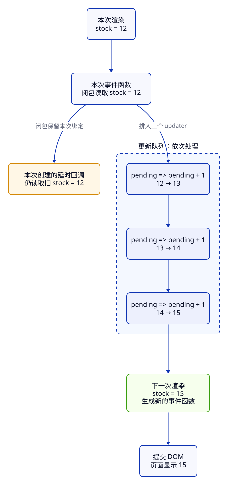

import CodeCompare from '../../../components/CodeCompare.astro';
import CodeExcerpt from '../../../components/CodeExcerpt.astro';
import LessonTask from '../../../components/LessonTask.astro';

> **第 2 周 · 第 12 天** · 阅读跟做约 55 分钟 · 实作约 40 分钟<br />
> 前置：JS 闭包、C21–C22 的 JSX 与 props · 运行：本地 React · 示例已运行验证

## 这一课解决什么问题

库存列表已经能显示六件商品，现在给 P001 增加三个按钮：连续补三件、立即补一件、延迟补三件。业务规则仍复用 core，React 负责让新库存出现在界面上。任务的两次验收是 **12→15**，以及“延迟 +3 期间立即 +1”得到 **16**。

继续自己 C22 完成后的工作区，当前目录仍是 `inventory/`，服务不用切换。只有补课或恢复时，才把任务卡中的 C22 起点解压到新目录并执行一次 `npm ci`。本课只新增 `src/react/StockActions.jsx`，修改同目录的 `App.jsx`；列表、工具栏、卡片继续使用上一课的文件。

<LessonTask lessonId="C23" />

## Java 程序员先看这里

<CodeCompare pairId="c23-state-queue" />

Java 这一侧只是普通赋值，不模拟 React。React 在事件结束后处理更新队列，再调用组件得到下一次界面。

<a id="1-事件发起更新usestate-记住状态"></a>

## 1. 用 state 记住界面需要的值

普通局部变量在每次组件调用时重建。`useState` 把需要跨渲染保留的值交给 React，返回本次快照和请求更新的 setter。

新建 `src/react/StockActions.jsx`，先写这一部分。它打开了组件函数，后面的处理函数和返回 JSX 都放在同一函数里。

<CodeExcerpt snippetId="c23-setup" />

初次渲染的 stock 是 P001 的 12；之后 React 使用保存的状态，初始参数不会在每次渲染都重置它。以后即使 product prop 改变，也不会自动用新 product.stock 同步这份局部 state。`add` 用共享的不可变更新函数取得下一库存，超过范围时保留原值。updater 不改 props，也不在里面写存储或发请求。

Java 局部变量自己赋值即可；React 的可见状态必须经过 setter，才能请求后续渲染。

<a id="2-状态快照setter-后面读到的还是本次值"></a>

## 2. 一次渲染的值是固定的

**先猜一猜：** 如果在一次点击里这样写，日志和下一次页面分别是什么？

```jsx
// 有问题的写法：把本次快照当成可以立即改变的变量
function restockThree() {
  setStock(stock + 1);
  setStock(stock + 1);
  setStock(stock + 1);
  console.log(stock);
}
```

从 12 开始，日志还是 12，下一次页面为 13。事件处理函数来自这一次渲染，里面三个 stock 都是 12；调用 setter 不会回头修改这个局部绑定。



先读左边的旧渲染，再沿队列读到下一次渲染。`setStock` 请求新快照，本次闭包保留旧快照。这与 Java 给局部变量连续赋值的机制不同。

<a id="3-批处理三次替换为何只加一次"></a>

<a id="4-函数式更新把计算交给队列"></a>

## 3. 批处理与更新队列

React 会把同一次事件里的更新一起处理，再提交界面。直接传值相当于“把待处理结果替换为这个值”，所以三次 `setStock(13)` 最终仍是 13。

如果新值依赖前一步结果，传入函数：`setStock(previous => previous + 1)`。React 依次把队列中的前一步结果交给下一步，12→13→14→15。把 Java/React 卡片右侧的 `restockThree` 放进组件，替换上面的错误版本。

**先猜一猜：** 从 12 开始，混合队列最后得到几？

```jsx
setStock(stock + 1); // 替换为 13
setStock((previous) => previous + 3); // 13 → 16
setStock(0); // 替换为 0
setStock((previous) => previous + 2); // 0 → 2
```

下一次页面为 2，当前事件中的 stock 仍为 12。队列按顺序计算，“替换”和“updater”可以混合，但日常递增统一用 updater 更容易读。

updater 必须保持纯粹：只根据输入计算返回值。开发时 StrictMode 可能重复调用它检查意外副作用；不能把“发请求、计次数、显示通知”写进去。Java 的纯函数也适合被重复调用，React 在这里依赖这个性质。

## 4. 延迟补货要基于执行时的待更新值

定时回调会捕获创建它的那次渲染。若点击时库存是 12，稍后写 `setStock(stock + 3)`，即使中途已经补到 13，也会被替换为 15。

在同一组件加入 `restockLater`，定时等待三秒，留出立即补货的操作时间：

<CodeExcerpt snippetId="c23-delay" />

updater 接到队列处理时的待更新值。先点延迟 +3，再点立即 +1，后来的 updater 从 13 计算出 16。闭包里的旧 stock 并没有被“刷新”，只是计算新值时不用它了。

有些业务需要保留点击时的信息，例如“把当时选中的商品交给盘点任务”，那就明确捕获它的 id。延迟增量应作用于哪个商品，与数量怎样累计是两个问题。Java 的异步回调同样需要明确捕获对象与时间点；React 还要经过渲染快照这一层。

<a id="5-延时回调先确定要保留哪个时刻的值"></a>

<a id="6-hooks-的顺序固定状态才有稳定位置"></a>

## 5. 完成事件入口，保持 Hooks 顺序

最后加入这些控件并关闭组件函数：

<CodeExcerpt snippetId="c23-controls" />

`onClick` 接收函数。写 `onClick={restockThree()}` 会在渲染时直接调用，可能造成重复更新。三个按钮传入的都是处理函数，点击时才执行。箭头函数也是函数值，不会因为写在 JSX 里就提前运行。

`useState` 放在组件顶层，每次渲染按相同顺序调用。条件决定显示什么，应放在调用 Hook 之后；不能在 if、循环、事件回调或提前 return 后才调用 Hook。React 据调用顺序关联 state，这不是 Java 的实例字段查找。

**完整替换** `src/react/App.jsx` 为下面内容。它保留 C22 的 ProductList 与 Toolbar 导入，再增加 StockActions 导入。ProductList 调用 `renderActions(product)`，只有 P001 返回操作区；卡片通过原有 children 显示它。

<CodeExcerpt snippetId="c23-app" />

P001 的操作区是本课的状态拥有者；外层静态卡片仍展示初始数据。当前库存请看操作区。下一课会把商品集合提升到统一 state，让卡片与汇总一起变化。

## 常见错误与调试

### 连续补三件只有 13

**现象**：刷新到 12，点一次连续补三件，只得到 13。

**工具**：浏览器打开 React DevTools → Components 选择 StockActions，查看 state；Sources 打开该文件，在处理函数的第一句 setter 设断点。

**证据**：断点处 stock 是 12，单步经过三个 setter 后仍是 12；三次参数都算成了 13。继续后 Components 显示新 state 为 13。

**原因**：这三次请求都是根据同一快照算出的替换值，没有累计队列结果。

**修复**：改为对照卡的三个函数式更新；延迟回调同样用 updater，不捕获旧 stock 做替换。

**确认**：完整刷新到 12，点一次连续补三件得到 15；再刷新，先延迟 +3 后立即 +1，先显示 13，三秒后显示 16。运行 `npm run lab -- check C23`，同一份 StockActions 的连续与延迟回归都应通过。错误写法分别让这两项得到 13 和 15；修复后得到 15 和 16。

## 练习

### 唯一任务：让 P001 的补货顺序正确

:::tip[自己尝试 · 本地 React]
1. 在当前工作区创建 StockActions：按第 1 节、对照卡右侧、第 4 节、第 5 节的顺序拼成**同一个文件**，不重复 import 或组件声明。
2. 修改 App 接入 P001 操作区；所有修改仍在当前工作区。
3. 故意先使用第 2 节的错误写法，按 Sources 步骤记录“12、三次 13、下一次页面 13”的证据。
4. 修为 updater，重新运行 `npm run lab -- check C23` 并完成两次页面操作。

预期：12→15；延迟 +3 与立即 +1 合并得到 16，原始数据文件仍为 12。
:::

<details>
<summary>提示</summary>

不要试图让 setter 后面的 stock 立刻变化。先把它想成“本次组件调用的参数”，再手算队列。延迟回调也保留自己的旧绑定，updater 才能接到前一步结果。

</details>

<details>
<summary>参考答案</summary>

四部分按正文顺序组成同一个组件：导入与初始化、连续补货函数、延迟处理函数、控件返回及结束大括号。三个 setter 都使用函数式更新，App 通过 ProductList 的 renderActions 只为 P001 添加它。检查直接渲染当前 StockActions；完整参考解在任务卡内。

</details>

## 项目进度

- P001 操作区能连续补货与延迟补货，两种操作共享同一个 state。
- updater 返回新状态，不在里面做外部副作用；Hooks 的调用顺序固定。
- 暂停时记录“C23 补货队列通过，下一步统一商品集合 state”。网页的完成标记仍由你主动选择。

## 小结

- state 是每次渲染的快照，setter 请求后续渲染。
- 同一事件中的更新排队处理；传值替换，传函数按前一步结果计算。
- 延迟回调保留旧闭包；累加使用 updater。
- updater 保持纯粹，Hooks 在顶层按固定顺序调用。

自测：为什么三次替换只加一件？updater 的 previous 由谁提供？延迟期间立即补一件为何可能被覆盖？StrictMode 为什么要求 updater 纯粹？

## 延伸阅读

- [React：state 如同一张快照](https://react.dev/learn/state-as-a-snapshot)
- [React：把一系列 state 更新加入队列](https://react.dev/learn/queueing-a-series-of-state-updates)
- [React：useState](https://react.dev/reference/react/useState)
- [React：Hooks 规则](https://react.dev/reference/rules/rules-of-hooks)
- [旧机制示例与验证记录](https://github.com/socoo123/js_web/tree/main/examples/c23)（按需参考）
