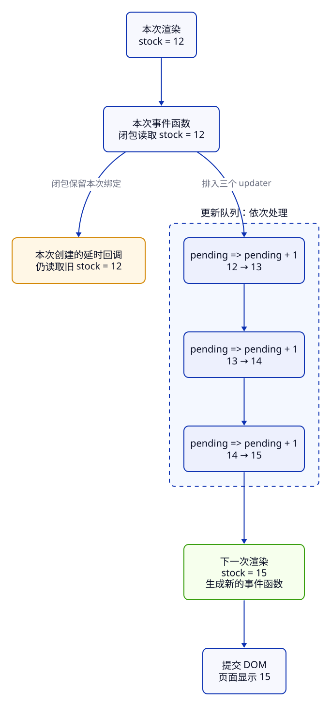

import CodeCompare from '../../../components/CodeCompare.astro';
import CodeExcerpt from '../../../components/CodeExcerpt.astro';
import Effect from '../../../components/Effect.astro';
import LessonTask from '../../../components/LessonTask.astro';
import Predict from '../../../components/Predict.astro';

## 这一课解决什么问题

库存列表已经能显示六件商品，这一课给 P001 加三个补货按钮：连续补三件、立即补一件、延迟补三件。三个按钮背后是同一个问题：点击之后，React 用哪个值算出新库存。业务规则继续复用 core，React 负责把新库存显示出来。

<Effect kind="page" preview="c23/actions" caption="完成后的效果：点一次「连续补三件」，P001 从 12 变成 15" />

学完你能：

- 用 `useState` 保存界面要记住的值，说清初始值什么时候生效。
- 解释连续三次 `setStock(stock + 1)` 为什么只加 1，并用 updater 改对。
- 让延迟补货接住中途的补货，同时遵守 Hooks 的调用规则。

<LessonTask lessonId="C23" />

## Java 程序员先看这里

<CodeCompare pairId="c23-state-queue" />

Java 一侧每次赋值都立刻改变变量。React 一侧只是把三次更新排进队列，事件结束后才算出下一次界面。

<a id="1-事件发起更新usestate-记住状态"></a>

## 1. 用 state 记住界面需要的值

React 每渲染一次，就重新调用一次组件函数，普通局部变量也随之重建。需要跨渲染保留的值叫 state，交给 React 保存。`useState` 返回本次的值和一个请求更新的 setter。

新建 `src/react/StockActions.jsx`，先写组件的开头。后面几节的函数和 JSX 都接在这个组件里。

<CodeExcerpt snippetId="c23-setup" />

<Effect kind="demo" demo="c23-first-render" caption="点一次 +1：12 → 13；再换成 P002，stock 仍是 13" />

**记住：** `useState(product.stock)` 的参数只在第一次渲染时使用，之后 React 返回它保存的值。

所以 product 换了，这份 state 不会自动跟着换。`add` 复用 core 的 `updateStock` 算出下一库存，超出上限时保留原值。

**Java 对照：** Java 给局部变量赋值就改了它；React 里看得见的状态必须经过 setter，才能请求下一次渲染。

<a id="2-状态快照setter-后面读到的还是本次值"></a>

## 2. 一次渲染的值是固定的

每次渲染拿到的 state 像一张快照：这次渲染里创建的函数，读到的始终是这张快照。调用 setter 只是请求下一次渲染，不会改手上的值。

<Predict question="从 12 开始点一次，Console 打印几？下一次页面显示几？">

```jsx
// 有问题的写法：把本次快照当成可以立即改变的变量
function restockThree() {
  setStock(stock + 1);
  setStock(stock + 1);
  setStock(stock + 1);
  console.log(stock);
}
```

<div slot="answer">

<Effect kind="console" caption="下一次页面：P001 当前库存 13 件">

```text
12
```

</Effect>

这个处理函数来自 stock 为 12 的那次渲染，三行都等于 `setStock(13)`。日志读到的也是同一个 12。

</div>
</Predict>



图从左往右读：旧渲染拿到 12，事件把更新排进队列，新渲染拿到算好的值。旧回调仍然保留旧快照。

**Java 对照：** Java 连续给局部变量赋值，每一行立刻生效；React 的 setter 不会改本次渲染里的 stock。

<a id="3-批处理三次替换为何只加一次"></a>

<a id="4-函数式更新把计算交给队列"></a>

## 3. 批处理与更新队列

React 把同一次事件里的更新先排进队列，事件结束后一起处理，这叫批处理。传值的意思是「把结果替换成这个值」，所以三次 `setStock(13)` 仍是 13。

新值依赖前一步结果时，传一个函数，例如 `setStock((previous) => previous + 1)`。这种函数叫 updater，React 处理队列时把前一步的结果交给它。

把对照卡右侧的 `restockThree` 放进组件，替换上一节的错误版本。

<Predict question="从 12 开始，这个混合队列处理完是几？本次事件里的 stock 是几？">

```jsx
setStock(stock + 1); // 替换为 13
setStock((previous) => previous + 3);
setStock(0); // 替换为 0
setStock((previous) => previous + 2);
```

<div slot="answer">

```text
队列：12 → 13 → 16 → 0 → 2
下一次页面：2
本次事件里的 stock：12
```

队列按顺序处理，替换和 updater 可以混用。日常递增统一写 updater，读代码的人不用手算。

</div>
</Predict>

updater 必须是纯函数：只根据参数算出返回值。开发时的检查模式 StrictMode 可能把它调用两次来暴露副作用，所以发请求、计数、弹通知都不能写在里面。

**Java 对照：** Java 的纯函数同样可以放心重复调用；React 正是依赖这一点来检查 updater。

## 4. 延迟补货要基于执行时的待更新值

定时回调捕获的是创建它的那次渲染。点击时库存是 12，稍后执行 `setStock(stock + 3)`，会把中途补到的库存直接替换掉。

在同一组件里加入 `restockLater`。三秒的等待留出了中途补货的时间：

<CodeExcerpt snippetId="c23-delay" />

<Effect kind="demo" demo="c23-update-queue" caption="① 三次传值得 13，三次 updater 得 15。② 延迟 +3 期间立即 +1：updater 得 16，旧值写法得 15。" />

updater 拿到的是定时器执行时队列里的待更新值，所以从中途补过的库存算起。闭包里的旧 stock 并没有被「刷新」，只是计算时不再用它。

如果业务要的恰好是点击那一刻的信息，比如把当时选中的商品交给盘点任务，就明确捕获它的 id。作用在哪个商品和数量怎样累计，是两个问题。

**Java 对照：** Java 的 lambda 只能捕获 effectively final 的局部变量，看到的同样是创建时的值；React 还多了一层渲染快照。

<a id="5-延时回调先确定要保留哪个时刻的值"></a>

<a id="6-hooks-的顺序固定状态才有稳定位置"></a>

## 5. 完成事件入口，保持 Hooks 顺序

最后加入这些控件，并关闭组件函数：

<CodeExcerpt snippetId="c23-controls" />

<Effect kind="page" preview="c23/actions" caption="接入 App 后的操作区：一行状态、三个按钮，点一次「连续补三件」显示 15" />

`onClick` 接收的是函数，点击时才执行。写成 `onClick={restockThree()}` 会在渲染时就调用它，造成重复更新。箭头函数也是函数值，写在 JSX 里不会提前运行。

`useState` 这类以 use 开头的 React 函数叫 Hook。Hook 必须写在组件顶层，每次渲染按相同顺序调用；不要放进 if、循环、事件回调，也不要放在提前 return 之后。

**Java 对照：** Java 按字段名找实例字段；React 按调用顺序找 state，顺序一变就会对错位置。

完整替换 `src/react/App.jsx`。它保留 C22 的 ProductList 和 Toolbar，新增 StockActions 导入。ProductList 对每个商品调用 `renderActions`，只有 P001 返回操作区：

<CodeExcerpt snippetId="c23-app" />

保存后刷新页面，P001 卡片里的状态行依次显示：

```text
刷新后：P001 当前库存 12 件
点一次「连续补三件」：P001 当前库存 15 件
```

外层卡片仍显示初始数据，当前库存看操作区里的状态行。P001 的操作区就是这份 state 的拥有者。

## 常见错误与调试

### 连续补三件只有 13

**现象**：刷新后是 12，点一次「连续补三件」只得到 13。

**工具**：React DevTools → Components，选中 StockActions 看 State。Sources 打开 StockActions.jsx，在处理函数第一句 setter 的行号上单击，设断点。

**证据**：

```text
停在第一句 setter：stock = 12
单步越过三句 setter：stock 仍是 12，三次参数都是 13
继续运行后，Components 里的 State：13
```

**原因**：三次请求都是用同一张快照算出的替换值，队列里没有累计。

**修复**：改成对照卡里的三个 updater。延迟回调同样用 updater，不用旧 stock 做替换。

**确认**：刷新后重做第 1 步，得到 15；再刷新，先点延迟补三件、再点立即补一件，先显示 13，三秒后显示 16。最后运行任务卡里的检查：

<Effect kind="terminal" title="修复后：检查通过" caption="错误写法时检查失败：连续补三件只得到 13，延迟补货只得到 15">

```text
C23：3 组隔离浏览器场景通过；只要求本课和必要前置行为，未触碰现有浏览器数据。
C23：86 条当前工作文件检查通过；没有修改商品数据或源码。
```

</Effect>

## 练习

### 唯一任务：让 P001 的补货顺序正确

:::tip[自己尝试 · 本地 React]
1. 按第 1 节、对照卡右侧、第 4 节、第 5 节的顺序，把四段代码拼成同一个 StockActions 文件，不重复 import 或组件声明。
2. 按第 5 节替换 App，接入 P001 操作区。
3. 先故意换成第 2 节的错误写法，按「常见错误与调试」记下 12、三次 13、页面 13 的证据。
4. 改回 updater，运行任务卡里的检查，再在页面上完成两次操作。

预期：

- 连续补三件：12→15。
- 延迟 +3 期间立即 +1：得到 16。
- 数据文件里的 P001 仍是 12。
:::

<details>
<summary>提示</summary>

不要指望 setter 后面的 stock 立刻变化。把它当成「本次组件调用的参数」，再手算队列。延迟回调也保留着自己的旧绑定，只有 updater 能接到前一步的结果。

</details>

<details>
<summary>参考答案</summary>

同一个组件按顺序由四部分组成：导入与初始化、连续补货函数、延迟补货函数、控件与结尾的大括号。

三处 setter 都用 updater：连续补货按队列累计，延迟补货从执行时的待更新值算起。

App 通过 ProductList 的 renderActions 只给 P001 加操作区。完整参考解在任务卡里。

</details>

## 项目进度

完成本课，就可以回到 L3 勾选[本课这一步](/js_web/labs/l3/#step-l3-c23-1)。勾选前确认：

- 刷新后操作区显示 12，点一次「连续补三件」得到 15。
- 延迟 +3 期间立即 +1，最终显示 16。
- updater 只计算返回值，不做外部副作用；Hooks 按固定顺序调用。

下一步：[C24 数组更新、key 与派生数据](/js_web/05-react/c24-arrays-keys-derived/)，把商品集合交给 App 统一管理。

## 小结

- state 是每次渲染的快照，setter 请求下一次渲染。
- 同一事件里的更新排队处理：传值是替换，传函数按前一步结果计算。
- 延迟回调保留旧闭包；需要累加时用 updater。
- updater 保持纯粹，Hooks 在顶层按固定顺序调用。

自测：

- 为什么三次替换只加一件？
- updater 的 previous 由谁提供？
- 延迟期间立即补一件，为什么旧值写法会把它覆盖？
- StrictMode 为什么要求 updater 纯粹？

下一课把商品集合交给 App，让卡片和汇总跟着库存一起变。

## 延伸阅读

- [React：state 如同一张快照](https://react.dev/learn/state-as-a-snapshot)
- [React：把一系列 state 更新加入队列](https://react.dev/learn/queueing-a-series-of-state-updates)
- [React：useState](https://react.dev/reference/react/useState)
- [React：Hooks 规则](https://react.dev/reference/rules/rules-of-hooks)
- [旧机制示例与验证记录](https://github.com/socoo123/js_web/tree/main/examples/c23)（按需参考）
