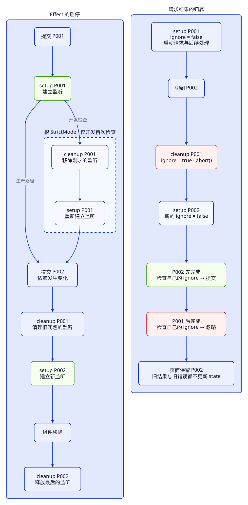

> **第 3 周 · 第 15 天** · 阅读跟做约 45 分钟 · 练习约 40 分钟\
> 前置：C13、C23、C28、C29 · 运行：Node 24 与本地 React · 示例已运行验证

## 这一课解决什么问题

你先打开机械键盘详情，又切到无线鼠标。鼠标很快加载出来，一秒后，详情却变回了键盘。下拉框仍选着 P002，Console 也没有报错。

加上取消请求以后，另一个问题出现了：新商品还没回来，“加载中”已经消失。两次请求操作同一份界面状态，谁最后写入，谁就决定了页面。我们要建立的规则是：**只有当前这次请求，才有权更新当前详情。**

学完你能：

- 用一份状态描述未选择、加载、成功、失败和取消，明确每种状态显示什么
- 区分 HTTP 失败、网络失败与数据解析失败，提供可用的重试入口
- 解释请求发出顺序为什么不决定返回顺序
- 将取消资源与忽略旧结果配合使用，保护成功、错误和加载状态
- 用 Network、断点和可控制完成顺序的测试定位竞态

普通 JS 例子在 [examples/c30](https://github.com/socoo123/js_web/tree/main/examples/c30)，进入目录运行 `node 文件名.js`。React 继续使用 [examples/inventory/04-react](https://github.com/socoo123/js_web/tree/main/examples/inventory/04-react)：在该目录执行 `npm ci`、`npm run dev -- --host 127.0.0.1`。

打开终端给出的 /js_web/ 地址，加上 `labs/requests.html?case=answer`。下文用 case 指代实验。实验读取本地的六份商品 JSON；竞态实验在文件读取后加入延时，模拟后续处理。Network 能看到文件请求，Console 能看到处理开始和结束，两段时间要分开看。

## Java 程序员先看这里

| Java 经验 | 浏览器 / React 对应 | 一句话差异 |
| --- | --- | --- |
| enum 表示业务阶段 | status 字符串区分请求阶段 | 一份状态比多个互相独立的布尔值容易保持一致 |
| Future 完成回调 | Promise 的 then / await 后续代码 | 完成顺序可以与调用顺序不同 |
| cancel 终止任务的请求 | AbortController 发出取消信号 | 只有支持 signal 的操作会响应，普通后续代码仍需检查归属 |
| try / catch / finally | 异步请求的成功、失败和收尾 | finally 属于某一次调用，不天然属于当前页面 |
| 多线程竞态 | 多个异步结果竞争更新 state | 即使 JS 回调逐个执行，也会因为顺序不同得到错误结果 |

## 1. 先画清请求状态，再写 fetch

详情区域先用一个 status 表示当前阶段。选中编号属于用户意图，返回的数据属于某次请求；将二者联系起来，才能判断正在显示谁。

| status | 进入条件 | 页面内容与下一步 |
| --- | --- | --- |
| idle | 还没选择，或清空选择 | 提示选择商品 |
| loading | 开始一次请求或重试 | 当前编号、加载提示、取消按钮 |
| success | 当前请求解析并校验成功 | 商品详情、重新加载按钮 |
| error | 当前请求失败 | 错误信息、重试按钮 |
| cancelled | 用户主动取消当前请求 | 取消提示、重新加载按钮 |

本课采用清晰的初学者策略：切换商品或重新请求时，清空旧内容和旧错误，进入 loading。这样加载 P002 时不会暂时把 P001 当成 P002 展示。保留旧内容也可以是一种产品设计，但要另外标出它属于哪个编号。

ProductDetails 中用 `useState({ status: "idle", id: null })` 保存请求。loading 只带 id，success 再带 data，error 再带 error，避免把上一轮的字段顺手留在对象里。RequestView 根据 status 渲染，下面是它的完整实现：

```jsx
import { formatPriceCents } from "./product-form.js";

export default function RequestView({ request, onCancel, onRetry }) {
  const { status, id, data, error } = request;
  return <section aria-labelledby="details-heading" aria-busy={status === "loading"}>
    <h2 id="details-heading">初始商品详情</h2>
    {status === "idle" && <p role="status">请选择商品查看详情。</p>}
    {status === "loading" && <p role="status">正在加载 {id}… <button type="button" onClick={onCancel}>取消加载</button></p>}
    {status === "error" && <><p role="alert">加载 {id} 失败：{error}</p><button type="button" onClick={onRetry}>重试详情</button></>}
    {status === "cancelled" && <><p role="status">已取消 {id}。</p><button type="button" onClick={onRetry}>重新加载</button></>}
    {status === "success" && <>
      <p role="status">详情已加载：{data.id}</p>
      <p>{data.name} · {data.category} · 初始库存 {data.stock} 件 · ¥{formatPriceCents(data.priceCents)}</p>
      <button type="button" onClick={onRetry}>重新加载</button>
    </>}
  </section>;
}
```

打开 answer，先看到“正在加载 P001”，处理结束显示“详情已加载：P001”和机械键盘的初始库存 12、¥399.00。loading 时只有取消入口；成功后出现重新加载入口。`aria-busy` 告诉辅助技术区域还在更新，失败信息用 alert，普通阶段提示用 status。

这份视图只处理显示与事件上报，发请求的生命周期放在 ProductDetails。

## 2. HTTP 返回了，不等于商品加载成功

[`fetch`](https://developer.mozilla.org/zh-CN/docs/Web/API/Fetch_API/Using_Fetch) 的 Promise 在拿到响应时就能兑现。404、500 也是 HTTP 响应，需要主动检查 response.ok；成功响应的 body 还要异步读取。

src/product-api.js 只负责定位资源和请求，将响应交给解析函数：

```js
import { readProductResponse } from "./read-product.js";

export async function fetchProduct(productId, { signal } = {}) {
  const url = `${import.meta.env.BASE_URL}data/products/${encodeURIComponent(productId)}.json`;
  const response = await fetch(url, { signal, headers: { Accept: "application/json" } });
  return readProductResponse(response, productId);
}
```

选 P001 会请求 `/js_web/data/products/P001.json`。`BASE_URL` 来自 Vite 的 base 配置，开发和生产都带 /js_web/；encodeURIComponent 把编号作为一个路径片段处理。Accept 指明需要 JSON，缺文件时 Vite 开发服务返回 404，避免返回首页 HTML。Pages 只需提供静态 JSON。

下面的 read-product.js 把检查分成三层：HTTP 状态、JSON 语法、商品字段。读取到合法 JSON，并不能保证它是一件合法商品。

```js
export async function readProductResponse(response, productId) {
  if (!response.ok) throw new Error(`HTTP ${response.status}`);
  const product = await response.json();
  if (product?.id !== productId || typeof product.name !== "string"
    || product.name.trim().length < 1 || product.name.trim().length > 40
    || !["外设", "显示器", "配件", "音频"].includes(product.category)
    || !Number.isInteger(product.stock) || product.stock < 0 || product.stock > 99999
    || !Number.isSafeInteger(product.priceCents) || product.priceCents < 0
    || !Array.isArray(product.tags) || !product.tags.every((tag) => typeof tag === "string")) {
    throw new Error("商品数据格式不正确");
  }
  return product;
}
```

正常 P002 保留库存 0；缺文件抛出 HTTP 404；格式损坏时 json() 拒绝；字段错了则抛出“商品数据格式不正确”。这些失败都交给调用方的 catch 转成 error 状态。

**先猜一猜：** 一个 status 为 404 的 Response，经过 Promise.resolve 后会进成功分支吗？运行 `node http-errors.js`，它用 Response 模拟“fetch 已经返回”后的阶段，依次打印 `已兑现 false 404`、`HTTP 404`、`SyntaxError`。HTTP 错误是我们检查 ok 后主动抛出的。

| 失败种类 | 能拿到什么 | 调试先看哪里 |
| --- | --- | --- |
| HTTP 404 / 500 | Response、status、响应内容 | Network 的 Status、Headers、Response |
| 断网等网络失败 | fetch 拒绝，常见为 TypeError | Network 失败项和 Console 的具体原因 |
| JSON / 字段错误 | HTTP 可能是 200，但解析或校验失败 | Response 的真实内容与解析断点 |
| 主动取消 | 默认 abort() 使相关操作以 AbortError 拒绝 | 取消动作、signal.aborted 与清理时序 |

Java HTTP 客户端对状态码的处理因 API 而异；迁移到 fetch 时，要把“拿到 HTTP 响应”和“业务读取成功”分开。

## 3. 后发先到：旧结果为什么覆盖新选择

**先猜一猜：** 先启动键盘，再启动鼠标；先让鼠标的 Promise 完成，最后让键盘完成，界面会留下谁？

```js title="race-order.js"
function deferred() {
  let resolve;
  const promise = new Promise((done) => { resolve = done; });
  return { promise, resolve };
}
const keyboard = deferred();
const mouse = deferred();
let selected = "P001";
let detail = null;
keyboard.promise.then((id) => { detail = id; });
selected = "P002";
mouse.promise.then((id) => { detail = id; });
mouse.resolve("P002");
await mouse.promise;
console.log("当前", selected, "详情", detail);
keyboard.resolve("P001");
await keyboard.promise;
console.log("当前", selected, "详情", detail);
```

两行输出为 `当前 P002 详情 P002`、`当前 P002 详情 P001`。selected 改变以后，原先的回调仍然可以运行。await 不会替你取消别的调用，也不会将并发请求排成发出顺序。这段普通 JS 只展示完成顺序，实际组件的问题在下面。

case=race 使用完整的错误组件 RaceBroken.jsx。父组件传入 productId，loadProduct 默认先 fetch，再做延时处理：P001 等待 1200 毫秒，P002 等待 200 毫秒。

```jsx
// 有问题的写法：最后结束的请求总能覆盖当前详情
import { useEffect, useState } from "react";
import { loadDelayedProduct } from "./request-loaders.js";

export default function RaceBroken({ productId, loadProduct = loadDelayedProduct }) {
  const [data, setData] = useState(null);
  useEffect(() => {
    setData(null);
    loadProduct(productId).then(setData);
  }, [productId, loadProduct]);
  return <p role="status">当前 {productId} · 详情 {data?.id ?? "加载中"}</p>;
}
```

打开实验，等 Console 出现“收到文件，开始处理 P001”，立即选 P002。鼠标先处理完，随后键盘写入，最终出现“当前 P002 · 详情 P001”。这个起点只用正常文件复现成功路径的乱序；完整的失败处理在第 5 节。

Java 中两个 CompletableFuture 的回调也可能后发先到；是否接受结果要由业务定义。



先看右栏：切换时，P001 的 cleanup 让它失效，再启动 P002；P001 后续即使继续完成，也已没有更新界面的资格。左栏是上一课的启停规则，两栏使用同一套清理时序。

## 4. abort 释放资源，旧结果还要单独拦住

[`AbortController`](https://developer.mozilla.org/zh-CN/docs/Web/API/AbortController) 把取消信号传给支持它的异步操作。每次 Effect 的 setup 创建一个新 controller，将 signal 传给 fetch，cleanup 调用 abort()。

signal 是一次性的：取消以后不会复原。运行这个小例子：

```js title="abort-signal.js"
const controller = new AbortController();
controller.abort();
console.log(controller.signal.aborted);
for (let attempt = 0; attempt < 2; attempt++) {
  try {
    await fetch('data:application/json,{"id":"P001"}', { signal: controller.signal });
  } catch (error) {
    console.log(error.name);
  }
}
```

依次打印 `true`、`AbortError`、`AbortError`。这里使用内存中的 data URL；同一个已取消 signal 连下一次加载也会立即拒绝，所以把 controller 永久放在 ref 中重复使用，会让“重试”持续失败。ref 可以存当前操作的取消入口，controller 本身要每次新建。

abort 能取消尚在进行的 fetch 和响应体读取。普通 Promise、定时器或你自己接在后面的计算，是否停止取决于其实现。实验的 setTimeout 特意没有接入 signal，用它展示后续工作仍会完成的情况。

case=abort-only 加上了取消，仍然保留错误：

```jsx
// 有问题的写法：只取消 fetch，没有拦住已经进入后续处理的结果
import { useEffect, useState } from "react";
import { loadDelayedProduct } from "./request-loaders.js";

export default function AbortOnly({ productId, loadProduct = loadDelayedProduct }) {
  const [data, setData] = useState(null);
  useEffect(() => {
    const controller = new AbortController();
    setData(null);
    loadProduct(productId, { signal: controller.signal }).then(setData).catch((error) => {
      if (error.name !== "AbortError") console.error(error);
    });
    return () => controller.abort();
  }, [productId, loadProduct]);
  return <p role="status">当前 {productId} · 详情 {data?.id ?? "加载中"}</p>;
}
```

仍按“收到 P001 文件后切换 P002”的顺序操作，最后还会显示 P001。此时文件早已读完，abort 不能倒退时间，更不会从 JS 中删除将来要调用的 then。Java 任务取消也有合作边界，发出取消请求和控制结果是否还能写回，是两个问题。

为旧操作设置一个独立的 ignore 标记即可解决归属问题。它的作用是让旧操作放弃写回；controller 则尽量停止仍能取消的资源。

## 5. 每次 Effect 独立拥有一次请求

ProductDetails 的完整文件放在 src/ProductDetails.jsx。它保存 request、用于重试的 attempt 和当前取消函数 cancelRef。下面连续两段位于同一个 Effect 内；进入这段前，productId 为 null 的分支已恢复 idle 并返回。

先建立本次操作，所有异步写回都检查同一个 ignore：

```jsx
    const controller = new AbortController();
    let ignore = false;
    setRequest({ status: "loading", id: productId });
    async function load() {
      try {
        const data = await loadProduct(productId, { signal: controller.signal });
        if (!ignore) setRequest({ status: "success", id: productId, data });
      } catch (error) {
        if (!ignore) setRequest({ status: "error", id: productId, error: error.message });
      }
    }
    load();
```

当前请求成功，状态变为 success；当前请求失败，状态变为 error。状态改变后，loading 自然结束，不再单独设置另一个 loading 布尔值。load 是 Effect 内部的 async 函数；Effect 自身保持同步，才能把清理函数交给 React。

紧接着登记主动取消和自动清理：

```jsx
    function stop() {
      ignore = true;
      controller.abort();
    }
    cancelRef.current = () => {
      stop();
      setRequest({ status: "cancelled", id: productId });
    };
    return () => { stop(); cancelRef.current = null; };
  }, [productId, attempt, loadProduct]);
```

先设置 ignore，再 abort。取消引起的拒绝随后进入 catch 时，已经看到 ignore 为 true，因此不会把取消改写成失败。切换商品和移除组件走 cleanup，只清理旧操作；用户点击取消时，额外设置 cancelled，让界面立即恢复可操作状态。

ignore 是 setup 内的局部变量，每次调用各有一份。旧 cleanup 只能把旧 ignore 改成 true，新 setup 的 ignore 从 false 开始。若把它改成一个共享 ref，并在新请求开始时又设回 false，旧回调也会读到 false，竞态便重新出现。

| 顺序 | P001 的操作 | P002 的操作 | 当前界面 |
| --- | --- | --- | --- |
| 选中 P001 | ignore=false，启动 | — | loading P001 |
| 切到 P002 | cleanup：ignore=true，abort | 新 ignore=false，启动 | loading P002 |
| P002 完成 | 已失效 | 检查后提交 success | success P002 |
| P001 后续完成或失败 | 检查到 true，放弃更新 | 保留 | success P002 |

同一个商品也可能请求两次。例如 P001 → P002 → P001，第一次 P001 和第三次 P001 的编号相同，操作却不同。只比较“返回 id 是否等于当前 id”拦不住第一次 P001；每次 setup 独立的 ignore 可以。

重试按钮执行 `setAttempt((n) => n + 1)`，依赖变化会启动全新操作。fetchProduct 声明在模块顶层，身份稳定；实验中的 loader 也在模块顶层定义。若每次渲染临时创建 loader 函数再传给组件，依赖会一直变化，正确做法是先理清函数的来源。

productId 改变到新 Effect 开始之间，request 还可能属于上一件商品。组件在渲染时比较 `request.id === productId`：不匹配就显示新编号的 loading；null 始终显示 idle。这层显示检查与异步回调中的 ignore 配合使用，各自解决一个时间窗口。

根 StrictMode 的首次开发检查会启动、清理、再启动，第一份 signal 已取消、第一份 ignore 已失效。Network 可能留下被取消的请求，或已经完成的本地文件记录；判断清理正确与否，要看旧操作还能否写回。

:::tip[自己尝试 · 本地 React]
1. 打开 `labs/requests.html?case=answer`，在 Console 看到 P001 开始处理后，立即选择 P002。
2. 等 P001 的“处理完成”也打印出来，确认详情仍为 P002。
3. 再选择 P001，加载中点“取消加载”；等处理结束，确认仍显示“已取消 P001”。
4. 点“重新加载”，等它显示 P001；再开始一次加载，立即隐藏详情，等旧处理完成后重新显示。

预期：取消立即结束加载，重新加载可以成功；隐藏后旧结果不显示，重新显示会发起独立的新请求。
:::

## 6. finally 也属于旧请求

只保护 data 还不够。旧请求的 catch 若设置错误，会盖住新结果；旧 finally 若无条件结束 loading，会让新请求看起来已经完成。

case=finally 的完整错误组件如下。它已保护 data，故意漏掉 finally：

```jsx
// 有问题的写法：旧请求的 finally 无条件清掉新请求的 loading
import { useEffect, useState } from "react";
import { loadDelayedProduct } from "./request-loaders.js";

export default function FinallyBroken({ productId, loadProduct = loadDelayedProduct }) {
  const [data, setData] = useState(null);
  const [loading, setLoading] = useState(false);
  useEffect(() => {
    let ignore = false;
    setLoading(true);
    setData(null);
    loadProduct(productId).then((data) => {
      if (!ignore) setData(data);
    }).finally(() => setLoading(false));
    return () => { ignore = true; };
  }, [productId, loadProduct]);
  return <p role="status">当前 {productId} · {loading ? "加载中" : "未加载"} · 详情 {data?.id ?? "无"}</p>;
}
```

这次反向操作：先等 P001 完成，选 P002，看到 P002 开始处理后立刻选 P001。P002 约 200 毫秒后先结束，它不再写 data，但 finally 把 loading 改成 false，于是 P001 仍在处理中，页面却出现“当前 P001 · 未加载 · 详情 无”。

保留独立 loading 的修复是保护 finally。FinallyFixed.jsx 中对应的连续片段为：

```jsx
    loadProduct(productId).then((data) => {
      if (!ignore) setData(data);
    }).finally(() => {
      if (!ignore) setLoading(false);
    });
    return () => { ignore = true; };
```

打开 case=finally-answer，重复操作，P001 一直显示加载中，直到自己的处理结束。这个小实验只比较正常文件的收尾时序；完整组件 ProductDetails 则用 status 统一管理成功和失败，无需额外 finally 更新加载标记。

Java 的 finally 也会在某次调用退出时执行，但它不知道用户已经选了另一件商品。请求代码中的每一处 state 写入，都要问一句：这次操作是否仍然有效？

## 常见错误与调试

### 下拉框选了 P002，详情却变回 P001

**现象**：case=race 先显示 P002，随后变成“当前 P002 · 详情 P001”。

**工具**：打开 DevTools → Network，勾选 Preserve log，选择 Fetch/XHR，用 `data/products` 过滤。再到 Sources → RaceBroken.jsx，在 `loadProduct(productId).then(setData)` 处设断点；查看实际写回时，可在 React DevTools → Components 检查 RaceBroken 的 productId 和 state。

**证据**：P001、P002 的 JSON 都返回 200，响应 body 的 id 也正确。Console 的“处理完成 P001”却晚于 P002。Components 中 prop 已为 P002，state 中 data.id 是 P001。Network 的请求成功没有证明组件接受了正确的结果。

**原因**：旧回调直接调用 setData。响应属于哪个操作，以及那个操作是否已清理，都没有检查。

**修复**：按 ProductDetails 的 Effect，为每次操作建立 ignore 和 controller；在成功、失败写回前检查 ignore，cleanup 先失效再取消。

**确认**：在 answer 重复快速切换和隐藏步骤，等旧处理结束，仍保留当前商品。阶段目录运行 `npm test -- tests/requests.test.jsx`，其中一个用例先完成 P002，再完成 P001，断言用户看到的详情始终属于 P002。

### 请求还没回来，加载提示已经消失

**现象**：case=finally 反向切换 P002 → P001，出现“未加载 · 详情 无”。

**工具**：Sources → FinallyBroken.jsx，在 `.finally(() => setLoading(false))` 的回调处设断点。结合 Console 的处理完成日志，检查暂停帧里的 productId、ignore；Network 同时查看文件请求是否已经结束。

**证据**：让页面已经选择 P001 时继续执行，旧回调里仍是 productId=P002、ignore=true。data 的写入被挡住了，setLoading(false) 却仍会执行。

**原因**：finally 无条件写入共享状态。完成的是旧 P002 操作，等待中的新 P001 被误标为结束。

**修复**：finally 也检查 ignore，或采用单一 status，在当前操作成功或失败时直接离开 loading。

**确认**：case=finally-answer 保持加载提示直到 P001 完成。`labs/requests-bugs.test.jsx` 保留三个错误起点的回归，运行 `npm run test:bug -- labs/requests-bugs.test.jsx` 应看到三个失败；按完整 ProductDetails 的设计替换后再运行，三项通过。

:::tip[自己尝试 · 本地 React]
1. 打开 `labs/requests.html?case=network`。DevTools → Network 勾选 Disable cache，将节流下拉框改为 Slow 3G，清空已有记录。
2. 选择 P002 后立刻选 P001。观察旧请求取消与新请求完成，确认最终详情为 P001。
3. 等页面资源已加载，将 Network 节流改成 Offline，再选择另一件商品。观察失败状态；改回 No throttling，点“重试详情”。
4. 打开 case=http，检查缺文件请求的 HTTP 404；打开 case=invalid，检查 HTTP 200 的响应正文为什么不是 JSON。

预期：真实慢请求也不会覆盖当前选择；断网后出现失败和重试入口，恢复网络后可以成功。http 与 invalid 刻意持续失败，重复点击仍失败是因为它们的资源条件没有改变。
:::

这里用 network 模式观察真正的传输延时；race、answer 的固定延时位于 JS 后续处理，不会显示成 Network 的下载耗时。慢网下默认 abort 的请求通常标为取消；若它已完成传输，保留 200 也符合时序，继续检查后续结果是否被正确忽略。

## 练习

### 练习 1：两份 ignore 会不会相互影响

先写下输出，再在 examples/c30 运行 `node prediction.js`。

```js title="prediction.js"
function start(id) {
  let ignore = false;
  return {
    finish() { console.log(id, ignore ? "忽略" : "提交"); },
    cleanup() { ignore = true; },
  };
}
const first = start("P001");
first.cleanup();
const second = start("P002");
second.finish();
first.finish();
```

验收：解释为什么旧操作被忽略，新操作仍能提交；再解释为什么只比较 id 无法区分两次 P001 请求。

<details>
<summary>提示</summary>

每次调用 start 都产生新的局部绑定。finish 和 cleanup 共享同一次调用的 ignore，两次 start 之间互不共享。

</details>

<details>
<summary>参考答案</summary>

依次打印 `P002 提交`、`P001 忽略`。first.cleanup 只修改第一份 ignore。第二次调用创建的新变量仍为 false。两次相同 id 也可以有不同的 ignore，所以 A → B → A 时，第一次 A 依然被正确丢弃。

</details>

### 练习 2：让取消和重试都能恢复

从 ProductDetails.jsx 开始，暂时移除取消函数里的 `setRequest({ status: "cancelled", id: productId })`，只调用 stop。自己复现后修复，再检查重试是否创建新 controller。

验收：取消后立即显示取消提示，不再停在 loading；旧处理晚成功或晚失败都不能修改它。点重新加载后能成功；整个过程中没有复用已取消 signal。

<details>
<summary>提示</summary>

资源停止和界面状态改变是两件事。stop 使本次结果失效，所以 catch 也不会再替你结束 loading；主动取消的事件要自己给出结束状态。

</details>

<details>
<summary>参考答案</summary>

恢复 cancelled 写入。重试增加 attempt，Effect 用新的 controller 和 ignore 开始；不要在事件里把旧 signal.aborted 当成可重置的开关。正常回归中的“主动取消结束 loading”用例覆盖了取消、晚返回、重新加载成功这条用户路径。

</details>

### 练习 3：让失败重试真的成功

使用 network 模式，通过 Offline 制造一次失败，再恢复网络重试。接着用 http 模式比较：为什么恢复网络仍是 404？

验收：说明两种失败的根因、分别找到 Network 证据；重试加载中清掉旧错误，成功后详情显示当前编号。

<details>
<summary>提示</summary>

重试只是重新执行请求。网络恢复能修好断网，但不会创建缺失的 P999.json。

</details>

<details>
<summary>参考答案</summary>

Offline 阻止传输，fetch 拒绝；恢复网络后请求现有 P001/P002 文件可成功。http 模式始终请求不存在的 P999.json，需要换回有效资源才能成功。界面在重试开始时替换整份 request 为 loading，因此旧 error 不会残留。重试同一个错误资源会再次失败，这也是有意义的结果。

</details>

## 项目进度

从 C29 的 examples/inventory/04-react 继续。新增 product-api.js、read-product.js、ProductDetails.jsx、RequestView.jsx 与 InventoryDetails.jsx。public/data/products 保存固定六件商品，每件一份 JSON；App 导入 InventoryDetails，在 InventorySummary 后放 `<InventoryDetails />`。

InventoryDetails 是本课新增的选择入口，完整文件如下：

```jsx
import { useState } from "react";
import { products } from "../../../shared/products.js";
import ProductDetails from "./ProductDetails.jsx";

export default function InventoryDetails() {
  const [productId, setProductId] = useState(null);
  return <>
    <label htmlFor="detail-product">查看初始商品</label>
    <select id="detail-product" value={productId ?? ""}
      onChange={(event) => setProductId(event.target.value || null)}>
      <option value="">请选择</option>
      {products.map((product) => <option key={product.id} value={product.id}>{product.id} {product.name}</option>)}
    </select>
    <p>详情展示六种商品的初始快照；列表中的补货和编辑保留在当前页面。</p>
    <ProductDetails productId={productId} />
  </>;
}
```

选择编号保存在本组件，请求状态保存在 ProductDetails；页面的编辑、补货和统计继续由原来的 reducer/Context 管理。详情刻意读取发布时的初始快照，与当前页面的可编辑库存分开显示。例如给 P002 补一件，列表库存变成 1，初始详情仍是 0；请求成功不应顺手用固定文件覆盖本地编辑。

在阶段 4 目录执行 `npm run lint`、`npm test`、`npm run build`，再用 `npm run preview -- --host 127.0.0.1` 打开生产首页。选择 P001 后切 P002，确认名称、库存和价格对应；清空选择恢复 idle。用 Offline → 重试检查恢复，随后补货并确认原有统计仍正常。

预期：初始总库存 52、价值 26348.00 元；P002 详情为无线鼠标、0 件、129.00 元。列表补货后总库存 53、价值 26477.00 元，详情依旧标明初始库存。生产 JSON 的请求路径也带 /js_web/，刷新恢复固定起点。

## 小结

- 用 status 统一描述请求阶段，重试从 loading 重新开始，主动取消有明确的界面结果。
- fetch 的 HTTP 响应、JSON 解析和字段校验是三层检查，404 需要主动抛错。
- 请求完成顺序可以反转；每次 Effect 独立的 ignore 决定这次操作是否仍能写回。
- cleanup 先使旧操作失效，再 abort 资源；成功、失败和 finally 的更新都要遵守归属规则。
- Network 解释传输，Console / 断点解释后续处理，回归测试控制完成顺序并检查最终界面。

自测：

1. 为什么两个请求都返回 200，页面仍可能显示错误商品？
2. abort 为什么不能自动阻止已经进入后续处理的 then？
3. 为什么 ignore 要属于一次 setup，而不是所有请求共用一个开关？
4. 旧 finally 为什么能让新请求的 loading 提前结束？
5. 取消以后只清资源、不更新状态，界面可能停在哪一步？

下一课将复用的逻辑提取为自定义 Hook，并用路由表达列表与详情的位置。

## 延伸阅读

- [React：在 Effect 中获取数据](https://react.dev/reference/react/useEffect#fetching-data-with-effects)
- [React：与 Effect 同步——请求数据](https://react.dev/learn/synchronizing-with-effects#fetching-data)
- [MDN：使用 Fetch API](https://developer.mozilla.org/zh-CN/docs/Web/API/Fetch_API/Using_Fetch)
- [MDN：AbortController](https://developer.mozilla.org/zh-CN/docs/Web/API/AbortController)
- [MDN：AbortSignal](https://developer.mozilla.org/zh-CN/docs/Web/API/AbortSignal)
- [Chrome DevTools：检查网络活动](https://developer.chrome.com/docs/devtools/network/)
