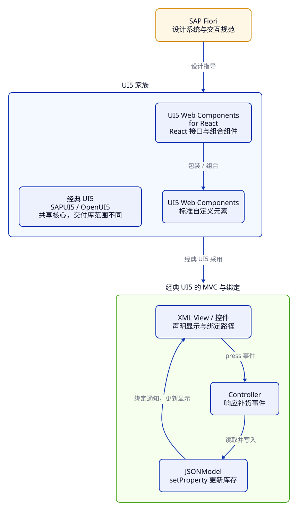

> **第 4 周 · 第 20 天** · 阅读跟做约 45 分钟 · 练习约 40 分钟  
> 前置：C16、C22、C38 · 运行：Node 24、本地 UI5 · 示例已运行验证

## 这一课解决什么问题

库存页已经用 Ant Design 做好了。新需求写着「与 SAP 的 Fiori 体验一致」，同事给你发来四个名字：SAPUI5、OpenUI5、UI5 Web Components、UI5 Web Components for React。

搜索后，有的教程写 XML 和 Controller，有的写 `<ui5-button>`，有的写 JSX。它们都能做出相似的按钮，工程结构却完全不同。选错路线，往往要重写的不是一个按钮，而是整套页面与数据连接方式。

学完你能：

- 根据交付与库范围，区分 UI5 家族的四套技术。
- 跟踪补货从 View、Controller 到 Model 绑定更新的过程。
- 给库存项目选路线，分清设计、运行、工具与元数据。

完整实验在 [examples/c39](https://github.com/socoo123/js_web/tree/main/examples/c39)。

## Java 程序员先看这里

| Java 经验 | UI5 中的对应物 | 差异 |
| --- | --- | --- |
| 产品的交互规范 | SAP Fiori | 约定任务、导航、反馈与布局；不是运行时依赖包 |
| MVC 分层 | Model、XML View、Controller | 三者都可以在浏览器中运行；Controller 不等于 Spring HTTP Controller |
| JavaBean 的字段与监听器 | JSONModel 与绑定 | 通过模型 API 更新数据，控件才能收到相应的更新通知 |
| Maven 与应用运行环境 | npm、UI5 CLI 与 UI5 框架 | npm 管包，CLI 服务开发与构建，UI5 框架在浏览器执行 |
| DTO 与字段描述 | 商品数据与元数据 | 一条记录回答「库存多少」，字段描述回答「库存是什么、怎样显示」 |

## 1. Fiori 先决定用户要完成什么

[SAP Fiori](https://www.sap.com/design-system/fiori-design-web/v1-120/discover/sap-design-system/sap-fiori) 是设计系统，关注按业务角色组织任务，以及跨页面一致的交互体验。它会影响你怎样安排库存工作，而不仅是按钮用什么颜色。

例如，仓库管理员进入首页，首先关心哪些商品需要补货；采购人员可能先看缺货与供应信息。相同的数据，可以按不同任务组织。

```js title="replenishment.js"
import { products } from "../shared/products.js";

const soldOut = products.filter((product) => product.stock === 0);
console.log(`总库存 ${products.reduce((sum, product) => sum + product.stock, 0)} 件`);
for (const product of soldOut) {
  console.log(`待补货：${product.id} ${product.name}`);
}
```

在 `examples/c39` 执行 `node replenishment.js`，得到「总库存 52 件」和「待补货：P002 无线鼠标」。我们没有改变六件商品，只把「待补货」提炼为一个明确任务。

页面可以突出待处理商品，从该行进入补货，成功后更新数量并反馈。这些交互安排都属于设计要求。

售罄、低库存、采购在途怎样触发补货，要和业务确认。设计系统提供表达方式，业务规则由应用决定。

对 Java 程序员来说，这类似先定义用例，再选 Web 框架：交互要求与实现框架处在不同层次。

## 2. 先分清交付物，再看长得像不像

**经典 UI5** 在本课程中指 SAPUI5/OpenUI5 的控件、模块、Model、绑定与 MVC 体系。它是一套应用框架，而 UI5 Web Components 是可以接入不同前端框架的自定义元素集合。

| 名称 | 交付与使用方式 | 库存应用中负责什么 |
| --- | --- | --- |
| SAPUI5 | SAP 交付的 UI5 框架；具有比 OpenUI5 更多的库 | 经典 UI5 页面、Model、绑定、路由，以及项目需要的 SAPUI5 库 |
| OpenUI5 | 开源交付，Apache-2.0；共享核心和常用控件库 | 本课程经典 UI5 库存版的实现基础 |
| UI5 Web Components | npm 包中的标准自定义元素，如 `<ui5-button>` | 提供 Fiori 风格的界面元素；应用选择状态、路由、请求方案 |
| UI5 Web Components for React | 基于 Web Components 的 React 接口与组合组件 | 在 React 应用中用 props、事件和 JSX 组织这些组件 |

[SAPUI5 与 OpenUI5 的官方比较](https://ui5.github.io/docs/02_Read-Me-First/sapui5-vs-openui5-5982a97.html)强调：核心与常用库共享，主要差异涉及许可和额外库的范围。OpenUI5 已有 `sap.m`、`sap.ui.layout` 等常用库，足够完成本课程的商品列表与编辑。SAPUI5 还提供额外的业务控件和集成能力。

选择时要查**目标版本的具体库**，例如 `sap.ui.comp` 不属于 OpenUI5。教程依赖这个库时，只换加载地址无法运行。SAPUI5 的使用条件结合项目的 SAP 产品与交付方式确认。

### 看加载入口，比看截图可靠

实验的 `index.html` 用以下入口加载 OpenUI5：

```html
  <script id="sap-ui-bootstrap"
    src="https://openui5.hana.ondemand.com/1.153.0/resources/sap-ui-core.js"
    data-sap-ui-theme="sap_horizon"
    data-sap-ui-libs="sap.m"
    data-sap-ui-async="true"
    data-sap-ui-compat-version="edge"
    data-sap-ui-language="zh-CN"
    data-sap-ui-resource-roots='{"course.c39":"./"}'
    data-sap-ui-on-init="module:course/c39/init"></script>
```

浏览器加载 UI5 核心与资源，执行本地 `init.js`，最终显示「无线鼠标」和库存 0。`sap.m` 是经典控件库，`course.c39` 是本地模块命名空间。

[CDN 引导](https://ui5.github.io/docs/04_Essentials/variant-for-bootstrapping-from-content-delivery-network-2d3eb2f.html)可以使用固定版本路径。示例固定框架资源，便于跟做；正式项目要跟踪该版本的维护与 CDN 提供期限。`compat-version="edge"` 选择兼容行为，不会把固定 URL 自动升级成最新框架。

Java 也可以从启动入口与依赖坐标判断技术栈；界面截图看不出这些关系。



先读上半部的设计指导与包装关系，再读下半部的一次补货流程。React 包装库连接的是 Web Components，MVC 的绑定流程属于经典 UI5 路线。

## 3. MVC：把“显示什么”与“怎样修改”接起来

经典 UI5 的 [MVC](https://ui5.github.io/docs/04_Essentials/model-view-controller-mvc-91f2334.html) 分工很直接：View 声明控件与显示，Model 管理数据，Controller 响应事件。下面把三者放进一个最小库存实验。

:::tip[自己尝试 · 本地 UI5]
1. 在仓库的 `examples` 目录执行 `python3 -m http.server 8039 --bind 127.0.0.1`。
2. 用 Chrome 打开 `http://127.0.0.1:8039/c39/`。首次加载需要访问 OpenUI5 CDN。
3. 点击「补货 3 件」两次，再刷新页面。

预期：无线鼠标库存从 0 变为 3，再变为 6；刷新回到 0。数量只保存在当前页面的内存 Model 中。
:::

### View：声明路径与事件

`Inventory.view.xml` 是交给 UI5 解析的 XML，不是直接放入浏览器 DOM 的 HTML：

```xml
<mvc:View controllerName="course.c39.Inventory"
  xmlns:mvc="sap.ui.core.mvc" xmlns="sap.m">
  <VBox class="sapUiSmallMargin">
    <Title text="库存绑定实验" level="H1" />
    <Text text="{inventory>/product/name}" />
    <HBox alignItems="Center">
      <Text text="库存：" />
      <Text id="stock" text="{inventory>/product/stock}" />
      <Text text="件" />
    </HBox>
    <Button text="补货 3 件" press=".onRestock" />
  </VBox>
</mvc:View>
```

页面会出现标题、商品名、库存和按钮。`xmlns="sap.m"` 让 `Text`、`Button` 等标签对应 `sap.m` 控件；`press=".onRestock"` 指向 Controller 的方法。UI5 创建控件对象，再由控件渲染 HTML。

`{inventory>/product/stock}` 是绑定表达式：`inventory` 是模型名，`>` 分隔模型名与数据路径，`/product/stock` 从该模型的根读取库存。它没有执行 JavaScript 的 `product.stock`，而是在声明一条需要持续同步的关系。

### Model：包装数据并提供更新接口

Controller 的初始化部分如下：

```js
    onInit() {
      const model = new JSONModel({
        product: { id: "P002", name: "无线鼠标", category: "外设", stock: 0, priceCents: 12900, tags: [] },
      });
      this.getView().setModel(model, "inventory");
    },
```

结果是 View 及其子控件可以通过 `inventory` 这个名字找到模型，两个绑定分别读到「无线鼠标」和 0。

[`JSONModel`](https://ui5.github.io/docs/04_Essentials/json-model-96804e3.html)管理浏览器内的 JavaScript 数据，并为控件提供绑定接口。这里的 Model 是前端对象；创建它不会连接数据库，也不会自动把改动保存到服务端。

Java DTO 承载字段；JSONModel 还将数据接入绑定系统。

### Controller：响应事件，修改模型

**先猜一猜：** 按钮没有直接修改 `Text`，为什么一次点击后，页面会从 0 变成 3？正确分支的关键代码是：

```js
      const model = this.getView().getModel("inventory");
      const stock = model.getProperty("/product/stock");
      model.setProperty("/product/stock", stock + 3);
```

输出是页面显示库存 3。完整事件方法还会在 Console 打印「模型库存 3」。

`getProperty` 读取数字 0，`setProperty` 写入数字 3，并触发相关绑定的更新检查。`Text` 通过绑定显示新值。Controller 计算库存，View 决定显示位置。

React 通过 setter 和新 state 表达更新，JSONModel 则通过模型 API 同步绑定。

JSONModel 也支持双向绑定，可以把输入连接到模型；库存上限、整数校验与取消草稿，仍由应用安排。

## 4. Web Components 与 React 包装库连接另一条路线

UI5 Web Components 用浏览器的自定义元素机制提供控件。应用导入组件模块以后，才能把 `<ui5-button>` 作为相应组件使用。它采用标准 DOM 的属性、事件、slots 等接口；经典 UI5 的 `<Button>` 则先由 XMLView 解析为 UI5 控件对象。

**先猜一猜：** 实验里明明已经显示了按钮，下面第二行日志会有值吗？在该实验页的 Console 执行：

```js
sap.ui.require(["sap/m/Button"], (Button) => {
  console.log(Button.getMetadata().getName()); // → sap.m.Button
  console.log(customElements.get("ui5-button")); // → undefined
});
```

这说明页面加载了经典 `sap.m.Button`，却没有注册 `ui5-button`。`getMetadata()` 读取的是经典控件类型的描述，`customElements.get()` 查询的是浏览器的自定义元素注册表。两者的查找对象不同。

[UI5 Web Components](https://ui5.github.io/webcomponents/docs/)可用于原生页面、React、Vue 等框架。接入 React 后，state、路由和请求缓存仍由应用管理。

[UI5 Web Components for React](https://github.com/UI5/webcomponents-react)在这些元素之上提供 React 接口与更高层的组合组件，用 JSX 组织界面；经典 UI5 的 XML View 和 Controller 则使用另一套运行机制。

React 19 已[原生支持自定义元素的属性与自定义事件](https://react.dev/reference/react-dom/components#custom-html-elements)。因此基本使用可以直接接入元素，包装库的价值在于接口便利与组合能力。具体事件名和属性传递，仍应按所选接口的文档编写。

Java 的适配器为已有对象提供另一种接口；React 包装库也负责接口衔接，底层控件仍是浏览器中的自定义元素。

### 给库存项目选择路线

| 需求 | 优先考察的路线 | 作决定前要核对什么 |
| --- | --- | --- |
| 接手已有 XML View、manifest、UI5 Model 的应用 | 经典 UI5 | 框架版本、具体库、现有绑定和部署环境 |
| 从零学习经典 MVC，使用公开数据完成库存功能 | OpenUI5 | 所需库是否都在 OpenUI5 中 |
| 现有 React 库存应用要采用 Fiori 风格组件 | React + UI5 Web Components，按需选 React 包装库 | 组件能力、React 接口、主题资源、依赖兼容性 |
| 原生网页只需引入几个 Fiori 风格元素 | 原生 UI5 Web Components | 注册模块、资源加载和 DOM 事件 |

当前 React 库存版可以保留业务与状态，再替换界面；已有经典 UI5 工程优先沿用其数据与路由结构。选择依据是现有工程和所需能力。

## 5. Tooling 管工程，绑定与元数据管重复劳动

企业页面有多张表、几十个字段和多种语言。同一库存值出现在表格、详情、摘要里，逐个修改 DOM 很容易遗漏。绑定保存「哪个控件依赖哪个数据」的关系，减少重复同步。

**元数据**则描述字段或类型。例如商品记录里有 `stock: 0`，字段描述里可以有名称、类型、长度或单位。下面用本地展示配置演示两者的区别：

```js title="field-metadata.js"
import { products } from "../shared/products.js";

// 本地展示配置，用来说明“描述字段”和“字段的值”是两件事。
const stockField = { path: "stock", label: "库存数量", unit: "件" };
const mouse = products.find((product) => product.id === "P002");
console.log(stockField.label);
console.log(mouse[stockField.path]);
console.log(`${stockField.label}：${mouse[stockField.path]} ${stockField.unit}`);
console.log(typeof mouse[stockField.path]);
```

在 `examples/c39` 执行 `node field-metadata.js`，依次输出「库存数量」、0、「库存数量：0 件」、`number`。显示规则可以变化，商品库存仍是数值 0。

真实 OData 元数据描述实体、字段类型与关系，注解还可提供标签等语义。UI5 有[读取属性元数据的绑定方式](https://ui5.github.io/docs/04_Essentials/property-metadata-binding-f5aa4bb.html)，需要由支持这些语义的控件解释。JSONModel 则包装普通数据，界面仍由应用定义。

三类描述要分清：`Button.getMetadata()` 描述控件类；OData 元数据描述服务结构；`stockField` 是本地展示配置，各有自己的消费者。

Java 中的实体字段、注解、Bean 描述也会分担类似工作；前端仍需确认哪些描述由哪个控件或工具解释。

### UI5 CLI 在浏览器之外工作

[UI5 Tooling 现已更名为 UI5 CLI](https://ui5.github.io/cli/v4/)。它用 Node 运行，提供项目配置、依赖资源处理、本地服务与静态构建。框架和工具有各自的版本：UI5 CLI 4 不等于「UI5 框架第 4 版」。

:::tip[自己尝试 · Node]
在仓库根目录执行下面的查询，需要能够访问 npm registry：

```sh
npm view @ui5/cli version engines --json
```

预期：返回当前 CLI 版本和 Node/npm 要求。本课查询时 CLI 属于 4 系列，Node 24 满足其声明范围。这个命令只查询包信息。
:::

工具链分工如下：

| 环节 | 使用什么 | 得到什么 |
| --- | --- | --- |
| 管理开发依赖与脚本 | npm、package.json、锁文件 | 可复现的工程依赖 |
| 声明经典 UI5 框架与库 | UI5 CLI、ui5.yaml | 本地服务和构建所需的框架资源 |
| 运行界面 | 浏览器、UI5 框架 | 控件、事件、Model 与绑定 |

`ui5 serve` 启动开发服务，`ui5 build` 生成静态产物；两者都不会提供真实的库存业务后端。本课的小实验用 HTTP 服务加载固定 CDN 资源，后面的工程再把配置和构建接起来。

## 常见错误与调试

### Model 已经变成 3，页面为什么还是 0

**现象**：打开 `http://127.0.0.1:8039/c39/?case=broken`，点击一次「补货 3 件」。Console 打印「模型库存 3」，页面库存仍是 0。

**工具**：打开 DevTools → Sources，按 Ctrl+P（macOS 用 Command+P）搜索 `Inventory.controller.js`，在 `console.log("模型库存", ...)` 这一行的行号处设置断点，再点击按钮。代码会停在修改以后、日志执行以前。

**证据**：在 Scope 中展开 `model`，或在暂停时的 Console 输入 `model.getProperty("/product/stock")`，得到 3；输入 `this.getView().byId("stock").getText()`，得到字符串 `"0"`。两个值说明数据已变，控件属性还没同步。

**原因**：错误分支直接修改了 Model 持有的普通对象：

```js
// 有问题的写法：绕过模型 API，没有通知绑定。
model.getData().product.stock = stock + 3;
```

直接赋值没有调用 JSONModel 的更新入口，绑定没有收到更新检查。其他操作可能使界面稍后变化；排错先核对写入方式。

**修复**：把赋值替换为 `model.setProperty("/product/stock", stock + 3)`；模型名和路径应与 XML 绑定一致。

**确认**：刷新后重复一次点击，模型是数字 3，控件文本是 `"3"`，页面显示 3。不要只核对 Console 的模型值，界面的同步也是验收条件。

配套 `binding.test.js` 用 Vitest 组织测试，通过 Playwright 启动后台 Chrome，加载真实 UI5 后核对模型与控件；运行方式见示例 README。普通对象测试无法覆盖绑定通知，因此这里选择浏览器回归。

## 练习

### 练习 1：描述字段，还是修改数据

先写出下面四行日志，再在 `examples/c39` 执行 `node prediction.js` 核对。

```js title="prediction.js"
import { products } from "../shared/products.js";

const mouse = structuredClone(products.find((product) => product.id === "P002"));
const path = "stock";
const field = { path, label: "库存数量" };
console.log(mouse[field.path]);
console.log(mouse.label);
field.label = "可用库存";
console.log(mouse.stock);
mouse.stock += 3;
console.log(`${field.label}：${mouse[field.path]}`);
```

验收：说明为什么改标签不会改库存，以及这个纯 JS 例子为什么无法证明 UI5 控件会刷新。

<details>
<summary>提示</summary>

`field.path` 是字符串 `"stock"`，因此 `mouse[field.path]` 读取的是商品库存。`field` 和 `mouse` 是两个不同对象。

</details>

<details>
<summary>参考答案</summary>

依次输出 0、`undefined`、0、「可用库存：3」。商品没有 `label` 字段；修改的是展示配置中的标签，库存保持原值，直到显式加 3。

例子只有普通对象，验证的是字段读取与赋值；界面同步要在实际 UI5 环境中观察。

</details>

### 练习 2：修复绑定更新

从 `Inventory.controller.js` 的错误分支开始，按调试步骤复现并修改。验收条件：刷新从 0 开始，连续点击显示 3、6；每次模型里仍是 number；刷新恢复 0。不得通过直接查找 DOM 修改文本来完成。

<details>
<summary>提示</summary>

Controller 负责修改哪个对象？XML 声明了哪个模型、哪条路径？修复应当让已有绑定继续工作。

</details>

<details>
<summary>参考答案</summary>

把 `model.getData().product.stock = stock + 3` 换成 `model.setProperty("/product/stock", stock + 3)`。模型更新接口负责连接已有绑定，View 不需要新增手工刷新代码。

数字 0 与数字 3 相加仍是 number，显示控件负责把值用于文本呈现。刷新后重新创建 JSONModel，所以回到初始值；本课没有保存到浏览器存储。

</details>

### 练习 3：为两个需求选技术路线

需求一：接手一个已有 XML View、Controller 和 `sap.ui.comp` 依赖的 SAPUI5 应用。需求二：保留现有 React 库存页的 state、路由和测试，把界面换为 Fiori 风格。

分别写下选用的路线、保留的内容、需要核对的一个依赖条件。验收：解释为什么需求一不能只改成 OpenUI5 的 CDN 地址，需求二为什么不必先引入 JSONModel。

<details>
<summary>提示</summary>

先看现有工程的组织方式，再查所需库的交付范围。相似的视觉效果不要求相同的数据框架。

</details>

<details>
<summary>参考答案</summary>

需求一沿用经典 SAPUI5 路线，保留 View、Controller 和模型；核对目标版本及 `sap.ui.comp` 的交付与使用条件。OpenUI5 不提供这个库，只换入口会留下无法加载的依赖。

需求二考察 React + UI5 Web Components，并按组件与接口需要选择 React 包装库。保留 React 状态、路由和业务测试；核对组件能力与 peerDependencies。页面数据仍可由原有 React 逻辑管理，JSONModel 属于另一套连接机制。

</details>

## 小结

- Fiori 是设计系统，从用户任务与一致的交互出发；UI5 家族提供具体实现选择。
- SAPUI5 与 OpenUI5 共享核心及常用库，选型要查具体库和交付条件。
- 经典 UI5 由 View 声明绑定，Controller 响应事件，Model API 连接数据更新与显示。
- Web Components 提供标准自定义元素；React 包装库在其上提供接口与组合能力。
- UI5 CLI 管开发与构建，元数据描述类型或字段，业务记录保存具体的值。

自测：

1. 为什么采用 Fiori 风格组件，仍需要设计「补货」这个用户任务？
2. `{inventory>/product/stock}` 中，模型名和数据路径分别是什么？
3. 普通对象已经修改成功，UI5 控件为什么可能还没更新？
4. React 应用采用 UI5 Web Components 后，原来的 state 与路由由谁管理？
5. UI5 CLI、UI5 框架、OData 元数据分别在什么环节起作用？

下一课建立 OpenUI5 工程，把启动入口、模块、XML View、Controller、Component 与 manifest 连接起来。

## 延伸阅读

- [SAP Fiori：设计系统与演进](https://www.sap.com/design-system/fiori-design-web/v1-120/discover/sap-design-system/sap-fiori)
- [UI5：SAPUI5 与 OpenUI5 的交付区别](https://ui5.github.io/docs/02_Read-Me-First/sapui5-vs-openui5-5982a97.html)
- [UI5：MVC 的职责](https://ui5.github.io/docs/04_Essentials/model-view-controller-mvc-91f2334.html)
- [UI5：JSONModel 与绑定路径](https://ui5.github.io/docs/04_Essentials/json-model-96804e3.html)
- [UI5 Web Components：介绍与 React 19 原生支持](https://ui5.github.io/webcomponents/docs/)
- [UI5 CLI：开始使用](https://ui5.github.io/cli/v4/pages/GettingStarted/)
