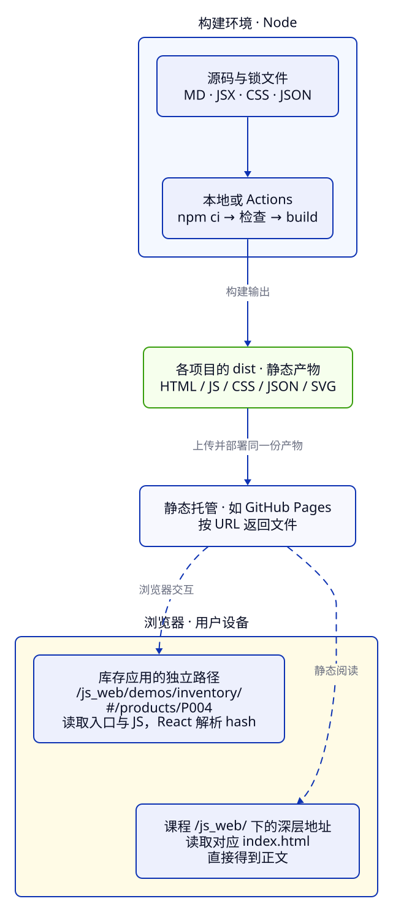

> **第 4 周 · 第 23 天** · 阅读跟做约 45 分钟 · 练习约 40 分钟  
> 前置：C20、C31、C45 · 运行：Node 24、本地 React · 部分示例未运行，已在对应位置标注

## 这一课解决什么问题

库存页在开发服务里一切正常。发布后，首页却变成空白：浏览器去域名根目录找 JS，而应用实际放在 `/js_web/`。改好资源后，列表又能用了；把商品详情地址发给同事，他刷新却得到 404。

本地开发服务、构建输出和线上文件服务，负责的事情不同。文件发布后，还要确认浏览器实际取到了什么。

学完你能：

- 解释 Node 构建、静态文件托管和浏览器运行的分工。
- 给 `/js_web/` 配好 base，追踪图片、JS、CSS 和 JSON 的实际请求地址。
- 分清真实静态页面和 React 的 hash 路由，判断一个地址刷新后能否工作。
- 读懂 Actions 的构建、产物上传和 Pages 发布，选对上传目录。
- 在严格静态预览和线上完成同一组验收，留下可重复的交付记录。

例子在 [examples/c46](https://github.com/socoo123/js_web/tree/main/examples/c46)，项目接着 [阶段 4](https://github.com/socoo123/js_web/tree/main/examples/inventory/04-react)。课程网站由 Astro 生成文章；库存练习由 Vite 构建 React 应用。两者各有自己的 `dist`。

## Java 程序员先看这里

| Java 经验 | 静态前端对应 | 差异 |
| --- | --- | --- |
| Maven 编译并打包 | `npm run build` 生成产物 | 构建脚本在 Node 里执行；产物中的 JS 通常交给浏览器执行 |
| WAR 的 context path | 这里的 `/js_web/` base | 它决定公开 URL 前缀；应用源码的目录名可以不同 |
| Controller 接收详情路径 | 静态服务器查找文件 | Pages 没有你的 Java Controller，任意业务路径不会自动得到应用首页 |
| JAR 作为一次发布单元 | 上传完整 `dist` | HTML、哈希 JS、CSS、按需模块和静态数据需要一起交付 |
| 服务端配置在进程启动时读取 | Vite 环境值在构建时写入 | 改构建配置后要重新构建和发布，用户设备不会读取 Actions 的环境变量 |

## 1. 构建结束以后，Node 已经完成了工作

构建是在开发机或 Actions runner 上运行程序，生成可交付文件。用户访问 Pages 时，服务器按 URL 返回这些文件，React 的渲染和事件处理发生在用户的浏览器。

在 `examples/c46` 运行 `node build-boundary.js`：

```js title="build-boundary.js"
import { readFile } from "node:fs/promises";

const file = new URL("../shared/products.json", import.meta.url);
const products = JSON.parse(await readFile(file, "utf8"));
const totalStock = products.reduce((sum, product) => sum + product.stock, 0);
console.log("构建输入", products.length, "种商品"); // → 构建输入 6 种商品
console.log("总库存", totalStock); // → 总库存 52
console.log("Node 中的 document", typeof document); // → Node 中的 document undefined
console.log("JSON 是文本", typeof JSON.stringify(products)); // → JSON 是文本 string
```

这段代码在 Node 中读取磁盘，所以能导入 `node:fs/promises`；这里没有页面 DOM。浏览器里的商品按钮则读取表单、更新 state、发出 HTTP 请求。把文件系统代码直接导入按钮组件，会把两个运行环境接错。

如同 Java 打包时生成配置文件，这里可在构建时生成 HTML 或 JSON。线上文件是这次构建的快照；修改源码数据后，要重新构建和部署。

阶段 4 已有锁文件。在 `examples/inventory/04-react` 执行：

```sh
npm ci
npm run build
npm run preview -- --host 127.0.0.1
```

预期：生成本目录的 `dist`，预览地址通常为 `http://127.0.0.1:4173/js_web/`。`npm ci` 按阶段 4 的锁安装，`build` 读源码生成产物，`preview` 读取已有产物。只改源码而不重新 build，preview 仍展示上一份结果。[Vite 的部署说明](https://vite.dev/guide/static-deploy.html)把 preview 定位为本地预览工具。

用户电脑无需安装 Node，浏览器加载生成的 JS 即可运行应用。



先顺着实线读一次发布，再沿虚线读一次访问。构建发生在文件交付之前；用户的点击不会回到 Actions runner。

### 哪些配置会进入产物

Vite 的 `import.meta.env.BASE_URL` 在构建时替换成配置的 base。读取的 `VITE_` 环境值也会进入客户端代码，适合放公开配置；密钥由后端保管。[环境变量文档](https://vite.dev/guide/env-and-mode.html)说明了这个替换过程。

Pages 托管静态结果。开发服务的代理配置不会随产物上线。详情读取来自静态 JSON，写入由浏览器内 mock 处理；刷新会重建 mock，已保存的本地快照仍按上一课恢复。

## 2. base 是 URL 的前缀，dist 是磁盘上的目录

本仓库的公开入口为 `https://socoo123.github.io/js_web/`。这里 `/js_web/` 是部署路径；静态目录里仍直接放 `index.html`，无需再套一层同名文件夹。

阶段 4 构建后可找到这些文件；哈希部分随内容变化：

```text
dist/
  index.html
  assets/index-<哈希>.js
  assets/index-<哈希>.css
  assets/InventoryReport-<哈希>.js
  data/products/P002.json
  media/inventory.svg
```

访问 `/js_web/data/products/P002.json` 时，部署服务把 `/js_web/` 之后的部分映射到上传目录，找到 `dist/data/products/P002.json`。上传目录选错一层，就会改变文件的对应关系。

Vite 配置已经有正确的 base，下面是 `vite.config.js` 中相关部分：

```js
export default defineConfig({
  plugins: [react()],
  base: "/js_web/",
  server: { fs: { allow: [fileURLToPath(new URL("../../", import.meta.url))] } },
  build: { sourcemap: true },
});
```

构建后查看 `dist/index.html`，JS 和 CSS 的 URL 应以 `/js_web/assets/` 开头。磁盘目录与公开 base 各有用途，如同 Java Web 应用的磁盘路径与 context path。

### 路径开头的一条斜线，会改变请求位置

**先猜一猜：** 当前停在课程深层页，下面三个 URL 会请求哪个目录？在 `examples/c46` 运行 `node paths.js`。

```js title="paths.js"
const page = "https://socoo123.github.io/js_web/07-project/c46-static-build-pages/";
console.log(new URL("/data/products/P002.json", page).pathname);
console.log(new URL("data/products/P002.json", page).pathname);
console.log(new URL("/js_web/data/products/P002.json", page).pathname);
```

```text
/data/products/P002.json
/js_web/07-project/c46-static-build-pages/data/products/P002.json
/js_web/data/products/P002.json
```

第一条从域名根开始，跳过 `/js_web/`；第二条相对当前页面目录，跟着文章层级走；第三条明确给出了应用前缀。相对 URL 由浏览器按页面地址解析。

构建工具处理导入的图片、CSS `url()` 和 HTML 资源引用。运行时拼接的 fetch 字符串应显式使用 base。阶段 4 的 `src/product-api.js` 已这样处理：

```js
const url = `${import.meta.env.BASE_URL}data/products/${encodeURIComponent(productId)}.json`;
const response = await fetch(url, { signal, headers: { Accept: "application/json" } });
return readProductResponse(response, productId);
```

`BASE_URL` 已有末尾斜线，后半段从 `data` 开始。对应文件在源码的 `public/data/products/`，构建时复制到 `dist/data/products/`，URL 中省略 `public`。[Vite 的资源文档](https://vite.dev/guide/assets.html)区分了导入资源和 public 文件的处理。

课程站另外使用 `astro.config.mjs` 中的 `site`、`base` 和静态输出配置；它们决定文章的公开地址。Vite 配置只影响阶段 4 库存练习。改其中一份，另一份不会自动跟着变化。

## 3. 真实静态页面与 hash 路由，刷新走两条路

文章的深层地址能直接打开，是因为构建时真的生成了对应目录下的 `index.html`。阶段 4 只生成一个应用首页，详情页面由加载后的 React 决定。

**先猜一猜：** 两个地址都显示 P002，服务器收到的请求路径相同吗？运行 `node routes.js`。

```js title="routes.js"
const detail = new URL("https://socoo123.github.io/js_web/#/products/P002");
console.log("请求路径", detail.pathname); // → 请求路径 /js_web/
console.log("浏览器路由", detail.hash); // → 浏览器路由 #/products/P002
const clean = new URL("https://socoo123.github.io/js_web/products/P002");
console.log("请求路径", clean.pathname); // → 请求路径 /js_web/products/P002
```

URL 中 `#` 后的片段留在浏览器，HTTP 请求不携带它。第一条先取得 `/js_web/` 的首页，然后 [HashRouter](https://reactrouter.com/api/declarative-routers/HashRouter)把 `#/products/P002` 交给 React 路由。直接粘贴或刷新这个地址，仍先请求已有的首页。

第二条把详情放进 pathname。刷新时，Pages 要找 `/js_web/products/P002` 对应的文件；本项目没有生成这个详情文件，所以得到 404。开发服务的 SPA 回退可能把未知路径也返回成首页，这会掩盖线上问题。

| 地址 | 文件服务要提供什么 | 结果由谁决定 |
| --- | --- | --- |
| `/js_web/07-project/c46-static-build-pages/` | 课程 `07-project/c46-static-build-pages/index.html` | 生成的 HTML 已含文章正文 |
| `/js_web/#/products/P002` | 库存应用的 `index.html` 与所需资源 | React 根据 hash 渲染详情 |
| `/js_web/products/P002/` | `products/P002/index.html` 等实际目标 | 当前库存产物没有这个文件，返回 404 |

前两条分别属于课程站和个人库存部署，公开前缀相同不表示二者共用首页。像 Java Controller 那样接收任意业务路径，需要额外的服务端路由或托管回退配置；本练习使用 hash，把所有 React 导航保留在已有首页上。

`HashRouter` 内部的 `/products` 从 hash 开始解析。这里无需再设置 `/js_web` 的 basename；文件路径的前缀已由 base 负责。

## 4. Actions 构建的是文件，Pages 发布的是产物

一次发布分成三个动作：Actions 按指定提交取出源码，构建 job 安装和检查后生成 `dist`，部署 job 把上传的 Pages artifact 发布出去。artifact 是 job 之间传递的文件集合。

课程仓库已有 `.github/workflows/deploy.yml`：它先检查 React 参考工程，再构建 Astro 课程，最终上传**仓库根目录的 `dist`**。所以课程上线后，你看到的是教程；阶段 4 自己的 `dist` 仍是本地练习产物。

个人练习若选择发布库存应用，完整模板放在 [deploy-react.yml](https://github.com/socoo123/js_web/blob/main/examples/c46/deploy-react.yml)。它保留整个仓库结构，因为阶段 4 会导入 `examples/shared`，并使用阶段自己的锁文件。构建 job 的关键片段如下：

> 未运行验证：个人练习仓库的 Actions 上传与发布尚未执行。下面的构建、产物检查和浏览器验收可以先在本地完成；个人发布请按步骤自己尝试。

```yaml
defaults:
  run:
    working-directory: examples/inventory/04-react
steps:
  # checkout、Node 和 npm 缓存配置见完整模板
  - run: npm ci
  - run: npm run lint
  - run: npm test
  - run: npm run build
  - run: npm run check:pages
```

`npm ci` 在阶段目录运行，使用阶段清单和锁；`setup-node` 的缓存也指向这份锁。缓存只减少下载。

`defaults.run.working-directory` 只影响 `run` 命令；下面 action 的 `with.path` 仍从仓库工作区根目录解析：

```yaml
- uses: actions/upload-pages-artifact@7b1f4a764d45c48632c6b24a0339c27f5614fb0b # v4
  with:
    path: examples/inventory/04-react/dist
```

这行上传完整库存产物，包含按需 JS、JSON 和图片。只上传首页会缺依赖；上传根 `dist` 会发布课程。模板固定 action 引用，升级时核对官方发行记录。

部署 job 使用 `needs: build` 等待构建，环境为 `github-pages`，并具备 `pages: write`、`id-token: write` 权限。它发布前一 job 的产物，不重新 build。完整配置可对照 [GitHub 的自定义 Pages 工作流文档](https://docs.github.com/en/pages/getting-started-with-github-pages/using-custom-workflows-with-github-pages)。

:::tip[自己尝试 · 本地 React]
1. 先在阶段 4 完成下一节的严格静态预览和练习，再准备个人 GitHub 仓库。保留仓库目录结构；使用自己的 `js_web` 仓库名时，可沿用当前 base。
2. 在个人仓库中，用示例 `examples/c46/deploy-react.yml` 替换 `.github/workflows/deploy.yml` 的内容，只保留一个 Pages 发布工作流。
3. 在个人仓库的 Settings → Pages → Build and deployment 中，将 Source 选为 GitHub Actions，再把改动提交到个人仓库 main。
4. 在 Actions 打开这次提交的 run，依次查看安装、测试、构建、上传与 deploy，成功后打开部署输出的 URL。

预期：个人地址出现库存应用，初始共 6 种、52 件；分享 hash 详情后能直接打开和刷新。若个人仓库改用其他名称，同步修改 Vite base 和本课检查脚本中的前缀，再构建验收。
:::

## 5. 用真正的文件边界验收

阶段 4 新增 `preview:pages`，只把 `/js_web/` 映射到已有 `dist`；缺文件返回 404，用来发现 SPA 回退掩盖的问题。

在 `examples/inventory/04-react` 执行：

```sh
npm run build
npm run check:pages
npm run preview:pages
```

预期：产物检查通过；打开 `http://127.0.0.1:4179/js_web/#/products/P002`，看到 P002 详情，库存为 0。按 F12 → Network，勾选 Disable cache，再刷新。Document 请求为 `/js_web/`，商品请求为 `/js_web/data/products/P002.json`，JS 和 CSS 都从 `/js_web/assets/` 读取。

接着把地址改成 `/js_web/products/P002/`，预期看到 404。回到 hash 地址即可恢复。`check:pages` 检查资源引用和六份固定商品；浏览器继续检查路由与交互。

| 检查动作 | 可观察的结果 |
| --- | --- |
| 打开库存首页 | 6 种、52 件、26348.00 元；JS/CSS 成功加载 |
| 直接打开 hash 详情并刷新 | Document 请求首页，P002 JSON 返回 200 且编号正确、库存为 0 |
| 返回列表，点击「查看分类报表」 | 按需 JS 加载成功，分类表格出现 |
| 访问无对应文件的干净详情路径 | 404，和 hash 详情明确区分 |
| 打开课程深层页并刷新 | 对应 HTML 返回 200；禁用 JS 仍有课程正文 |

最后一项在课程站根目录 `npm run build`、`npm run preview -- --host 127.0.0.1 --port 8746 --ignore-lock` 后检查，地址为 `http://127.0.0.1:8746/js_web/07-project/c46-static-build-pages/`。库存应用是客户端 React，禁用 JS 后不会渲染商品；课程正文则已经生成在 HTML 中。

线上再重复检查，核对 Actions 提交号。遇到旧页面时，比对 HTML 引用的哈希文件名与本次产物，再查看请求缓存。

## 常见错误与调试

### 构建成功，线上首页却是空白

**现象**：Actions 构建、部署都成功，页面没有商品；Network 里的入口 JS 返回 404。

**工具**：F12 → Network，勾选 Disable cache 后刷新；选中失败 JS 查看 Headers → Request URL，再打开产物 `dist/index.html` 比较其 `src`。

**证据**：错误产物请求 `/assets/index-…js`，当前发布入口为 `/js_web/`，正确资源应位于 `/js_web/assets/`。故意复现时，可在阶段目录运行 `npm run build -- --base=/`，再用严格预览打开应用。

**原因**：构建使用域名根 base，把入口资源写到了错误前缀。退出预览、重新运行普通 `npm run build` 才会恢复当前 Vite 配置的 `/js_web/`。

**修复**：确认 `vite.config.js` 的 base 后，重新 build，先通过 `npm run check:pages`，再发布完整产物。

**确认**：严格预览中 JS/CSS 返回 200，列表出现；自动回归 `npm run test:e2e:pages` 同时检查 hash 刷新、正确 JSON 和缺失文件 404。这个 bug 跨越构建与浏览器请求，回归放在产物检查和浏览器层；业务函数 UT 无法观察入口 URL。

## 练习

### 练习 1：预测文件请求与浏览器路由

在 `examples/c46/prediction.js` 查看四个目标地址。先写出每个请求的 pathname 和浏览器保留的 hash，再运行 `node prediction.js` 核对。

<details>
<summary>提示</summary>

当前地址的 pathname 是 `/js_web/`，hash 里的 `/products/P002` 不是目录。以 `/` 开头的目标从域名根解析，以 `#` 开头的目标只替换片段。

</details>

<details>
<summary>参考答案</summary>

四行分别是：`/js_web/data/products/P002.json`、`/data/products/P002.json`、`/js_web/` 配 `#/products/P004`、`/js_web/products/P004/`。其余三行没有 hash。

第三行仍请求首页，React 负责 P004；第四行会让文件服务器查找新目录。相同业务编号不意味着相同 HTTP 路径。

</details>

### 练习 2：修好个人部署的上传目录

从 `examples/c46/deploy-react.yml` 开始。假设构建命令在阶段目录成功，但下面的上传步骤误放进模板；你准备发布的是库存应用：

```yaml
# 有问题的写法：这里指向课程网站的产物
- uses: actions/upload-pages-artifact@7b1f4a764d45c48632c6b24a0339c27f5614fb0b # v4
  with:
    path: dist
```

目标：改正上传路径，并在本地确认所选目录的首页引用 `/js_web/assets/`，P002 JSON 存在且库存为 0；hash 详情刷新正常，干净详情路径返回 404。个人发布步骤沿用第 4 节的未运行标注。

<details>
<summary>提示</summary>

看清 `run` 与 `uses` 的差异。阶段自己的 build 写到阶段自己的 `dist`；模板中 action 的输入路径从仓库根目录解析。

</details>

<details>
<summary>参考答案</summary>

把 `path` 改成 `examples/inventory/04-react/dist`，与完整模板保持一致。阶段目录执行 `npm run build`、`npm run check:pages`、`npm run preview:pages`，按第 5 节核对 URL 和内容。

原因是 `defaults.run.working-directory` 不改变 action 的 `with.path`。只有指向实际库存产物，部署 job 才会收到包含库存入口、数据和按需模块的文件集合。

</details>

## 项目进度

从 `examples/inventory/04-react` 继续，商品组件和数据保持已有实现。这次加入 `scripts/check-pages.mjs`、`scripts/serve-pages.mjs`、`playwright.pages.config.js` 与 `e2e/pages.spec.js`；`package.json` 增加产物检查、严格预览和专用浏览器回归命令。原有生产冒烟仍使用原配置。

在阶段目录运行：

```sh
npm run lint
npm test
npm run test:e2e:pages
```

预期：业务回归通过；专用浏览器回归先构建并检查产物，再验证严格文件服务上的详情直达、刷新、返回、按需报表与 404。需要自己观察 Network 时，单独运行 `npm run preview:pages`，用第 5 节的地址操作。

部署后记录提交号、线上地址和首页/详情刷新/资源的结果。个人库存应用使用自己的 Pages 入口。

## 小结

- Node 执行构建；Pages 返回静态文件；React 在用户浏览器运行。
- `/js_web/` 是公开 URL 前缀，上传目录内部直接放 `index.html`。
- 课程深层地址依靠真实 HTML，React hash 详情依靠已有首页和浏览器路由。
- Actions 上传完整且正确的 `dist`，部署 job 发布同一份产物。
- 验收同时看状态码、资源内容和页面行为，并在严格静态预览与线上各做一次。

自测：

1. 为什么构建能用 `node:fs`，商品按钮组件却不能直接用它？
2. `/data/products/P002.json` 与带 base 的地址分别请求哪里？
3. hash 详情刷新时，服务器实际收到哪个 Document 路径？
4. 构建在阶段目录运行，上传 action 的 path 为什么还要写阶段目录？
5. 页面可用、Actions 成功、深层刷新成功，各证明了什么？

下一课按业务风险补齐综合项目，并选择值得保留的 UT、集成测试和 E2E。

## 延伸阅读

- [Vite：静态部署与 GitHub Pages](https://vite.dev/guide/static-deploy.html)
- [Vite：构建与 public base](https://vite.dev/guide/build.html#public-base-path)
- [Astro：部署到 GitHub Pages](https://docs.astro.build/en/guides/deploy/github/)
- [GitHub：自定义 Pages 工作流与产物](https://docs.github.com/en/pages/getting-started-with-github-pages/using-custom-workflows-with-github-pages)
- [React Router：HashRouter](https://reactrouter.com/api/declarative-routers/HashRouter)
- [MDN：URL 的 hash](https://developer.mozilla.org/en-US/docs/Web/API/URL/hash)
